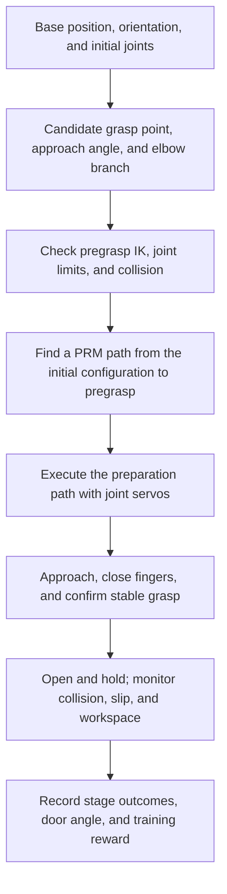
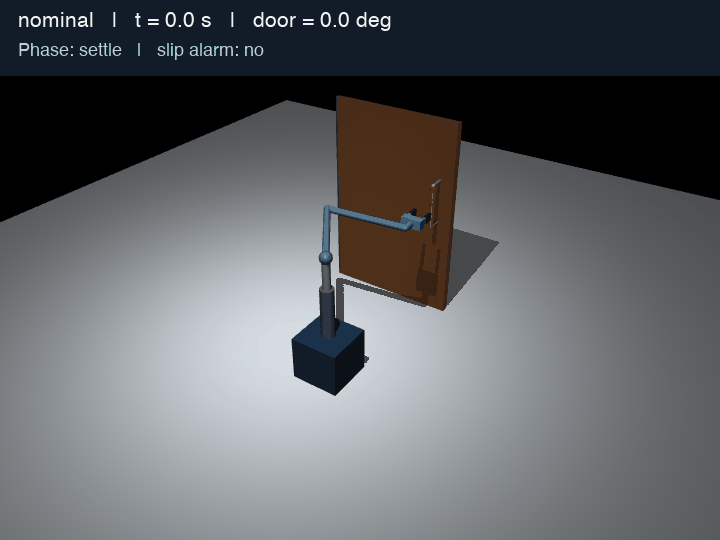

# MuJoCo Door Opening

## Overfitting review and a new frozen test (2026-11-11, v10)

The preselected mobile door-opening policy achieves **71/72, 35/36, and 70/72** correct decisions on training, validation, and a fresh test cohort. These results show no clear training-set overfitting but cover only nine familiar templates. Among four LoRA/P-G plus I controls, output retention selects different weights with **71/72** training, **35/36** validation, and **71/72** test correctness, zero collisions, and **41** inspections; the original primary policy scores **70/72** with **43** inspections on the same test. The new weights correct one additional scene without winning on validation, so **the primary policy remains the one selected before testing**.

[Full overfitting review, per-scene differences, and limitations](docs/mobile_retention_results.md) · [Pre-test protocol](docs/mobile_retention_evaluation_plan.md). This cohort contains **1152** candidate records and **288** physical replays. Weights and data are stored in ignored `runs/` directories.

## Gradient projection across two execution branches (2026-11-11, v9)

Ordinary gradient summation and PCGrad each complete 320 rank-8 LoRA/P-G updates and 1600 I updates. Negative gradient inner products occur during training, and PCGrad projects gradients in 12 of 320 updates. Validation selection retains the initial P/G checkpoint in both arms, and the final model tensors match the previous primary policy. All 422 original core tensors and normalization remain unchanged across 8 stage checkpoints. The newly frozen 72-scene test remains unread under the predefined rule.

[Full training and gradient results](docs/mobile_branch_pcgrad_results.md) · [Validation curves and gradient statistics](docs/mobile_branch_pcgrad_results.png) · [Training design](docs/mobile_branch_pcgrad_plan.md). New weights and logs are in ignored `runs/mobile_branch_pcgrad_training_seed42_20261111/`; the existing formal test results follow below.

## Independent test of scene-group training (2026-11-10, v8)

On a fresh cohort of 18 groups and 72 scenes, the primary policy makes **72/72** correct decisions, opens **53/53** candidate-feasible scenes, correctly refuses **19/19**, and has **0** collisions. Always inspecting also succeeds on every scene; learned inspection reduces additional inspections from **72 to 39 (-45.8%)**. Four continuation arms with 320 LoRA/P-G and 1600 I updates each produce no better primary policy; the selected policy matches frozen v6 exactly. Seven names share four sets of evidence through exact inference equivalence. The run executes 1152 candidates and **288** live replays, rather than 504.

The same frozen policy scores 68/72 and 72/72 on geometry-disjoint v6/v8 tests, for a descriptive total of **140/144 correct decisions, 100/101 feasible openings, 40/43 correct refusals, and zero collisions**. Per-scene task outcomes match always inspecting, while total inspections decrease from **144 to 82 (-43.1%)**. These remain 36 parameter groups within 9 templates and one training seed.

[Independent results and two-cohort summary](docs/mobile_branch_balance_results.md) · [Four deployed-policy comparisons](docs/mobile_branch_balance_results.png) · [Four-arm training and validation](docs/mobile_branch_balance_development.md) · [Fusion results](docs/mobile_partial_fusion_results.md). The 422 original core tensors and normalization are preserved. Raw models, arrays, trajectories, and logs are in ignored `runs/mobile_branch_balance_evaluation_seed42_20261110/`.

## Formal inspection-regret test (2026-11-10, v6)

Three arms each complete 1600 inspection-head updates with the original core, existing LoRA, and P/G frozen. The validation-selected joint-regret objective makes **68/72** correct decisions on a fresh 18-group, 72-scene test, with **47/48** openings, **21/24** correct refusals, and **0** collisions. Its per-scene success, refusal, and collision outcomes match learned inspection from v5 on this cohort. Inspections decrease from **49 to 43 (-12.2%)**, and mean episode duration falls from 40.86 to 37.15 simulated seconds; always inspecting uses 72 inspections versus 43.

All 1152 candidate records, 432 live replays, and non-I tensor checks pass. Remaining failures include 3 inappropriate attempts after handle-detection failure and 1 false refusal caused by excluding a successful station through the depth constraint. This cohort differs from the historical v5 test below, so 72/72 versus 68/72 reflects different test scenes. The measured benefit is lower inspection cost with unchanged task accuracy.

[Complete matched results and failure analysis](docs/mobile_inspection_regret_results.md) · [Six-policy comparison](docs/mobile_inspection_regret_results.png) · [Training and validation](docs/mobile_inspection_regret_development.md) · [Frozen evaluation design](docs/mobile_inspection_regret_evaluation_plan.md). Models, arrays, logs, and trajectories are in ignored `runs/mobile_inspection_regret_evaluation_seed42_20261110/`.

## Formal partial-map test (2026-11-10, v5)

The validation-selected partial-map policy makes **72/72** correct decisions on a fresh 18-group, 72-scene test: **50/50** feasible openings, **22/22** correct refusals, and **0** collisions. Always inspecting with the same model also achieves full correctness. Learned inspection reduces additional inspections from 72 to **47 (-34.7%)** and mean episode duration from 55.38 to 40.74 simulated seconds. All 1152 candidate records, 720 live replays, and 422 original frozen tensors are verified.

Door-opening constraints use only the depth currently observed; navigation and arm preparation use known geometry. Both new P/G arms select update 0, so the learning benefit comes from I. Frozen v4 with always inspection also scores 72/72 on this cohort. A full-map geometric reference uses no inspection and scores 68/72, opens 50/50 feasible scenes, has zero collisions, and achieves higher net utility than the primary policy. These results do not establish improved accuracy from new LoRA updates or a world-model rollout advantage.

[Full formal results and scope](docs/mobile_partial_results.md) · [Matched comparison](docs/mobile_partial_results.png) · [Training and validation](docs/mobile_partial_development.md) · [Frozen evaluation design](docs/mobile_partial_evaluation_plan.md). Arrays, models, logs, and trajectories are in ignored `runs/mobile_partial_evaluation_seed42_20261110/`.

## Outcome factorization and door-sweep planning (2026-11-09, v4)

Two models each complete 320 LoRA/P-G updates and 800 independent inspection-head updates. The validation-selected factorized-outcome policy with door-sweep constraints makes **71/72** correct decisions on 72 fresh scenes, opens **52/53** feasible scenes, and has **0** collisions. The frozen previous baseline scores 61/72 with 50/53 openings and 1 collision on the same cohort. All 864 replays and 8 stage checkpoints pass verification, with 422 original tensors frozen.

The clear benefit comes from known geometric constraints; this run does not establish that factorized supervision outperforms an equal-capacity scalar objective. Learned and always inspection with the scalar model have identical per-scene correctness, while inspections decrease from 54 to 21. Planning uses a complete known map; no-inspection and partial-map controls are the next comparisons.

[Complete results, protocol, and run records](docs/mobile_outcome_results.md) · [Twelve-policy comparison](docs/mobile_outcome_results.png) · [Preregistered design](docs/mobile_outcome_plan.md). Models, arrays, and logs remain in ignored `runs/mobile_outcome_seed42_20261109/`, alongside preserved historical experiments.

## H-JEPA mobile door opening and active inspection (2026-11-09)

The system supports continuous base motion, fresh reached observations, station selection, and contact-based opening. Three LoRA arms each complete 480 updates. The new test contains 36 scenes, including 25 feasible under the candidate library. The validation-selected reached-view policy opens 24/25, makes 30/36 correct decisions, and has 2 collisions. The initial-image control scores 11/25 and 22/36; the cost-aware policy uses 18/36 inspections and makes 27/36 correct decisions.

Positioning, grasping, and inspection supervision connect to actual downstream task returns, and inspection incurs physical path and time costs. All 288 physical replays match the saved outcomes, 422 original model tensors remain bitwise unchanged, and 32 contract tests pass after integration into the main branch. Navigation uses known geometry and an ideal holonomic base. Results cover one training seed and 9 test-scene groups.

[Full protocol, results, and verification](docs/mobile_active_continuation.md) · [Base trajectories and recorded camera images](docs/mobile_active_motion.png) · [Control comparison](docs/mobile_active_results.png). Models, data, and logs are in ignored `runs/mobile_active_seed42_20261109/`; historical tests and original checkpoints are preserved.

## Overall experiment progress (2026-10-26)

Local H-JEPA work, remote grasp learning, and PRM updates are integrated. All three modules have independent experiments,
but PRM and the independent angle policy are not yet connected to the H-JEPA pipeline; their metrics do not form one
end-to-end success rate. See [overall evaluation and integration verification](docs/experiment_progress_20261026.md).

## Grasping: evaluating and executing a complete plan

For each base position and orientation, record the initial joint configuration and assess whether each grasp plan can complete the following stages:



Any failed stage terminates the candidate and records its reason.

| Stage | Passing condition | Interpretation of failure |
| --- | --- | --- |
| Target configuration | Legal pregrasp IK on the selected elbow branch; collision-free endpoints | `goal_ik_unreachable` / `invalid_start` / `invalid_goal` excludes this target or endpoint, rather than every possible grasp |
| PRM path | `direct_path` or `roadmap_path`, with all final edges passing the discrete geometry check | `no_path_within_budget` means finite sampling found no path; skip execution or increase the budget/change the candidate |
| Path execution | Position servos reach the goal without collision or early door motion; tracking error and speed satisfy thresholds | Record preparation collision or tracking failure with `opening_tested=false` |
| Grasp acquisition | The original controller confirms stable bilateral contact | Reachability alone does not establish a stable opening grasp |
| Complete opening | Reach approximately 90 degrees and hold, without collision, persistent slip, or contact loss | Record workspace, collision, slip, or incomplete opening separately, preserving actual safe progress |

**Path existence, PRM path discovery, and successful execution are distinct outcomes.** With a correct edge validator, a found path establishes a valid route in the model; failure under a finite budget does not establish impossibility. Discrete collision checks can miss intermediate collisions if the step is too large, and a geometric route still requires dynamic execution. Reaching pregrasp also does not establish complete opening after grasp acquisition.

The planner uses four joint coordinates `[lift, shoulder, elbow, wrist]`, with default initial configuration `[0 m, -90 degrees, -120 degrees, 0 degrees]`. It retains 240 valid random nodes and 12 neighbors by default, trying direct connection before Lazy PRM. Neighbor edges are checked during search; invalid edges are removed before searching again. The planner uses known MuJoCo geometry and does not plan closed-chain motion after grasp acquisition.

Integration points:

- `collect_grasp_data.py`: analyze every candidate at each station, save `*_prm_preflight.jsonl`, and then record physical execution outcomes.
- `train_grasp_rl.py` / `compare_grasp_learning.py`: pass the selected candidate through the same PRM and execution stages before grasping, opening, and reward calculation. PRM results currently do not mask action probabilities.
- `simulate.py`, `run_demo.py`, and the original H-JEPA pipeline retain their own initialization interfaces. Direct `trial(plan=...)` still resets to pregrasp by default; the new learning workflow executes preparation first and then calls `trial(reset_before_trial=False)`.

A negative reward with `opening_tested=false` describes failure of the current planning budget or preparation procedure. It is not an observed failed opening trial or a proof that the station is impossible. Preparation collisions are recorded and included in pipeline collision statistics.

### PRM examples and reproduction

| Example | Preparation outcome | Subsequent opening |
| --- | --- | --- |
| `(0.6, -1.0)`, no obstacle | Direct connection passes; no random roadmap needed | Full opening and hold |
| Same station with a small obstacle | 500 valid nodes from 715 samples; a 5-waypoint detour lowers the original lift axis by about 9.6 cm | Full opening and hold |
| Same obstacle, zero sampling budget | No path found; the previous example establishes a feasible path | Execution skipped |
| `(0.3, -0.9)` | Path found and executed | Workspace limit after opening to about 42.5 degrees |
| `(2.0, -1.2)` | No legal IK for the current pregrasp target and elbow branch | Execution skipped |

```bash
python prm_examples.py
# Open reproduced/prm_examples/index.html locally
mjpython prm_examples.py --view detour
# Optional: render a 2x-speed GIF from the recorded physical trajectory
python prm_examples.py --render detour
```

See [PRM implementation and settings](docs/prm_pregrasp.md), [measured results](docs/prm_results/REPORT.md), and the [offline interactive page](docs/prm_results/index.html). Download the HTML page and open it in a browser; GitHub displays its source.
New default experiment directories use the `_prm` suffix. Explicit paths allow evaluation of previous data and models; `--no-prm` runs the original initialization baseline.

## Grasp plans, angle learning, and validation on new stations

The system adds serializable grasp plans (height, approach angle, elbow branch, force cap, and timing) and independent
REINFORCE / supervised reward-prediction controls. The original H-JEPA RGB-D interface and pipeline are preserved.
The new models learn discrete angles; they are not integrated into the H-JEPA world model and do not control individual joints.

- [Grasp plans](docs/grasp_plans.md) · [Physical-control demo](docs/grasp_update_demo.md)
- [RL instructions](docs/grasp_rl.md) · [Data collection and SL/RL training](docs/supervised_grasp_learning.md)
- [Verified experiment results](docs/grasp_learning_results/REPORT.md) · [Analysis and the rationale for generated data](docs/grasp_learning_results/ANALYSIS.md)

From the repository root, in a Python environment with `requirements.txt` installed:

```bash
python collect_grasp_data.py
python compare_grasp_learning.py train
python compare_grasp_learning.py evaluate
# macOS graphical demo; generate model weights first:
mjpython compare_grasp_learning.py demo --scene test_021 --method reinforce --seed 42
```

New experiments default to 36/12/24 training/validation/test stations, 29 angles (the original 21 fine angles plus +/-30, +/-45, +/-60, and +/-90 degrees), and seed 42.
Use `--angle-grid legacy21` for the previous grid or `--angles-deg` / range options for a custom grid. See [angle diversity and validation](docs/grasp_angle_diversity.md) and [measured results by station](results/angle_diversity/README.md).
The new default data and comparison directories are `reproduced/grasp_learning_data_prm_diverse29/` and `reproduced/grasp_learning_comparison_prm_diverse29/`.
The published historical comparison uses 42/43/44; pass `--seeds 42 43 44` explicitly to reproduce those settings.
Reports and small metric files ship with the code. Commands generate large data, videos, and model weights in ignored `reproduced/` directories.
In the historical 36/12/24-station experiment without PRM, SL did not outperform RL, and the training-selected fixed +18-degree policy also scored 10/24. The new PRM workflow passed integration checks on 12/4/8 stations, 504 candidate procedures, and 252 RL decisions. These experiments do not isolate a PRM success-rate gain or evaluate new door families or real robots.

Regression checks: `python -m unittest test_prm test_grasp_plan test_grasp_learning test_grasp_rl test_git_size -v`.
By default, `trial(point)` restores the elbow branch and actuator force caps from construction, avoiding settings inherited from the previous episode.

## H-JEPA: positioning and staged policies

Latest completed experiment: **refusal offset vs binary side-feasibility**,
with two matched 240-step LoRA continuations from the same patch-mean model.
Validation selects rank continuation + offset (**73/96** development), but
on a fresh 96-scene test it scores **67/96**, equal to the frozen starting
model. BCE scores **69/96** but was not selected; no test-driven promotion
occurs. The selected method opens 57/68 feasible doors and correctly refuses
10/28 impossible scenes, versus 61 and 6 initially. All **288 physical replays**
match, and original core weights stay frozen. See
[refusal study](docs/hjepa_setup.md#refusal-calibration-and-binary-side-supervision-2026-10-26)
and [figure](docs/hjepa_refusal_seed42_results.png).

Previous experiment: positioning-only **native ViT CLS vs patch mean**,
same 192-dimensional head input, paired cameras, seed 42, 576 train / 96 val,
240 LoRA updates per arm. Validation selects patch mean at step 160. A fresh
96-scene test scores **60/96** versus CLS **59/96**, previous coverage model
**54/96**, and historical decomposed model **57/96**. Patch mean opens 56/66
feasible doors but correctly refuses only 4/30 impossible scenes; its advantage
over CLS is small. Both arms have 96 matching physical replays, and original
core weights remain unchanged. See [pooling study](docs/hjepa_setup.md#native-vit-pooling-study-2026-10-26)
and [figure](docs/hjepa_pooling_seed42_results.png).

Completed coverage study: **seed 42**, matched paired-view LoRA, 240 updates
per arm, **192 vs 576 training scenes**, the same fresh 96 validation scenes,
then 96 independent tests. Validation selects the expanded arm at step 160.
Test correct decisions change **49/96 -> 51/96**, false refusals **19 -> 14**,
and collisions **15 -> 9**, but wrong-side choices increase **11 -> 14**.
The historical decomposed candidate still scores **56/96** on this suite;
more data has not solved generalization. All 96 selected-policy physical
replays match; original core weights remain frozen. See
[protocol/results](docs/hjepa_setup.md#seed-42-coverage-expansion-2026-10-26)
and [figure](docs/hjepa_coverage_seed42_results.png).

Latest observation experiment: matched-compute **front x2 vs front+rear**, both
LoRA, 160 updates. On a fresh 48-scene test the dual-camera candidate scores
**29/48**, repeated-front control **23/48**, and untrained dual-camera routing
**28/48**. Dual-camera training still has six false refusals. Validation had
selected the single-camera arm, so the test winner was **not** promoted.
Both arms have 48 matching live physical replays. Endpoint-only collection
reduces this test dataset to about 54 MB. See
[method/results](docs/hjepa_setup.md#fixed-camera-observation-ablation-2026-10-26)
and [figure](docs/hjepa_paired_view_results.png).

Position training now defaults to **door-side reward v1**: openable side +2,
wrong side when the other opens -2, neither side opens -1, refusal 0. A separate
within-side base term is weighted 0.25. The objective and validation distinguish
side choice, base choice and grasp errors. See
[reward definition and commands](docs/hjepa_setup.md#door-side-specific-position-reward-2026-10-26).

Completed side-reward study: both 240-step arms select step 80 on validation.
On 48 fresh scenes, the selected head update changes correct decisions
**20/48 -> 22/48**, wrong-side errors **14 -> 9**, collisions **12 -> 6**, but
adds four false refusals. Three old wrong-side cases become correct-side
choices, three become refusals, and one new wrong-side error appears. The LoRA
arm also scores 22/48; the previous decomposed candidate scores 24/48 on this
same suite. See [full comparison](docs/hjepa_setup.md#door-side-reward-full-study-2026-10-26)
and [figure](docs/hjepa_side_reward_results.png). Existing defaults remain intact.

Latest controlled experiment (2026-10-26): **240 position-head updates vs
240 position-head + LoRA updates**, with successful-action-set supervision.
The final LoRA fits training (**185/192** correct) but generalizes poorly
(**9/24** validation); neither arm beats its initialization on validation.
Both therefore retain the original scalar LoRA at checkpoint selection. On a
fresh 48-scene test that frozen fallback scores **24/48**, versus **21/48** for
the previous decomposed candidate. This is a negative experiment, not a model
improvement. See [method and results](docs/hjepa_setup.md#successful-action-set-position-experiment-2026-10-26)
and [comparison figure](docs/hjepa_listwise_results.png).

Previous study (2026-10-26): literature-guided outcome/progress decomposition,
within-scene preferences, **600 LoRA steps**, then one validation-fitted
execution/refusal threshold. On a newly frozen 48-scene test, openings change
**27/35 -> 24/35**, correct refusals **0/13 -> 3/13**, and collisions **8 -> 3**.
Overall correct decisions remain **27/48**, with five false refusals: this is
a more conservative candidate, not an overall accuracy improvement. Original
weights and the default checkpoint are preserved. See
[method, papers and results](docs/hjepa_setup.md#literature-guided-reward-decomposition-2026-10-26),
[test figure](docs/hjepa_reward_calibrated.png), and the training wait rule in
[AGENTS.md](AGENTS.md).


Current continuation uses **LoRA**, with the original H-JEPA core frozen and
unmerged. The expanded suite has 240 independent scenes (192/24/24), twelve
structural families and randomized camera/geometry/lighting. The local pipeline
collects physical counterfactuals, trains adapters, then evaluates frozen test
scenes. See [LoRA continuation and progress](docs/hjepa_setup.md#lora-continuation).

```powershell
.\.venv\Scripts\python.exe run_hjepa_lora_experiment.py
.\.venv\Scripts\python.exe hjepa_lora_status.py
```

The next continuation uses a **separate 48-scene test-only dataset**, seed
20261019. Its training manifest contains only the 192 train / 24 validation
scenes; test arrays are never opened by the trainer. The previous 24-scene test
has been physically replayed and retained as a historical comparison (LoRA
opens 12/18 feasible scenes, original checkpoint 9/18).

```powershell
.\.venv\Scripts\python.exe prepare_hjepa_splits.py
.\.venv\Scripts\python.exe continue_hjepa_lora.py
.\.venv\Scripts\python.exe hjepa_lora_status.py
```

Progress: `runs/hjepa/lora_continued_model/status.json`. Independent test data:
`runs/hjepa/independent_test_data/`. Generate the
[scene-level test report](docs/hjepa_setup.md#separate-independent-test-set)
with `python report_hjepa_holdout.py`.

The continuation and **all 48 independent physical replays are complete**.
Full openings improve from previous LoRA **24/35 to 26/35** feasible scenes;
correct refusals remain **0/13**. Overall correct decisions are **26/48**,
equal to the original base's 26/48 (23 openings plus 3 correct refusals).
This is a limited opening gain, not a solved task. See the
[independent test figure](docs/hjepa_lora_independent.png) and
[measured results](docs/hjepa_setup.md#completed-independent-test-results).

The commands below document the earlier full-model training baseline; the LoRA
continuation preserves that checkpoint and writes a separate adapter.

## Official H-JEPA setup

The staged world-model pipeline now uses the complete official `pusht_hjepa_l2`
configuration (224x224 ViT-Tiny, 23.3M parameters), two timescales,
separate positioning/grasping policies, fresh arrival RGB-D, physical trajectory
collection, downstream rewards, and scene-disjoint evaluation.
See [setup, training and limitations](docs/hjepa_setup.md).

```powershell
.\.venv\Scripts\python.exe setup_hjepa.py
.\.venv\Scripts\python.exe collect_hjepa.py
.\.venv\Scripts\python.exe train_hjepa.py --policy-updates 100
.\.venv\Scripts\python.exe run_hjepa.py
```

The default full run uses batch 128, BF16, 9 epochs and ViT activation
recomputation to fit the local 6 GB RTX 3060. The earlier 0.55M compact model is
retained as an explicit legacy profile. Base placement uses simulator resets. The original contact baseline
below remains available independently through `run_demo.py`.

Expanded frozen-policy evaluation (new scene seed, matched stage interventions,
base/grasp yaw sweeps and 30/60/90-degree controller targets):

```powershell
.\.venv\Scripts\python.exe evaluate_hjepa_stages.py --device cuda
.\.venv\Scripts\python.exe evaluate_hjepa_views.py --device cuda
.\.venv\Scripts\python.exe report_hjepa_stages.py
.\.venv\Scripts\python.exe -m unittest test_hjepa test_hjepa_stages test_git_size -v
.\.venv\Scripts\python.exe check_git_size.py
```

The stage evaluator crosses the pre/post-update positioning and grasping heads
while asserting identical world/value weights. Physical candidate tables are
evaluation labels, never selector inputs. Raw results stay in ignored `runs/`;
weights, arrays and video/archive files are also ignored. `check_git_size.py`
rejects Git-visible or staged files above 10 MiB, including tracked files that
ignore patterns cannot protect.
See [measured stage/angle results](docs/hjepa_stage_results.md) for the policy
interventions, stress failures and camera-view sensitivity.

Structural feasibility tests add collidable pillars, bidirectional/one-way
hinges and one/two-sided handles. Both operating sides are in the same four-base
candidate pool. See [structural results and physical states](docs/hjepa_structural_results.md).

```powershell
.\.venv\Scripts\python.exe evaluate_hjepa_structure.py --device cuda
# Observe and pull from the back: reverse swing avoids the front-side pillar.
.\.venv\Scripts\python.exe run_hjepa.py --scenario pillar-front --base-mode fixed --fixed-base-id 2 --method geometry --output runs/hjepa/structural_demo
```

These are historical structural tests of the original frozen checkpoints,
whose training data contained only front-side operation.
Geometry-based side selection/rejection in the report is a privileged reference.

Train the complete model on fresh structural scene splits, with two-sided
operation and an explicit refusal candidate:

```powershell
.\.venv\Scripts\python.exe collect_hjepa.py --structural --output runs/hjepa/structural_data --seed 20261017
.\.venv\Scripts\python.exe train_hjepa.py --data runs/hjepa/structural_data --output runs/hjepa/structural_model --init-checkpoint runs/hjepa/official_model/selected.pt --epochs 9 --policy-updates 1000 --device cuda
.\.venv\Scripts\python.exe refit_structural_position.py
.\.venv\Scripts\python.exe evaluate_structural_training.py --device cuda
.\.venv\Scripts\python.exe report_structural_training.py
.\.venv\Scripts\python.exe run_hjepa.py --checkpoint runs/hjepa/structural_model/selected.pt --scenario pillar-front --output runs/hjepa/structural_trained_demo
```

Structural fine-tuning keeps the official architecture/batch/precision. The
world checkpoint uses validation loss; frozen stage-policy updates use validation
return for selection. The six new test scenes are evaluated after selection.
The optional positioning refit probes the same full ViT before its JEPA
projector, fits the original task head and accepts it only when validation
return improves. Dynamics, value and grasp representations stay projected.

The completed full-model structural run used 9 epochs / 1,053 steps on the
RTX 3060 Laptop, with 2,848 MiB peak allocation. On six held-out scenes, opening
improved from 3/5 to 4/5 feasible doors; the blocked two-pillar case was not
rejected. See [training results and remaining failures](docs/hjepa_structural_training.md).

A MuJoCo simulation of robotic door opening: detect a fixed lever handle, choose a grasp configuration, acquire a two-finger grasp, open through contact forces, and detect slip and contact loss.

The reference scene has a fixed base, three planar rotary joints, one vertical lift, and a parallel two-finger gripper. The door hinge is unactuated; opening results from physical gripper-handle contact. The system uses known geometry, controlled RGB-D detection, analytical inverse kinematics, and joint servos.

## Example animations

### Complete opening



### Failure halfway through opening


At an actual door angle of about 42.5 degrees, the next reference target requires the elbow to exceed its -165-degree lower limit, and the controller terminates. Contact is still maintained at that point. The recorded angle is the simulation's stopping angle, rather than an exact physical maximum.

### Slip and contact loss


The low-friction diagnostic uses mu=0.005, with a persistent-slip alarm at about 3.77 s and confirmed contact loss at about 4.73 s. This deliberately low value reproduces the failure and is not calibrated to a measured material.

## Installation and reproduction

Complete grasp plans support grasp height, approach angle, elbow branch, stage durations, and gripper actuator force caps,
with command-line settings and JSON save/load. See [parameterized grasp plans and examples](docs/grasp_plans.md).
`GraspPlan` provides plan representation and execution; the independent SL/RL modules select candidate angles without guaranteeing a global optimum.

Verified environment: macOS, Python 3.12.5, MuJoCo 3.16.0, NumPy 2.5.4, and Pillow 12.3.0. Dependency versions are pinned in `requirements.txt`.

Open the repository folder in VS Code and run the following commands in its terminal:

```bash
python3.12 -m venv .venv
source .venv/bin/activate
python -m pip install -r requirements.txt
python run_demo.py
```

The full workflow renders fresh initial RGB-D, detects the handle, selects a grasp point, runs six dynamic cases and checks, and exports animations and diagnostics. New outputs go to `reproduced/`; bundled `results/` files are saved reference results.

On Windows, activate with `.venv\Scripts\activate`; create the environment with `py -3.12 -m venv .venv`. Rendering requires a working graphics environment. Verification described here used the macOS environment above.

Reuse the initial observation while recomputing motion and animations:

```bash
python run_demo.py --reuse-observation
```

Live viewing on macOS:

```bash
mjpython simulate.py --case nominal --view
mjpython simulate.py --case workspace_limit --view
```

Reproduce the complete slip-to-release sequence separately:

```bash
python simulate.py --case low_friction --continue-after-slip
python render_slip_detail.py
```

A single case normally stops at the slip alarm; `--continue-after-slip` enables the diagnostic continuation through subsequent contact loss.

## Experiments and results

| Case | Description | Saved reference result |
|---|---|---|
| `unreachable` | Initial grasp point or pregrasp pose is unreachable | Grasp not acquired |
| `reach_only` | Stop after approach and grasp; opening is not tested | Bilateral grasp acquired |
| `workspace_limit` | An intermediate joint reference exceeds its range | Actual door angle approximately 42.505 degrees |
| `low_friction` | Insufficient friction causes slip and release | Door remains nearly closed |
| `nominal` | Normal grasp, opening, and hold | Approximately 89.679 degrees |
| `no_grip` | Causal control with fingers held open | Door remains closed |

The six cases retain the grasp point and orientation selected in the nominal scene while changing station, friction, or finger closure. See [summary.json](results/summary.json) for 8 reference checks and timestep sensitivity.

## Distinguishing station constraints from grasp constraints

`station_feasibility.py` first checks a conservative contact region independent of grasp angle. If not excluded, it executes the baseline and expands the angle, height, elbow-branch, force, and timing search. Outcomes distinguish a physically verified successful plan, certified workspace exclusion, and an inconclusive search. Finite search failure is not labeled absolute station infeasibility.

```bash
python station_feasibility.py diagnose --base 0.8 -1.0 --baseline-angle 0
python station_feasibility.py diagnose --base 1.4 -0.4 --max-rollouts 0
python station_feasibility.py examples
```

Collection adds `station_workspace_check` to `*_prm_preflight.jsonl`, separately from pregrasp path status. This field does not automatically remove training stations or alter rewards. [Implementation and reproduction](docs/station_feasibility.md) · [Measured examples](docs/station_feasibility_results/REPORT.md).

## Integrated experiment settings (2026-10-27)

H-JEPA updates, local station diagnostics, and the six case directories are integrated. New experiments default to seed `42` for data sampling and PRM, and `[42]` for SL/RL training. Historical reports, data, and models are preserved; their source hashes and verification statements refer to their original versions.

To retain the sampling, PRM, and three-seed settings of the 72-station experiment, specify them explicitly and use new output directories:

```bash
python collect_grasp_data.py --output reproduced/prm_full72_explicit_seeds_new --angle-grid legacy21 --train-scenes 36 --validation-scenes 12 --test-scenes 24 --seed 20261026 --prm-seed 7
python compare_grasp_learning.py train --data reproduced/prm_full72_explicit_seeds_new --output reproduced/prm_full72_explicit_seeds_models_new --seeds 42 43 44
python compare_grasp_learning.py evaluate --data reproduced/prm_full72_explicit_seeds_new --output reproduced/prm_full72_explicit_seeds_models_new
```

These commands retain the historical random settings without guaranteeing bitwise equivalence across source versions or environments. `--resume` requires matching source hashes for an existing collection; do not bypass that check to append to old data after integration. `station_workspace_check` only records geometry diagnostics and does not filter stations or change training rewards. Integration of H-JEPA with independent PRM/angle policies remains future work.

See [integration notes](docs/integration_20261027.md) for merge checks and validation scope.

## Full 72-station PRM data and three-seed validation (2026-10-27)

Collection reproduces the coordinates, orientations, and 36 / 12 / 24 train/validation/test split of the earlier full experiment, yielding 1,512 candidate records with PRM preparation and physical execution. Training seeds are 42, 43, and 44, with 756 training decisions per method per seed. SL scores 9, 9, and 9 /24 (mean 37.5%); REINFORCE scores 10, 9, and 9 /24 (mean 38.89%); the training-selected fixed +18-degree policy scores 10/24 (41.67%). All 179 distinct test actions match on fresh replay.

Every pregrasp path in this cohort passes the direct-connection check, so these results do not establish a random-roadmap detour benefit. The test grid contains successful plans at 10/24 stations, although other angles or controllers may change that count. The three training seeds share 24 test stations and do not provide 72 independent test stations. Source hashes differ from the previous implementation, preventing attribution of changes solely to PRM.

[Full measured report](docs/prm_full72_results/REPORT.md) · [72 station coordinates and candidate outcomes](docs/prm_full72_results/positions.csv) · [Verification](docs/prm_full72_results/verification.json). Raw data are in `reproduced/prm_full72_data_20261027/`, and models and training records are in `reproduced/prm_full72_comparison_20261027/`. Earlier small experiments are preserved.

## File guide

| File | Purpose |
|---|---|
| `scene.xml` | Door, handle, arm, gripper, contact, and actuator parameters |
| `perception.py` | RGB-D acquisition, color segmentation, and lever cross-section fitting |
| `planning.py` | Nine grasp candidates and geometric trajectory screening |
| `station_feasibility.py` | Geometric station exclusion, expanded grasp search, and successful/unknown outcomes |
| `prm.py` | Lazy PRM from initial joints to pregrasp, plus physical preparation-path tracking |
| `prm_examples.py` | Five station examples, roadmap analysis, recorded trajectory replay, and optional GIFs |
| `collect_grasp_data.py` | Split data by station; perform PRM preflight before recording candidate outcomes |
| `train_grasp_rl.py` / `compare_grasp_learning.py` | Angle learning, SL/RL training, and independent evaluation with preparation checks |
| `simulate.py` | Dynamic control, contact monitoring, and outcome classification |
| `benchmark.py` | Six controlled cases and validation |
| `diagnose_workspace.py` | Actual stopping state and first out-of-range target |
| `render_results.py` | Render animations from saved physical trajectories |
| `render_slip_detail.py` | Close-up release animation and parameter export |
| `run_demo.py` | Full reproduction entry point |
| `results/` | Reference results in six case directories; see the [case index](results/README.md) |

[Implementation, coordinates, and criteria](docs/implementation.md) · [Complete slip-case parameters](results/low_friction/low_friction_parameters.json) · [Partial-opening diagnosis](results/workspace_limit/workspace_limit_diagnosis.json)

## Current scope

The original reference vision method assumes a gold vertical lever, known radius, calibrated cameras, and visible handle endpoints. Hinge and robot geometry come from the known scene; contact force and relative motion are read from simulation state. The mobile experiments support four existing handles, an ideal x/y/yaw base, known-geometry A* navigation, RRT arm preparation, and physically reached camera observations; see the [mobile experiment report](docs/mobile_active_continuation.md). General visual mapping, online occlusion tracking, real six-axis robots, automatic regrasping, and hardware validation remain future work.
