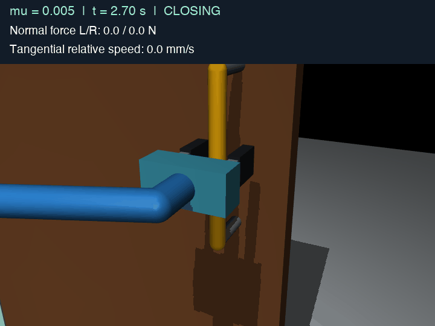

# MuJoCo Door Opening

## 抓持方案、角度学习与新站位验证

新增可序列化的抓持方案（高度、接近角度、肘分支、力上限、时序），以及独立的
REINFORCE / 监督奖励预测对照。保留原 H-JEPA 的实时 RGB-D 感知接口和管线。
新模型只学习离散角度，尚未接入 H-JEPA 世界模型，也不是逐关节控制策略。

- [抓持方案](docs/grasp_plans.md) · [物理对照 demo](docs/grasp_update_demo.md)
- [RL 使用说明](docs/grasp_rl.md) · [数据采集与 SL/RL 训练](docs/supervised_grasp_learning.md)
- [已验证实验结果](docs/grasp_learning_results/REPORT.md) · [分析与自生成数据的依据](docs/grasp_learning_results/ANALYSIS.md)

在仓库根目录、已安装 `requirements.txt` 的 Python 环境中：

```bash
python collect_grasp_data.py
python compare_grasp_learning.py train
python compare_grasp_learning.py evaluate
# macOS 图形演示，须先生成模型权重：
mjpython compare_grasp_learning.py demo --scene test_021 --method reinforce --seed 42
```

默认使用 36/12/24 个训练/验证/测试站位、21 个角度和 3 个训练种子。
报告和小型指标文件随代码发布；大数据、视频和模型权重在忽略的 `reproduced/` 中由命令生成。
本次 SL 未优于 RL，训练集选出的固定 +18° 同样达到 10/24；结果不代表新门型或真实机器人表现。

回归检查：`python -m unittest test_grasp_plan test_grasp_learning test_grasp_rl test_git_size -v`。
默认 `trial(point)` 会恢复构造时的肘分支和执行器力上限，避免继承上一回合的方案设置。

Current continuation uses **LoRA**, with the original H-JEPA core frozen and
unmerged. The expanded suite has 240 independent scenes (192/24/24), twelve
structural families and randomized camera/geometry/lighting. The local pipeline
collects physical counterfactuals, trains adapters, then evaluates frozen test
scenes. See [LoRA continuation and progress](docs/hjepa_setup.md#lora-continuation).

```powershell
.\.venv\Scripts\python.exe run_hjepa_lora_experiment.py
.\.venv\Scripts\python.exe hjepa_lora_status.py
```

The commands below document the earlier full-model training baseline; the LoRA
continuation preserves that checkpoint and writes a separate adapter.

## Official H-JEPA setup

The staged world-model pipeline now uses the complete official `pusht_hjepa_l2`
configuration (224x224 ViT-Tiny, 23.3M parameters), two timescales,
separate positioning/grasping policies, fresh arrival RGB-D, physical trajectory
collection, downstream rewards, and scene-disjoint evaluation.
See [setup, training and limitations](docs/hjepa_setup.md).

```powershell
.\.venv\Scripts\python.exe setup_hjepa.py
.\.venv\Scripts\python.exe collect_hjepa.py
.\.venv\Scripts\python.exe train_hjepa.py --policy-updates 100
.\.venv\Scripts\python.exe run_hjepa.py
```

The default full run uses batch 128, BF16, 9 epochs and ViT activation
recomputation to fit the local 6 GB RTX 3060. The earlier 0.55M compact model is
retained as an explicit legacy profile. Base placement uses simulator resets. The original contact baseline
below remains available independently through `run_demo.py`.

Expanded frozen-policy evaluation (new scene seed, matched stage interventions,
base/grasp yaw sweeps and 30/60/90-degree controller targets):

```powershell
.\.venv\Scripts\python.exe evaluate_hjepa_stages.py --device cuda
.\.venv\Scripts\python.exe evaluate_hjepa_views.py --device cuda
.\.venv\Scripts\python.exe report_hjepa_stages.py
.\.venv\Scripts\python.exe -m unittest test_hjepa test_hjepa_stages test_git_size -v
.\.venv\Scripts\python.exe check_git_size.py
```

The stage evaluator crosses the pre/post-update positioning and grasping heads
while asserting identical world/value weights. Physical candidate tables are
evaluation labels, never selector inputs. Raw results stay in ignored `runs/`;
weights, arrays and video/archive files are also ignored. `check_git_size.py`
rejects Git-visible or staged files above 10 MiB, including tracked files that
ignore patterns cannot protect.
See [measured stage/angle results](docs/hjepa_stage_results.md) for the policy
interventions, stress failures and camera-view sensitivity.

Structural feasibility tests add collidable pillars, bidirectional/one-way
hinges and one/two-sided handles. Both operating sides are in the same four-base
candidate pool. See [structural results and physical states](docs/hjepa_structural_results.md).

```powershell
.\.venv\Scripts\python.exe evaluate_hjepa_structure.py --device cuda
# Observe and pull from the back: reverse swing avoids the front-side pillar.
.\.venv\Scripts\python.exe run_hjepa.py --scenario pillar-front --base-mode fixed --fixed-base-id 2 --method geometry --output runs/hjepa/structural_demo
```

These are historical structural tests of the original frozen checkpoints,
whose training data contained only front-side operation.
Geometry-based side selection/rejection in the report is a privileged reference.

Train the complete model on fresh structural scene splits, with two-sided
operation and an explicit refusal candidate:

```powershell
.\.venv\Scripts\python.exe collect_hjepa.py --structural --output runs/hjepa/structural_data --seed 20261017
.\.venv\Scripts\python.exe train_hjepa.py --data runs/hjepa/structural_data --output runs/hjepa/structural_model --init-checkpoint runs/hjepa/official_model/selected.pt --epochs 9 --policy-updates 1000 --device cuda
.\.venv\Scripts\python.exe refit_structural_position.py
.\.venv\Scripts\python.exe evaluate_structural_training.py --device cuda
.\.venv\Scripts\python.exe report_structural_training.py
.\.venv\Scripts\python.exe run_hjepa.py --checkpoint runs/hjepa/structural_model/selected.pt --scenario pillar-front --output runs/hjepa/structural_trained_demo
```

Structural fine-tuning keeps the official architecture/batch/precision. The
world checkpoint uses validation loss; frozen stage-policy updates use validation
return for selection. The six new test scenes are evaluated after selection.
The optional positioning refit probes the same full ViT before its JEPA
projector, fits the original task head and accepts it only when validation
return improves. Dynamics, value and grasp representations stay projected.

The completed full-model structural run used 9 epochs / 1,053 steps on the
RTX 3060 Laptop, with 2,848 MiB peak allocation. On six held-out scenes, opening
improved from 3/5 to 4/5 feasible doors; the blocked two-pillar case was not
rejected. See [training results and remaining failures](docs/hjepa_structural_training.md).

基于 MuJoCo 的机械臂开门仿真：识别固定拉杆把手、选择抓取姿态、两指夹持、通过接触力开门，并检测滑移与脱手。

场景使用固定底座、三个平面转动关节、一个竖直升降轴与两指平行夹爪。门铰链无驱动器，开门运动由夹爪与把手的实体接触产生。当前采用已知几何、受控 RGB-D 识别、解析逆运动学和关节伺服控制。

## 示例动画

### 完整打开


### 开到一半后失败


实际门角约 42.5° 时，下一参考目标需要肘关节超过 -165° 下限，控制器提前终止。此时夹爪仍保持接触；42.5° 是仿真终止时的实际角度，不是精确的物理最大开度。

### 滑动与脱手



低摩擦故障案例使用 μ=0.005；约 3.77 s 触发持续滑移告警，约 4.73 s 确认接触丢失。该极低摩擦参数用于复现故障，未对应实测材料。

## 安装与复现

现已支持完整抓握方案：抓握高度、接近角度、肘关节分支、各阶段时长和夹爪驱动力上限，
可通过命令行设置并保存/加载 JSON。见 [参数化抓握方案与运行示例](docs/grasp_plans.md)。
这一步提供方案表示和执行接口，尚未自动搜索最优抓法。

验证环境：macOS、Python 3.12.5、MuJoCo 3.16.0、NumPy 2.5.4、Pillow 12.3.0。依赖版本固定在 `requirements.txt`。

在 VS Code 中打开仓库文件夹，并在终端执行：

```bash
python3.12 -m venv .venv
source .venv/bin/activate
python -m pip install -r requirements.txt
python run_demo.py
```

完整流程会重新渲染初始 RGB-D、识别把手、选择抓点、运行六组动力学实验和验证、导出动画与诊断。新结果位于 `reproduced/`，包内 `results/` 是已保存的参考结果。

Windows 激活环境使用 `.venv\Scripts\activate`；可用 `py -3.12 -m venv .venv` 创建环境。图形渲染需要可用的图形环境。当前仅在上述 macOS 环境完成验证。

固定初始观测、重新计算运动与动画：

```bash
python run_demo.py --reuse-observation
```

macOS 实时观看：

```bash
mjpython simulate.py --case nominal --view
mjpython simulate.py --case workspace_limit --view
```

单独复现完整脱手过程：

```bash
python simulate.py --case low_friction --continue-after-slip
python render_slip_detail.py
```

默认单案例运行在滑移告警时结束；`--continue-after-slip` 是为观察后续接触丢失而启用的诊断模式。

## 实验与结果

| 案例 | 含义 | 已保存参考结果 |
|---|---|---|
| `unreachable` | 初始抓点或预抓取位姿不可达 | 无法建立抓握 |
| `reach_only` | 接近并夹住后结束，不测试后续开门 | 双侧抓握建立 |
| `workspace_limit` | 中途关节参考目标越界 | 实际门角约 42.505° |
| `low_friction` | 摩擦不足导致滑动和脱手 | 门基本未打开 |
| `nominal` | 正常夹持开门与保持 | 约 89.679° |
| `no_grip` | 手指始终张开的因果对照 | 门保持关闭 |

六个案例保持正常场景选出的抓点和朝向不变，分别改变站位、摩擦或闭合状态。8 项参考验证结果及步长敏感性结果见 [summary.json](results/summary.json)。

## 文件说明

| 文件 | 作用 |
|---|---|
| `scene.xml` | 门、把手、机械臂、夹爪、接触和驱动参数 |
| `perception.py` | RGB-D 采集、颜色分割和拉杆截面拟合 |
| `planning.py` | 9 个抓取候选与几何轨迹筛选 |
| `simulate.py` | 动力学控制、接触监测与结果分类 |
| `benchmark.py` | 六组对照实验和验证 |
| `diagnose_workspace.py` | 实际停止状态与首个越界目标的诊断 |
| `render_results.py` | 从保存的物理轨迹渲染动画 |
| `render_slip_detail.py` | 脱手近景动画和参数导出 |
| `run_demo.py` | 完整复现入口 |
| `results/` | 参考动画、输入观测、轨迹、接触数据与诊断 |

[详细实现、坐标与判据](docs/implementation.md) · [脱手案例完整参数](results/low_friction_parameters.json) · [半开失败诊断](results/workspace_limit_diagnosis.json)

## 当前范围

视觉方法依赖金色竖直拉杆、已知半径、标定相机及端部可见的先验；铰链与机器人几何来自已知场景。接触力与相对运动直接读取仿真状态。新增的官方 H-JEPA 训练与分阶段策略管线见上方链接。当前仍没有通用视觉模型、在线遮挡跟踪、真实六轴机器人、移动底座导航或自动重抓，亦未完成真实机器人验证。
