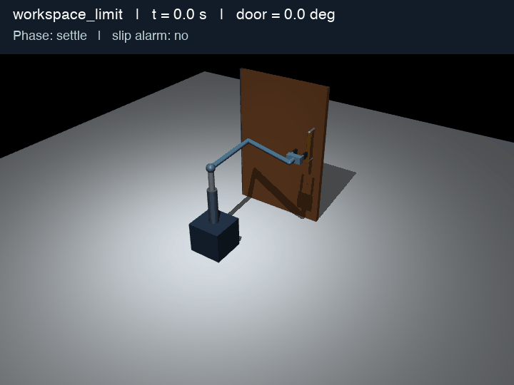

# MuJoCo Door Opening

基于 MuJoCo 的机械臂开门仿真：识别固定拉杆把手、选择抓取姿态、两指夹持、通过接触力开门，并检测滑移与脱手。

场景使用固定底座、三个平面转动关节、一个竖直升降轴与两指平行夹爪。门铰链无驱动器，开门运动由夹爪与把手的实体接触产生。当前采用已知几何、受控 RGB-D 识别、解析逆运动学和关节伺服控制。

## 示例动画

### 完整打开


### 开到一半后失败



实际门角约 42.5° 时，下一参考目标需要肘关节超过 -165° 下限，控制器提前终止。此时夹爪仍保持接触；42.5° 是仿真终止时的实际角度，不是精确的物理最大开度。

### 滑动与脱手


低摩擦故障案例使用 μ=0.005；约 3.77 s 触发持续滑移告警，约 4.73 s 确认接触丢失。该极低摩擦参数用于复现故障，未对应实测材料。

## 安装与复现

验证环境：macOS、Python 3.12.5、MuJoCo 3.16.0、NumPy 2.5.4、Pillow 12.3.0。依赖版本固定在 `requirements.txt`。

在 VS Code 中打开仓库文件夹，并在终端执行：

```bash
python3.12 -m venv .venv
source .venv/bin/activate
python -m pip install -r requirements.txt
python run_demo.py
```

完整流程会重新渲染初始 RGB-D、识别把手、选择抓点、运行六组动力学实验和验证、导出动画与诊断。新结果位于 `reproduced/`，包内 `results/` 是已保存的参考结果。

Windows 激活环境使用 `.venv\Scripts\activate`；可用 `py -3.12 -m venv .venv` 创建环境。图形渲染需要可用的图形环境。当前仅在上述 macOS 环境完成验证。

固定初始观测、重新计算运动与动画：

```bash
python run_demo.py --reuse-observation
```

macOS 实时观看：

```bash
mjpython simulate.py --case nominal --view
mjpython simulate.py --case workspace_limit --view
```

单独复现完整脱手过程：

```bash
python simulate.py --case low_friction --continue-after-slip
python render_slip_detail.py
```

默认单案例运行在滑移告警时结束；`--continue-after-slip` 是为观察后续接触丢失而启用的诊断模式。

## 实验与结果

| 案例 | 含义 | 已保存参考结果 |
|---|---|---|
| `unreachable` | 初始抓点或预抓取位姿不可达 | 无法建立抓握 |
| `reach_only` | 接近并夹住后结束，不测试后续开门 | 双侧抓握建立 |
| `workspace_limit` | 中途关节参考目标越界 | 实际门角约 42.505° |
| `low_friction` | 摩擦不足导致滑动和脱手 | 门基本未打开 |
| `nominal` | 正常夹持开门与保持 | 约 89.679° |
| `no_grip` | 手指始终张开的因果对照 | 门保持关闭 |

六个案例保持正常场景选出的抓点和朝向不变，分别改变站位、摩擦或闭合状态。8 项参考验证结果及步长敏感性结果见 [summary.json](results/summary.json)。

## 文件说明

| 文件 | 作用 |
|---|---|
| `scene.xml` | 门、把手、机械臂、夹爪、接触和驱动参数 |
| `perception.py` | RGB-D 采集、颜色分割和拉杆截面拟合 |
| `planning.py` | 9 个抓取候选与几何轨迹筛选 |
| `simulate.py` | 动力学控制、接触监测与结果分类 |
| `benchmark.py` | 六组对照实验和验证 |
| `diagnose_workspace.py` | 实际停止状态与首个越界目标的诊断 |
| `render_results.py` | 从保存的物理轨迹渲染动画 |
| `render_slip_detail.py` | 脱手近景动画和参数导出 |
| `run_demo.py` | 完整复现入口 |
| `results/` | 参考动画、输入观测、轨迹、接触数据与诊断 |

[详细实现、坐标与判据](docs/implementation.md) · [脱手案例完整参数](results/low_friction_parameters.json) · [半开失败诊断](results/workspace_limit_diagnosis.json)

## 当前范围

视觉方法依赖金色竖直拉杆、已知半径、标定相机及端部可见的先验；铰链与机器人几何来自已知场景。接触力与相对运动直接读取仿真状态。当前没有通用视觉模型、在线遮挡跟踪、真实六轴机器人、移动底座控制、自动重抓或学习型世界模型，亦未完成真实机器人验证。
