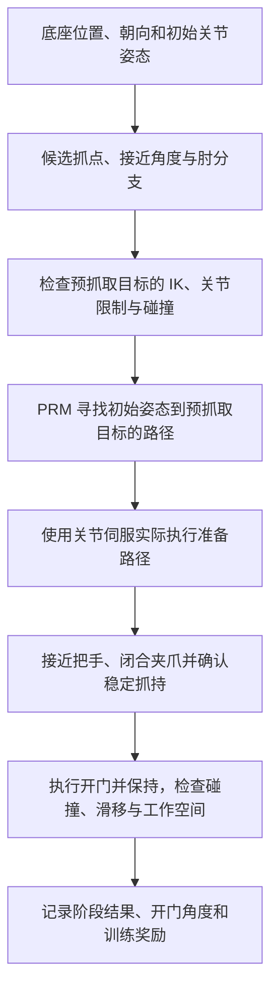

# MuJoCo Door Opening

## 整体实验进度（2026-10-26）

本地 H-JEPA 与远端抓持学习、PRM 更新已整合。三个模块已有独立实验，
但 PRM 和独立角度策略尚未接入 H-JEPA 主链路，不能将各模块指标当作统一
端到端成功率。见 [整体评估与合并验证](docs/experiment_progress_20261026.md)。

## Grasping：抓持方案的判断与执行

对每个指定的底座位置与朝向，记录初始关节姿态，再判断候选抓持方案能否完成以下步骤：



任一步失败都结束当前候选并记录原因，不继续把它当成已验证可行方案。

| 判断步骤 | 通过条件 | 不通过时如何解释 |
| --- | --- | --- |
| 目标姿态 | 当前肘分支存在合法预抓取 IK，端点无碰撞 | `goal_ik_unreachable` / `invalid_start` / `invalid_goal`：排除当前目标或端点，不证明所有抓法都无解 |
| PRM 路径 | `direct_path` 或 `roadmap_path`，最终路径各边通过当前离散几何检查 | `no_path_within_budget`：有限采样未找到，跳过该候选执行；可另行增加预算或更换候选 |
| 路径执行 | 位置伺服实际到位，未发生碰撞或提前推门，跟踪误差与速度满足阈值 | 准备执行失败；记录碰撞或跟踪原因，`opening_tested=false` |
| 抓持建立 | 原控制器确认稳定双侧接触 | 可达但未抓稳，不等于可以开门 |
| 完整开门 | 默认达到 90° 附近并稳定保持；无碰撞、持续滑移或接触丢失 | 分别记录工作空间、碰撞、滑移或未完成；保留实际安全进度 |

**“存在路径”“PRM 找到路径”“实际执行成功”是三个不同判断。** 理想 PRM 在正确的边验证器下，找到路径就是模型内存在一条有效路线的证据；有限预算没找到不证明不存在。工程代码使用离散碰撞检查，步长过大可能漏掉中间碰撞；几何路线还需要动力学执行确认。PRM 到达预抓取点也不证明抓住后能全开。

当前采用四维关节配置 `[升降, 肩, 肘, 腕]`，默认初始姿态为 `[0 m, −90°, −120°, 0°]`。默认保留 240 个有效随机节点、12 个近邻，先尝试直连；直连受阻才使用 Lazy PRM。邻居边在寻路时检查，失败删边再搜索。它使用已知 MuJoCo 几何，尚未规划抓住后的闭环约束运动。

接入范围：

- `collect_grasp_data.py`：对每个站位先分析全部候选，保存 `*_prm_preflight.jsonl`，然后生成实际执行结果。
- `train_grasp_rl.py` / `compare_grasp_learning.py`：策略选择的候选经过相同 PRM 和路径执行步骤后，才进入抓持、开门与奖励计算；当前没有用 PRM 结果做动作概率掩码。
- `simulate.py` / `run_demo.py` / 原 H-JEPA 流程保留各自的初始化接口，不能把它们当成已接入 PRM。直接调用 `trial(plan=...)` 默认仍重置到预抓取点；新学习流程会先执行准备路径，再调用 `trial(reset_before_trial=False)`。

`opening_tested=false` 的负奖励表示当前规划预算或准备流程失败，不能当作已经实际测试并证明“这个站位无法开门”的标签。准备阶段碰撞会记录，并计入流程碰撞统计。

### PRM 例子与复现

| 例子 | 准备路径判断 | 后续开门 |
| --- | --- | --- |
| `(0.6, -1.0)`，无遮挡 | 直连通过，无需随机建图 | 全开保持 |
| 同站位，增加小障碍 | 715 次采样中保留 500 个有效节点，找到 5 路标路径；用原升降轴下降约 9.6 cm 绕行 | 全开保持 |
| 同一障碍，零采样预算 | 未找到；上一个例子已证明不等于绝对无路 | 跳过执行 |
| `(0.3, -0.9)` | 找到路径并成功到位 | 开到约 42.5° 后工作空间受限 |
| `(2.0, -1.2)` | 当前预抓取目标和肘分支没有合法 IK | 跳过执行 |

```bash
python prm_examples.py
# 本地打开 reproduced/prm_examples/index.html
mjpython prm_examples.py --view detour
# 可选：从已记录的真实物理轨迹生成 2 倍速 GIF
python prm_examples.py --render detour
```

见 [PRM 实现与参数](docs/prm_pregrasp.md)、[实测报告](docs/prm_results/REPORT.md) 和 [离线交互页面](docs/prm_results/index.html)（下载后在浏览器打开；GitHub 文件页仅显示源码）。
新默认实验目录带 `_prm` 后缀，旧数据/模型可通过显式路径继续评估；`--no-prm` 显式运行原初始化基线。

## 抓持方案、角度学习与新站位验证

新增可序列化的抓持方案（高度、接近角度、肘分支、力上限、时序），以及独立的
REINFORCE / 监督奖励预测对照。保留原 H-JEPA 的实时 RGB-D 感知接口和管线。
新模型只学习离散角度，尚未接入 H-JEPA 世界模型，也不是逐关节控制策略。

- [抓持方案](docs/grasp_plans.md) · [物理对照 demo](docs/grasp_update_demo.md)
- [RL 使用说明](docs/grasp_rl.md) · [数据采集与 SL/RL 训练](docs/supervised_grasp_learning.md)
- [已验证实验结果](docs/grasp_learning_results/REPORT.md) · [分析与自生成数据的依据](docs/grasp_learning_results/ANALYSIS.md)

在仓库根目录、已安装 `requirements.txt` 的 Python 环境中：

```bash
python collect_grasp_data.py
python compare_grasp_learning.py train
python compare_grasp_learning.py evaluate
# macOS 图形演示，须先生成模型权重：
mjpython compare_grasp_learning.py demo --scene test_021 --method reinforce --seed 42
```

默认使用 36/12/24 个训练/验证/测试站位、21 个角度，新增实验默认种子为 42。
已发布历史比较使用 42/43/44，复现时显式传入 `--seeds 42 43 44`。
报告和小型指标文件随代码发布；大数据、视频和模型权重在忽略的 `reproduced/` 中由命令生成。
历史无 PRM 的 36/12/24 站位实验中，SL 未优于 RL，训练集选出的固定 +18° 同样达到 10/24。新增 PRM 流程以 12/4/8 站位、504 次候选流程和 252 次 RL 决策完成接入验证；这两组实验不用于直接比较 PRM 的成功率增益，也不代表新门型或真实机器人表现。

回归检查：`python -m unittest test_prm test_grasp_plan test_grasp_learning test_grasp_rl test_git_size -v`。
默认 `trial(point)` 会恢复构造时的肘分支和执行器力上限，避免继承上一回合的方案设置。

## H-JEPA: positioning and staged policies

Latest completed experiment: **refusal offset vs binary side-feasibility**,
with two matched 240-step LoRA continuations from the same patch-mean model.
Validation selects rank continuation + offset (**73/96** development), but
on a fresh 96-scene test it scores **67/96**, equal to the frozen starting
model. BCE scores **69/96** but was not selected; no test-driven promotion
occurs. The selected method opens 57/68 feasible doors and correctly refuses
10/28 impossible scenes, versus 61 and 6 initially. All **288 physical replays**
match, and original core weights stay frozen. See
[refusal study](docs/hjepa_setup.md#refusal-calibration-and-binary-side-supervision-2026-10-26)
and [figure](docs/hjepa_refusal_seed42_results.png).

Previous experiment: positioning-only **native ViT CLS vs patch mean**,
same 192-dimensional head input, paired cameras, seed 42, 576 train / 96 val,
240 LoRA updates per arm. Validation selects patch mean at step 160. A fresh
96-scene test scores **60/96** versus CLS **59/96**, previous coverage model
**54/96**, and historical decomposed model **57/96**. Patch mean opens 56/66
feasible doors but correctly refuses only 4/30 impossible scenes; its advantage
over CLS is small. Both arms have 96 matching physical replays, and original
core weights remain unchanged. See [pooling study](docs/hjepa_setup.md#native-vit-pooling-study-2026-10-26)
and [figure](docs/hjepa_pooling_seed42_results.png).

Completed coverage study: **seed 42**, matched paired-view LoRA, 240 updates
per arm, **192 vs 576 training scenes**, the same fresh 96 validation scenes,
then 96 independent tests. Validation selects the expanded arm at step 160.
Test correct decisions change **49/96 -> 51/96**, false refusals **19 -> 14**,
and collisions **15 -> 9**, but wrong-side choices increase **11 -> 14**.
The historical decomposed candidate still scores **56/96** on this suite;
more data has not solved generalization. All 96 selected-policy physical
replays match; original core weights remain frozen. See
[protocol/results](docs/hjepa_setup.md#seed-42-coverage-expansion-2026-10-26)
and [figure](docs/hjepa_coverage_seed42_results.png).

Latest observation experiment: matched-compute **front x2 vs front+rear**, both
LoRA, 160 updates. On a fresh 48-scene test the dual-camera candidate scores
**29/48**, repeated-front control **23/48**, and untrained dual-camera routing
**28/48**. Dual-camera training still has six false refusals. Validation had
selected the single-camera arm, so the test winner was **not** promoted.
Both arms have 48 matching live physical replays. Endpoint-only collection
reduces this test dataset to about 54 MB. See
[method/results](docs/hjepa_setup.md#fixed-camera-observation-ablation-2026-10-26)
and [figure](docs/hjepa_paired_view_results.png).

Position training now defaults to **door-side reward v1**: openable side +2,
wrong side when the other opens -2, neither side opens -1, refusal 0. A separate
within-side base term is weighted 0.25. The objective and validation distinguish
side choice, base choice and grasp errors. See
[reward definition and commands](docs/hjepa_setup.md#door-side-specific-position-reward-2026-10-26).

Completed side-reward study: both 240-step arms select step 80 on validation.
On 48 fresh scenes, the selected head update changes correct decisions
**20/48 -> 22/48**, wrong-side errors **14 -> 9**, collisions **12 -> 6**, but
adds four false refusals. Three old wrong-side cases become correct-side
choices, three become refusals, and one new wrong-side error appears. The LoRA
arm also scores 22/48; the previous decomposed candidate scores 24/48 on this
same suite. See [full comparison](docs/hjepa_setup.md#door-side-reward-full-study-2026-10-26)
and [figure](docs/hjepa_side_reward_results.png). Existing defaults remain intact.

Latest controlled experiment (2026-10-26): **240 position-head updates vs
240 position-head + LoRA updates**, with successful-action-set supervision.
The final LoRA fits training (**185/192** correct) but generalizes poorly
(**9/24** validation); neither arm beats its initialization on validation.
Both therefore retain the original scalar LoRA at checkpoint selection. On a
fresh 48-scene test that frozen fallback scores **24/48**, versus **21/48** for
the previous decomposed candidate. This is a negative experiment, not a model
improvement. See [method and results](docs/hjepa_setup.md#successful-action-set-position-experiment-2026-10-26)
and [comparison figure](docs/hjepa_listwise_results.png).

Previous study (2026-10-26): literature-guided outcome/progress decomposition,
within-scene preferences, **600 LoRA steps**, then one validation-fitted
execution/refusal threshold. On a newly frozen 48-scene test, openings change
**27/35 -> 24/35**, correct refusals **0/13 -> 3/13**, and collisions **8 -> 3**.
Overall correct decisions remain **27/48**, with five false refusals: this is
a more conservative candidate, not an overall accuracy improvement. Original
weights and the default checkpoint are preserved. See
[method, papers and results](docs/hjepa_setup.md#literature-guided-reward-decomposition-2026-10-26),
[test figure](docs/hjepa_reward_calibrated.png), and the training wait rule in
[AGENTS.md](AGENTS.md).


Current continuation uses **LoRA**, with the original H-JEPA core frozen and
unmerged. The expanded suite has 240 independent scenes (192/24/24), twelve
structural families and randomized camera/geometry/lighting. The local pipeline
collects physical counterfactuals, trains adapters, then evaluates frozen test
scenes. See [LoRA continuation and progress](docs/hjepa_setup.md#lora-continuation).

```powershell
.\.venv\Scripts\python.exe run_hjepa_lora_experiment.py
.\.venv\Scripts\python.exe hjepa_lora_status.py
```

The next continuation uses a **separate 48-scene test-only dataset**, seed
20261019. Its training manifest contains only the 192 train / 24 validation
scenes; test arrays are never opened by the trainer. The previous 24-scene test
has been physically replayed and retained as a historical comparison (LoRA
opens 12/18 feasible scenes, original checkpoint 9/18).

```powershell
.\.venv\Scripts\python.exe prepare_hjepa_splits.py
.\.venv\Scripts\python.exe continue_hjepa_lora.py
.\.venv\Scripts\python.exe hjepa_lora_status.py
```

Progress: `runs/hjepa/lora_continued_model/status.json`. Independent test data:
`runs/hjepa/independent_test_data/`. Generate the
[scene-level test report](docs/hjepa_setup.md#separate-independent-test-set)
with `python report_hjepa_holdout.py`.

The continuation and **all 48 independent physical replays are complete**.
Full openings improve from previous LoRA **24/35 to 26/35** feasible scenes;
correct refusals remain **0/13**. Overall correct decisions are **26/48**,
equal to the original base's 26/48 (23 openings plus 3 correct refusals).
This is a limited opening gain, not a solved task. See the
[independent test figure](docs/hjepa_lora_independent.png) and
[measured results](docs/hjepa_setup.md#completed-independent-test-results).

The commands below document the earlier full-model training baseline; the LoRA
continuation preserves that checkpoint and writes a separate adapter.

## Official H-JEPA setup

The staged world-model pipeline now uses the complete official `pusht_hjepa_l2`
configuration (224x224 ViT-Tiny, 23.3M parameters), two timescales,
separate positioning/grasping policies, fresh arrival RGB-D, physical trajectory
collection, downstream rewards, and scene-disjoint evaluation.
See [setup, training and limitations](docs/hjepa_setup.md).

```powershell
.\.venv\Scripts\python.exe setup_hjepa.py
.\.venv\Scripts\python.exe collect_hjepa.py
.\.venv\Scripts\python.exe train_hjepa.py --policy-updates 100
.\.venv\Scripts\python.exe run_hjepa.py
```

The default full run uses batch 128, BF16, 9 epochs and ViT activation
recomputation to fit the local 6 GB RTX 3060. The earlier 0.55M compact model is
retained as an explicit legacy profile. Base placement uses simulator resets. The original contact baseline
below remains available independently through `run_demo.py`.

Expanded frozen-policy evaluation (new scene seed, matched stage interventions,
base/grasp yaw sweeps and 30/60/90-degree controller targets):

```powershell
.\.venv\Scripts\python.exe evaluate_hjepa_stages.py --device cuda
.\.venv\Scripts\python.exe evaluate_hjepa_views.py --device cuda
.\.venv\Scripts\python.exe report_hjepa_stages.py
.\.venv\Scripts\python.exe -m unittest test_hjepa test_hjepa_stages test_git_size -v
.\.venv\Scripts\python.exe check_git_size.py
```

The stage evaluator crosses the pre/post-update positioning and grasping heads
while asserting identical world/value weights. Physical candidate tables are
evaluation labels, never selector inputs. Raw results stay in ignored `runs/`;
weights, arrays and video/archive files are also ignored. `check_git_size.py`
rejects Git-visible or staged files above 10 MiB, including tracked files that
ignore patterns cannot protect.
See [measured stage/angle results](docs/hjepa_stage_results.md) for the policy
interventions, stress failures and camera-view sensitivity.

Structural feasibility tests add collidable pillars, bidirectional/one-way
hinges and one/two-sided handles. Both operating sides are in the same four-base
candidate pool. See [structural results and physical states](docs/hjepa_structural_results.md).

```powershell
.\.venv\Scripts\python.exe evaluate_hjepa_structure.py --device cuda
# Observe and pull from the back: reverse swing avoids the front-side pillar.
.\.venv\Scripts\python.exe run_hjepa.py --scenario pillar-front --base-mode fixed --fixed-base-id 2 --method geometry --output runs/hjepa/structural_demo
```

These are historical structural tests of the original frozen checkpoints,
whose training data contained only front-side operation.
Geometry-based side selection/rejection in the report is a privileged reference.

Train the complete model on fresh structural scene splits, with two-sided
operation and an explicit refusal candidate:

```powershell
.\.venv\Scripts\python.exe collect_hjepa.py --structural --output runs/hjepa/structural_data --seed 20261017
.\.venv\Scripts\python.exe train_hjepa.py --data runs/hjepa/structural_data --output runs/hjepa/structural_model --init-checkpoint runs/hjepa/official_model/selected.pt --epochs 9 --policy-updates 1000 --device cuda
.\.venv\Scripts\python.exe refit_structural_position.py
.\.venv\Scripts\python.exe evaluate_structural_training.py --device cuda
.\.venv\Scripts\python.exe report_structural_training.py
.\.venv\Scripts\python.exe run_hjepa.py --checkpoint runs/hjepa/structural_model/selected.pt --scenario pillar-front --output runs/hjepa/structural_trained_demo
```

Structural fine-tuning keeps the official architecture/batch/precision. The
world checkpoint uses validation loss; frozen stage-policy updates use validation
return for selection. The six new test scenes are evaluated after selection.
The optional positioning refit probes the same full ViT before its JEPA
projector, fits the original task head and accepts it only when validation
return improves. Dynamics, value and grasp representations stay projected.

The completed full-model structural run used 9 epochs / 1,053 steps on the
RTX 3060 Laptop, with 2,848 MiB peak allocation. On six held-out scenes, opening
improved from 3/5 to 4/5 feasible doors; the blocked two-pillar case was not
rejected. See [training results and remaining failures](docs/hjepa_structural_training.md).

基于 MuJoCo 的机械臂开门仿真：识别固定拉杆把手、选择抓取姿态、两指夹持、通过接触力开门，并检测滑移与脱手。

场景使用固定底座、三个平面转动关节、一个竖直升降轴与两指平行夹爪。门铰链无驱动器，开门运动由夹爪与把手的实体接触产生。当前采用已知几何、受控 RGB-D 识别、解析逆运动学和关节伺服控制。

## 示例动画

### 完整打开


### 开到一半后失败


实际门角约 42.5° 时，下一参考目标需要肘关节超过 -165° 下限，控制器提前终止。此时夹爪仍保持接触；42.5° 是仿真终止时的实际角度，不是精确的物理最大开度。

### 滑动与脱手


低摩擦故障案例使用 μ=0.005；约 3.77 s 触发持续滑移告警，约 4.73 s 确认接触丢失。该极低摩擦参数用于复现故障，未对应实测材料。

## 安装与复现

现已支持完整抓握方案：抓握高度、接近角度、肘关节分支、各阶段时长和夹爪驱动力上限，
可通过命令行设置并保存/加载 JSON。见 [参数化抓握方案与运行示例](docs/grasp_plans.md)。
`GraspPlan` 提供方案表示和执行接口；独立 SL/RL 模块可选择候选角度，但不保证全局最优。

验证环境：macOS、Python 3.12.5、MuJoCo 3.16.0、NumPy 2.5.4、Pillow 12.3.0。依赖版本固定在 `requirements.txt`。

在 VS Code 中打开仓库文件夹，并在终端执行：

```bash
python3.12 -m venv .venv
source .venv/bin/activate
python -m pip install -r requirements.txt
python run_demo.py
```

完整流程会重新渲染初始 RGB-D、识别把手、选择抓点、运行六组动力学实验和验证、导出动画与诊断。新结果位于 `reproduced/`，包内 `results/` 是已保存的参考结果。

Windows 激活环境使用 `.venv\Scripts\activate`；可用 `py -3.12 -m venv .venv` 创建环境。图形渲染需要可用的图形环境。当前仅在上述 macOS 环境完成验证。

固定初始观测、重新计算运动与动画：

```bash
python run_demo.py --reuse-observation
```

macOS 实时观看：

```bash
mjpython simulate.py --case nominal --view
mjpython simulate.py --case workspace_limit --view
```

单独复现完整脱手过程：

```bash
python simulate.py --case low_friction --continue-after-slip
python render_slip_detail.py
```

默认单案例运行在滑移告警时结束；`--continue-after-slip` 是为观察后续接触丢失而启用的诊断模式。

## 实验与结果

| 案例 | 含义 | 已保存参考结果 |
|---|---|---|
| `unreachable` | 初始抓点或预抓取位姿不可达 | 无法建立抓握 |
| `reach_only` | 接近并夹住后结束，不测试后续开门 | 双侧抓握建立 |
| `workspace_limit` | 中途关节参考目标越界 | 实际门角约 42.505° |
| `low_friction` | 摩擦不足导致滑动和脱手 | 门基本未打开 |
| `nominal` | 正常夹持开门与保持 | 约 89.679° |
| `no_grip` | 手指始终张开的因果对照 | 门保持关闭 |

六个案例保持正常场景选出的抓点和朝向不变，分别改变站位、摩擦或闭合状态。8 项参考验证结果及步长敏感性结果见 [summary.json](results/summary.json)。

## 文件说明

| 文件 | 作用 |
|---|---|
| `scene.xml` | 门、把手、机械臂、夹爪、接触和驱动参数 |
| `perception.py` | RGB-D 采集、颜色分割和拉杆截面拟合 |
| `planning.py` | 9 个抓取候选与几何轨迹筛选 |
| `prm.py` | 初始关节姿态到预抓取目标的 Lazy PRM，以及实际准备路径跟踪 |
| `prm_examples.py` | 五个点位例子、路线图分析、实际轨迹重放和可选 GIF |
| `collect_grasp_data.py` | 按站位划分数据，先做 PRM 预检再记录候选执行结果 |
| `train_grasp_rl.py` / `compare_grasp_learning.py` | 带准备路径检查的角度学习、SL/RL 训练与独立验证 |
| `simulate.py` | 动力学控制、接触监测与结果分类 |
| `benchmark.py` | 六组对照实验和验证 |
| `diagnose_workspace.py` | 实际停止状态与首个越界目标的诊断 |
| `render_results.py` | 从保存的物理轨迹渲染动画 |
| `render_slip_detail.py` | 脱手近景动画和参数导出 |
| `run_demo.py` | 完整复现入口 |
| `results/` | 参考动画、输入观测、轨迹、接触数据与诊断 |

[详细实现、坐标与判据](docs/implementation.md) · [脱手案例完整参数](results/low_friction_parameters.json) · [半开失败诊断](results/workspace_limit_diagnosis.json)

## 当前范围

视觉方法依赖金色竖直拉杆、已知半径、标定相机及端部可见的先验；铰链与机器人几何来自已知场景。接触力与相对运动直接读取仿真状态。新增的官方 H-JEPA 训练与分阶段策略管线见上方链接。当前仍没有通用视觉模型、在线遮挡跟踪、真实六轴机器人、移动底座导航或自动重抓，亦未完成真实机器人验证。
