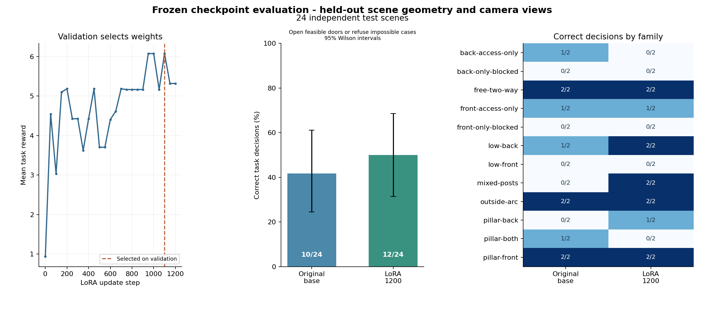
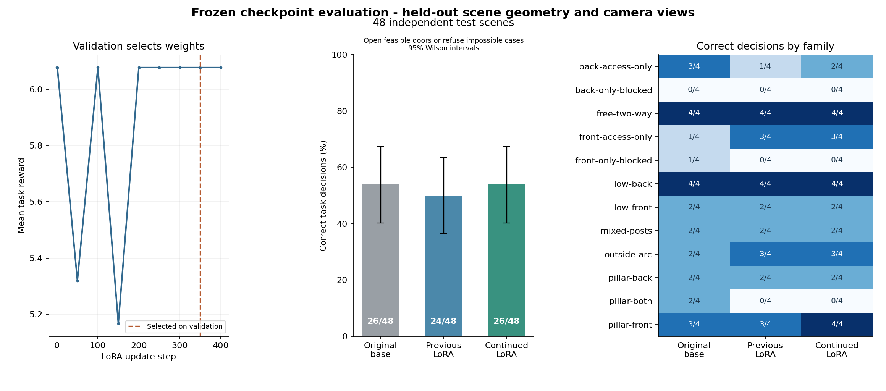
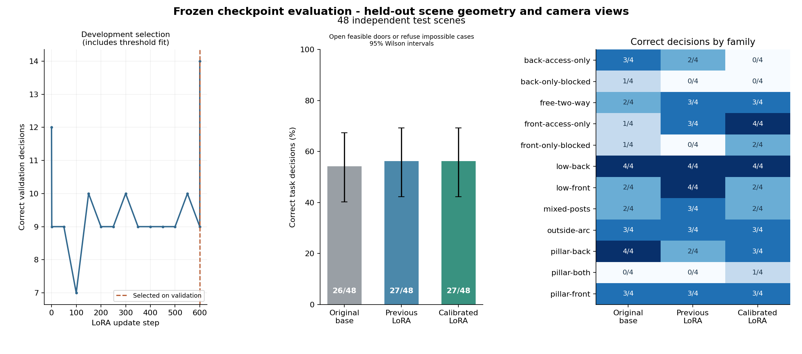
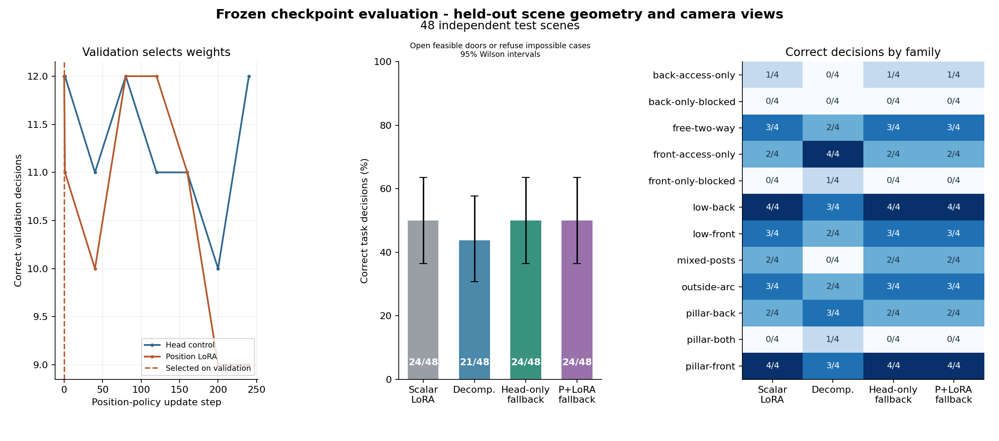
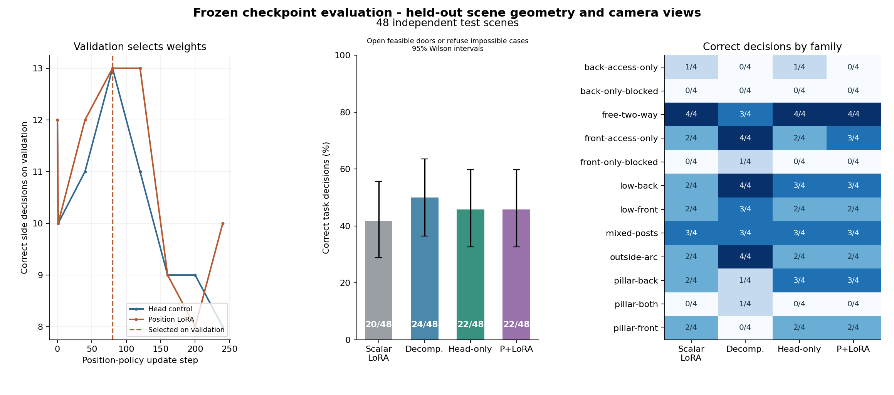
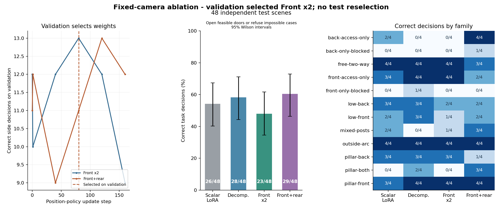
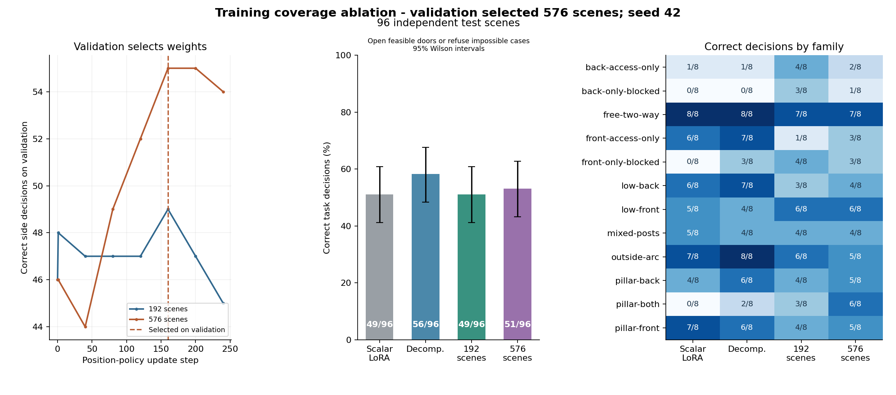
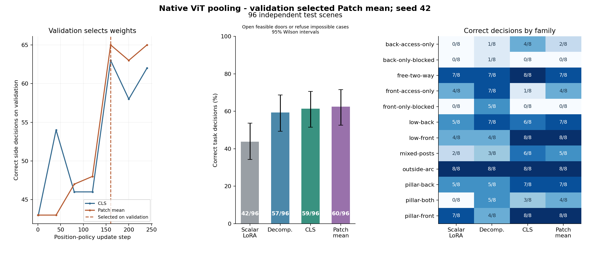
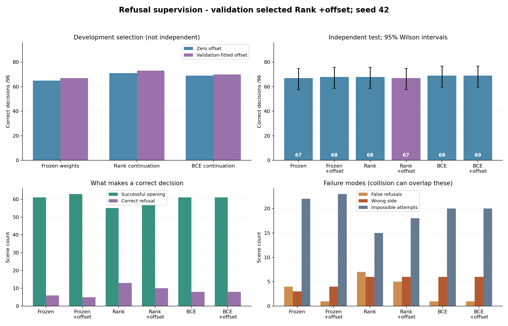

# Official full H-JEPA configuration for the door scene

The default now uses the complete **`pusht_hjepa_l2`** model configuration from
the [official release](https://github.com/kevinghst/H-JEPA), commit
`97054ecaff83e13839195ec4b92d74c08a0127c5`. `hjepa_model.default_config()` resolves
the release's `config/train/base/pusht.yaml` and `pusht_hjepa_l2.yaml`, then calls
its **`create_world_model()`** factory. The backbone is not a locally rebuilt
approximation or a resized CNN.

The older compact model and its measurements are retained in
[the compact experiment history](hjepa_compact_history.md). Those measurements
do not describe the full configuration. Old checkpoints remain loadable;
training one explicitly requires `--profile compact` and its original dataset.

## Model and training settings

| Setting | Full official configuration |
| --- | --- |
| Image input | Native 224x224 RGB; ImageNet normalization |
| Patch size | 14 |
| Visual encoder | ViT-Tiny, 12 layers, width 192, 3 attention heads |
| Level 1 predictor | 4 layers, 8 heads, dim_head 64, MLP width 1024 |
| Level 2 predictor | 6 layers, 16 heads, dim_head 64, MLP width 2048 |
| Latent dimensions | 192 / 192 |
| Projection heads | Official MLPs, hidden width 2048, BatchNorm |
| History / rollout training | 3 / 1, at each level |
| Upper temporal stride | 2 |
| Upper action encoder | Official sequence Transformer, output dimension 4 |
| Latent action queue | 4,000 |
| SIGReg | 1,024 random projections, weight 0.09 per level |
| Training batch | 128, shuffle, drop incomplete batches |
| Precision | BF16 mixed precision on CUDA |
| AdamW learning rates | Level 1: 5e-5; level 2: 1e-5 |
| Weight decay / gradient clip | 0.001 / 1.0 |
| Epoch budget | 9 |

The official world model has **23,222,914 parameters** with the door action
interface. Adding the two stage policy heads and two value heads brings the
total to **23,324,422**, approximately 89 MiB of FP32 parameter storage.

The only architecture change required by the scene is the primitive action
dimension: Push-T uses 2; the door controller uses 6. With frameskip 5, the
level-1 action embedder receives 30 values instead of 10. The native and adapted
world models have identical state-dict keys and tensor shapes except for that
input convolution weight, changing from `(10, 10, 1)` to `(10, 30, 1)`. A contract
test checks this against a second model constructed by the upstream factory.
No encoder, predictor, projection or action-encoder width/depth is reduced.

This configuration initializes its ViT from `ViTConfig`, as the upstream
factory does. It does not load a pretrained V-JEPA video backbone, nor is a
Push-T environment checkpoint presented as door-trained weights.

## Install and run on Windows

Use the existing project virtual environment, or create one with Python 3.11+:

```powershell
py -3.11 -m venv .venv
.\.venv\Scripts\python.exe setup_hjepa.py
.\.venv\Scripts\python.exe -m pip install --upgrade torch==2.8.0+cu126 --index-url https://download.pytorch.org/whl/cu126
.\.venv\Scripts\python.exe -m unittest test_hjepa -v
```

The CUDA command above matches this laptop's driver 561.09 / CUDA 12.6 support;
select a driver-compatible build on another machine. The tested Transformers
version is pinned in `requirements-hjepa.txt`. The local CUDA allocator fix in
`hjepa_runtime.py` handles the malformed inherited `expandable_segments=True`
option within project processes; it does not edit the system environment.

```powershell
.\.venv\Scripts\python.exe collect_hjepa.py
.\.venv\Scripts\python.exe train_hjepa.py --policy-updates 100
.\.venv\Scripts\python.exe run_hjepa.py
.\.venv\Scripts\python.exe evaluate_hjepa.py
```

Defaults use `runs/hjepa/official_data`, `official_model`, `official_demo` and
`official_evaluation`. Training/inference choose CUDA automatically when
available. `--device cpu` remains available; official BF16 training is tested
on the RTX 3060. `--steps N` overrides the epoch budget for an explicitly short
check. The default full run uses all 9 epochs. The collected dataset supplies
78 complete batches per epoch, hence **702 optimizer steps**.

`best.pt` selects the predictor by validation loss. The official CLI then freezes
that predictor and runs train-only stage-policy updates (100 by default), saving
**`selected.pt`**, the inference/evaluation default. It checks that every world
model weight and buffer remains unchanged during those policy updates.
`last.pt` preserves the final-epoch model and its policy-update branch for audit.
The raw best and final-epoch files are retained. Each run records a
`resolved_config.json` and `training.json` so its model size, data budget,
precision, optimizer rates and runtime are reviewable.

## RTX 3060 memory behavior

The unchanged model with batch 128 and BF16 ran out of memory without activation
recomputation. A real two-step training probe, including backward propagation,
AdamW state, validation and task heads, **passed** with recomputation:

| Runtime | Batch | Result | Peak PyTorch allocation | Peak reserved pool |
| --- | --- | --- | --- | --- |
| Standard autograd | 128 | CUDA OOM | See raw report; Windows used shared memory | — |
| ViT activation recomputation | 128 | Passed | 2,849.6 MiB | 3,516 MiB |

`enable_activation_checkpointing()` checkpoints the original ViT forward in
chunks of 32 images. It recomputes activations during backpropagation. Its
parameters and computations remain those of the official ViT. The projection
heads' BatchNorm and the two SIGReg objectives still operate over the **whole
128-example batch**. This is not small-batch gradient accumulation. Full model
dimensions, resolution, temporal context and training batch remain unchanged.
Checkpointing is enabled by default for the full profile. It trades runtime
for memory. Use `--no-activation-checkpointing` on a larger GPU to disable it.

Reproduce the capacity checks:

```powershell
.\.venv\Scripts\python.exe probe_hjepa_official.py
.\.venv\Scripts\python.exe probe_hjepa_official.py --activation-checkpointing
```

Results are in `runs/hjepa/official_capacity/*batch128.json`. The allocation
numbers refer to PyTorch tensors/pools, not all desktop and driver usage.
Windows WDDM may spill into shared host memory during an OOM attempt; its
reported logical allocation must not be read as physical VRAM capacity.

## Door data and interfaces

The 240-trial dataset was recollected at **native 224x224**, every **0.1 seconds**,
rather than upscaling the earlier 64x64 images. It contains 21,007 frames across
12 door scenes, split 8 train / 2 validation / 2 test. All base/grasp variants
of a scene stay in the same split.

The release's level-1 frameskip is 5. Each training sample spans 35 raw frames:
seven image states sampled at indices `0, 5, ..., 30`, with five consecutive
primitive actions flattened into each 30-dimensional action block. The
hierarchy derives its 4-frame level-1/level-2 training crops as upstream does.
Thus a level-1 transition covers 0.5 s and a level-2 transition covers 1 s.
Action z-score statistics come only from training scenes, use sample standard
deviation, and are saved as model buffers for planning. Constant columns are
handled with the upstream finite-value normalization convention.

RGB pixels live in memory-mapped `.pixels.npy` files (about 2.95 GiB total), so
the Windows trainer does not load the entire video dataset into RAM. Each NPZ
contains state/action/time arrays and the two stage observations; the manifest
links its pixel file. Initial/arrival camera frames are center-cropped to the
square renderer's field of view before resizing. Perception retains the
calibrated high-resolution RGB-D observation.

The primitive door command is XYZ, sine/cosine of hand yaw, and normalized
finger aperture, averaged over each raw 0.1-second interval. Candidate rollouts
use the same fixed command schedule and the same five-action packing and
normalization. Joint states remain available for logs and controller execution;
the official backbone keeps `use_proprio: false` and encodes images.

The task sequence remains initial observation -> position policy -> base reset
placement -> **fresh arrival observation** -> grasp policy -> physical
alignment/grasp/open/hold. The base is fixed during manipulation. No future IK
or collision oracle is an input to learned ranking. Arrival perception failures
and unreachable candidates remain negative positioning examples.

## Training/runtime scope

The world-model architecture and per-level predictive/SIGReg objective use the
official factory and forward function directly. The Windows trainer uses the
release's batch, precision, epoch count, per-level AdamW rates and gradient clip.
Its warmup/cosine formula and epoch scheduling interval follow
`main_hjepa.py` and stable-pretraining 0.1.7 defaults; these are recorded in the
training report. Pixel/action preprocessing matches the upstream conventions.
The local memory-mapped loader and `state_dict` checkpoints replace the release's
HDF5/Lightning/SLURM runtime. Those platform adapters are not paper benchmark
reproduction claims.

The two candidate-conditioned policies and downstream value heads are local
door-task components. They warm-start on measured returns. Optional
`--policy-updates` alternates finite-pool policy gradients with the world model
frozen; it is not online GRPO/PPO exploration. The reward remains
`10 S + sum(M_k) + 2 P - lambda_collision C - lambda_incomplete V - 0.1 T`.
Completion requires at least 88 degrees and a stable one-second hold; progress
uses the safe trajectory prefix and final-angle shortfall is assessed once.

Planning ranks finite base/grasp candidates using the shared representation,
position/grasp policy heads and imagined latent trajectories. It does not run
the paper's continuous top-down subgoal optimizer. Base navigation, on-policy
recollection, generic perception and real-robot validation remain outside this
scene implementation. Evaluation compares direct scores, rollout horizons and
full-path geometry at the chosen base; a small held-out door family alone
cannot establish general world-model benefits.

## NUS SoC alternative

For larger experiments, the [official SoC GPU guide](https://www.comp.nus.edu.sg/~cs3210/student-guide/soc-gpus/)
documents using a SoC UNIX account, enabling Compute Cluster in
[mySoC services](https://mysoc.nus.edu.sg/~myacct/services.cgi), connecting through
the SoC network/VPN, and SSH to `YOUR_SOC_UNIX_ID@xlogin.comp.nus.edu.sg`.
Use `sinfo` to inspect resources and request a GPU through Slurm, such as
`srun --gpus=1 nvidia-smi`. The guide lists A100/H100 resources. Account-specific
entitlements, quotas and availability need checking after login; no universal
free quota was verified from the public documentation. No remote job was
submitted from this workspace.

## Completed local full-model run (2026-10-16)

The full model completed **9 epochs / 702 optimizer steps**, batch 128 and BF16,
in **1,678 seconds (about 28 minutes)** on the 6 GB RTX 3060 Laptop. Peak PyTorch
allocation was **2,851.2 MiB**, with **3,518 MiB** reserved. All nine contract
tests passed, including native-vs-door architecture shapes and ViT recomputation
output/gradient equivalence.

The validation-selected predictor came from step 650. Selecting `best.pt` alone
omitted the subsequent stage-policy updates: its learned positioning initially
chose the delayed workspace-limit base and stopped the nominal door at 42.5
degrees. The finalization pipeline now freezes the selected predictor, updates
its two policies for 100 alternating updates using **training scenes only**, and
saves `selected.pt`. An explicit tensor equality check verified that every world
model parameter and buffer stayed unchanged. The raw failure results are retained
in `official_demo_before_policy_update` and
`official_evaluation_before_policy_update` under `runs/hjepa/`.

With `selected.pt`, the nominal demonstration reached **89.656 degrees** and
held for one second without slip/collision flags. The 24 integration evaluation
runs (12 configurations on two scene splits) all completed successfully,
including the direct and geometry references. Details are in
`runs/hjepa/official_model/training.json`, `official_demo/hjepa.json`, and
`official_evaluation/{metrics,trials}.json`.

These two test scenes were reused while debugging the stage-checkpoint pipeline.
They provide integration checks, not an untouched final research test set.
Reserve new scene seeds before making comparative generalization claims. The
current results also do not demonstrate a world-model advantage over the
references.

## Expanded stage evaluation (2026-10-17)

`evaluate_hjepa_stages.py` freezes the official full model and evaluates eight
fresh random scenes (seed 20261017), nine parameter stress scenes and one
no-grip negative control. The random scenes are checked against the physical
parameters of all collection splits, rather than only checking scene IDs.
Stress cases deliberately reuse the nominal geometry to isolate a changed
friction, hinge resistance, handle radius-from-hinge or height; they are not
additional independent random samples.

For every scene it executes all 5 bases × 4 grasps, starting each grasp from
the same actual constructor arrival state used to capture its RGB-D observation.
It compares the four `P_pre/G_pre`, `P_post/G_pre`, `P_pre/G_post`,
`P_post/G_post` combinations. `pre` is the supervised warm-start in `best.pt`;
`post` is the 100 alternating offline updates in `selected.pt`. Every non-policy
parameter/buffer, including value heads and input statistics, must match.
This isolates each policy update without retraining or changing the predictor.

The four diagnostic boundaries are reachable position, collision-free completed
alignment, acquired stable grasp, and opening with a one-second hold. Reports
include unconditional stage counts and conditional rates with their actual
denominators, failure stage and physical stop reason. An additional grasp-only
comparison holds *each* arrival base/image/state fixed, including failed
upstream placements, rather than comparing grasp policies on different states.

Fixed placement, direct policy, 1/4, 1/2 and full-arc latent lookahead, and
full-path geometry use the same candidate pools. The world-model selector uses
value heads instead of the direct grasp head for nonzero horizons; updating
that grasp head therefore cannot be credited for changes to world-model
selection. Cached counterfactual returns are used only after decisions have
been ranked, and never enter policy/world/geometric scores.

Four scenes also receive base yaw offsets -45 to +45 degrees, grasp offsets
-30 to +30 degrees, and target angles 30/60/90 degrees at three fixed bases.
Partial-angle tests change the physical reference and require an actual angle
within 2 degrees, bilateral contact and low door velocity throughout the last
second. They are controller diagnostics: the learned model was trained for
90 degrees and is not presented as goal-conditioned. Default execution remains
90 degrees. Suite/source/checkpoint hashes protect resume from mixing runs.

```powershell
.\.venv\Scripts\python.exe evaluate_hjepa_stages.py --device cuda
# Use another output directory when changing the seed or implementation.
.\.venv\Scripts\python.exe evaluate_hjepa_stages.py --seed 20261018 --output runs/hjepa/stages_seed2
.\.venv\Scripts\python.exe check_git_size.py --max-mib 10
```

Detailed generated tables live in `runs/hjepa/stage_evaluation/`: `suite.json`,
one candidate table per scene, `angles.json`, and `metrics.json`. Experiment
outputs, external repositories, weights, arrays and archives remain ignored.
The size checker also examines staged blob sizes, which catches a large staged
version even after the working file has been replaced with a smaller version.
Existing tracked reference assets are retained; the largest is the 5.45 MiB
nominal GIF, below the default 10 MiB guard.

`evaluate_hjepa_views.py` additionally orbits the calibrated camera around its
fixed nominal optical target: yaw -30/-15/0/15/30 degrees and elevation
-10/0/10 degrees, on the first two fresh scenes. The target does not follow the
true handle position. Intrinsics and extrinsics remain consistent with RGB-D;
lighting is unchanged. Both post-update direct and full-horizon world-model
selection run at each view, for 60 records total. Perception failures count
against end-to-end success instead of falling back to ground-truth handles.

```powershell
.\.venv\Scripts\python.exe evaluate_hjepa_views.py --device cuda
.\.venv\Scripts\python.exe report_hjepa_stages.py
```

The [measured results](hjepa_stage_results.md) include small versioned plots.
Raw output remains ignored. Counts distinguish candidate assessment records,
executor calls and actual dynamics integrations: a visual failure can reject
all four grasp candidates without running four physical trajectories.

## Structural constraints: pillars and operating sides

`structural_scene.py` builds nine physical MJCF variants: free bidirectional
swing, a pillar in either swing path, pillars in both paths, positive-only and
negative-only hinges, front/back-only handle access, and a single-sided,
single-direction door whose allowed arc is obstructed. Pillars are collidable
static cylinders; door-panel contact stops the trial as `door_obstructed`.
There are no scenario-name success/failure gates, door actuators or hand welds.

The structural candidate pool contains two front and two mirrored back bases,
each with the same four local grasps. Back operation mirrors the IK elbow branch,
refreshes RGB-D from that side, grasps its actual handle and commands negative
hinge rotation. Raw signed angles and progress in the commanded direction are
logged separately. `action_at`, physical execution and geometric screening use
the same signed reference. All existing checkpoint dimensions stay unchanged.

A pillar in the positive arc obstructs that arc for every base. A side switch
only helps if the door permits a reverse swing and has an accessible reverse
handle. A pillar in each arc, or one in the only permitted/accessed arc, leaves
no full-opening solution within this skill library. The geometry reference can
reject such cases; learned selectors currently always choose an action and
have no trained or calibrated abstention head.

One-way hinges and one-sided access test different constraints. A hinge stop
constrains rotation, not all possible actions from a face: a robot with an
appropriate push skill might operate a one-way door from the other side.
The current action library performs approach/grasp/pull/hold. Single-sided
handles additionally enforce grasp access through actual geometry; no handle
is invented when the arrival detector fails.

The two closed, two-handled one-way variants differ only in their hidden hinge
limits. Their initial RGB-D and robot state are indistinguishable. A single
frame cannot identify this difference: learning it requires an observable
doorstop/marking or a probing/contact history. Known-geometry screening reads
joint limits explicitly and must not be credited as learned visual foresight.
Pillars and missing handles, in contrast, provide geometric/visual differences.

`evaluate_hjepa_structure.py` crosses the two pre/post policy versions, compares
direct and three lookahead horizons, tests fixed front/back placement, and
compares full-path geometry across both sides. Every candidate starts from the
matched observed arrival state. Geometry-derived rankings and learned rankings
are fixed before their measured outcomes are used for evaluation. The report
separates successful opening, safe refusal, collision, grasp failure and slip.

```powershell
.\.venv\Scripts\python.exe evaluate_hjepa_structure.py --device cuda
.\.venv\Scripts\python.exe run_hjepa.py --scenario pillar-front --base-mode fixed --fixed-base-id 2 --method world-model --output runs/hjepa/structural_demo
.\.venv\Scripts\python.exe -m unittest test_structural_scene test_hjepa test_hjepa_stages test_git_size -v
```

[Structural results](hjepa_structural_results.md) contain the nine-scene tables
and actual terminal-state views. Detailed counterfactual outcomes, stage-state
snapshots, CSV and hashes remain in ignored `runs/hjepa/structural_evaluation/`.
These canonical scenes are deterministic diagnostic examples, not an independent
random generalization benchmark. No structural training or policy adaptation
has been claimed for the old front-only checkpoint.

## Structural training and refusal

`collect_hjepa.py --structural` creates 24 randomized door scenes, with 12 train,
6 validation and 6 held-out test scenes. Each of six observable families has
two training variants and one variant per other split: free two-way doors,
front/back pillars, two pillars and front/back-only handle access. Handle
position, friction, hinge resistance and pillar angle/radius vary independently.
One-way hinges with identical closed images remain ambiguity controls outside
the supervised family set; no hidden permission bit is supplied to the encoder.

Each scene has four physical base candidates, four grasps each and one virtual
positioning refusal record. Refusal uses the feature `[0,0,0,0]`, distinct from
physical yaw features with unit sin/cos norm. Its fixed return is zero regardless
of whether a different action could have succeeded. It never produces a physical
trajectory or a fictitious arrival observation for grasp training. Success,
collision and slip returns remain measured through the existing simulator.
The positioning warm start weights each base/refusal equally. The same policy
head dimensions and complete 23.3M parameter model are retained.

Fine-tuning loads the existing full model with a fresh optimizer, then trains
all world-model weights using the official 224x224 / batch 128 / BF16 / 9-epoch
profile and activation recomputation. State/action normalization uses training
scenes only. The selected world checkpoint is the minimum validation loss.
Up to 1,000 alternating offline policy updates then freeze that world model.
Policy snapshots are compared every 100 updates using validation returns;
the best pair is restored, with exact equality checks on frozen world weights.
The encoder latents are cached only for these frozen-head updates.

`evaluate_structural_training.py` selects actions from held-out current RGB-D
and candidate features before looking up any measured outcomes. It compares
the old checkpoint (using its own representation), the four pre/post stage-head
combinations at a fixed new world model, and latent lookahead. Correct refusals
are reported separately from opening successes. Final direct-policy choices
are also replayed through live perception and contact dynamics on all six test
scenes, with assertions against the matched candidate records.

```powershell
.\.venv\Scripts\python.exe collect_hjepa.py --structural --output runs/hjepa/structural_data --seed 20261017
.\.venv\Scripts\python.exe train_hjepa.py --data runs/hjepa/structural_data --output runs/hjepa/structural_model --init-checkpoint runs/hjepa/official_model/selected.pt --epochs 9 --policy-updates 1000 --device cuda
.\.venv\Scripts\python.exe evaluate_structural_training.py --device cuda
```

Use a structural `--scenario` when running this checkpoint: its four physical
bases include both faces. Outputs stay in ignored `runs/hjepa/` and previous
weights are preserved. Use a new output directory for a subsequent training run.

Validation checks can additionally compare `refit_structural_position.py`:
this freezes the complete world model and fits only the existing positioning
MLP on the same ViT's pre-projector CLS features. Training-only affine feature
standardization is folded into the MLP's existing first layer, so parameter
counts and shapes do not change. Train returns supervise soft-label ranking
(temperature 0.03 in return/15 units); validation return selects among 300
updates, checked every 10 updates. The replacement is accepted only if it
improves validation return. Original selected weights are archived before
replacement, and every non-position tensor must remain exactly equal.

Run this optional step **before** the first held-out evaluation. Policy
comparisons record the positioning representation interface for each version;
world-model/value/grasp latents continue using the official JEPA projection.
This is a task-policy adaptation, not a change to the official world model.

## LoRA continuation

The current user-requested continuation freezes the original world model.
It does **not** perform another full-model fine-tune. Rank-8, alpha-16 LoRA with
0.05 dropout wraps 138 eligible linear layers in the unchanged official model.
There are 1,170,512 adapter parameters and 101,508 ordinary task-head parameters;
original core parameters never enter the optimizer. BatchNorm statistics and
the official latent-action queue are frozen too. Adapters are never merged into
the original weights, and their loader verifies the base checkpoint SHA256.

The old train split had only two scenes per family. Its selected policy opens
8/10 feasible **training** scenes, versus 5/5 validation and 4/5 historical test
scenes. It never rejects impossible cases. More iterations alone are therefore
not justified by the earlier five-scene denominator. The old held-out cases
are now historical diagnostics, rather than new evidence for this continuation.

The expanded dataset uses seed 20261018: **240 scenes, 192 train / 24 validation /
24 test**. Twelve families cover free doors, front/back/bilateral pillars,
front/back-only handles, blocked single-handle doors, outside-arc distractor
pillars, mixed posts and low posts. Pillar angle, radius, thickness and height,
handle position, friction, resistance, camera azimuth (-12 to +12 degrees),
camera height and illumination vary. All four bases and four grasp trials for
one scene stay in the same split. Each scene also has one zero-return refusal
record: 4,080 total planned records. Low posts behind the closed door are an
occlusion stress case; extra data does not make hidden geometry observable.
Unmarked hidden one-way hinges remain outside the main training suite.

Reward remains the existing slide-3 contract for this comparison:

```text
R = 10*success + positioned + aligned + grasped
    + 2*safe_progress - 5*collision - 3*final_shortfall - 0.1*time_fraction
R(refuse) = 0
```

Successful openings yield approximately +14.9. A typical 40-degree blocked
opening yields about -3, already below refusal. Increasing collision penalties
alone would not fix a policy that cannot distinguish which side is blocked.
The existing positioned proxy is `outcome != A_initial_unreachable`, so even a
perception failure currently earns that +1 (total -2 without a trajectory).
This compatibility limitation is retained explicitly rather than silently
changing labels between datasets. Exact penalties for each run are stored in
the collected episode metrics.

Adapter training adds task-policy gradients through the visual encoder, so
static obstacles receive supervision as well as the official predictive loss.
Earlier policy fitting detached all encoder features. Windows are sampled
uniformly by scene to reduce the dominance of long successful trajectories.
The continuation keeps native 224x224 images, two hierarchical levels,
batch 128 and BF16. Its budget is **1,200 adapter steps**, not nine new complete
passes through the enlarged dataset. AdamW uses adapter LR 1e-4, head LR 3e-4,
50-step warmup, cosine decay and weight decay 0.01. These are explicitly task
adaptation settings rather than the upstream full-training scheduler.

Validation task return selects the checkpoint; validation total loss (predictive,
value and policy terms) breaks ties.
The unadapted checkpoint is included as a fallback. Up to 400 alternating
policy-head updates follow, with the adapters frozen, again retaining the best
validation pair including update zero. Test outcomes are used only after both
selections are frozen. The evaluator crosses pre/post heads within the same
adapted world model, compares the original checkpoint, tests lookahead, and
physically replays all 24 held-out scenes. Refusals and false refusals are
reported separately from full openings.

```powershell
# Runs four resumable collectors, then CUDA LoRA training, then frozen evaluation.
.\.venv\Scripts\python.exe run_hjepa_lora_experiment.py
.\.venv\Scripts\python.exe hjepa_lora_status.py

# After the job completes, the compact adapter is loadable through the usual API.
.\.venv\Scripts\python.exe run_hjepa.py --checkpoint runs/hjepa/diverse_lora_model/adapter.pt --scenario pillar-front --output runs/hjepa/lora_demo
```

Artifacts are under ignored `runs/hjepa/diverse_lora_{data,model}`. Check
`status.json` for the actual stage; a running collection is not a completed
training result. Per-worker logs, provenance, source snapshots, training curves,
the core-immutability contract, frozen-test hashes and evaluation JSON are
retained. `selected.pt` is self-contained; `adapter.pt` contains only LoRA/task
heads plus metadata and requires the unchanged base checkpoint. Neither
replaces `runs/hjepa/structural_model/selected.pt`.

A two-step CUDA smoke check (`runs/hjepa/lora_smoke_v2`) completed with batch 128
and approximately 2,875 MiB peak allocated VRAM. All original core tensors and
statistics matched exactly after updates. The short adaptation reduced old
validation return; selection correctly kept the unadapted version. This is a
safety/integration check, not evidence of improved opening success. LoRA
preserves the base file; it does not itself guarantee that an enabled adapter
will generalize.

## Separate independent test set

The 1,200-step LoRA run has completed. The prior 24 test scenes are now a
historical comparison, and all 24 physical replays have been verified:

| Frozen checkpoint | Full openings / feasible scenes | Correct refusals / impossible scenes | False refusals | Correct task decisions |
|---|---:|---:|---:|---:|
| Original base | 9/18 | 1/6 | 5 | 10/24 |
| LoRA 1,200 steps | 12/18 | 0/6 | 0 | 12/24 |



Both figures use test scenes, rather than training-set 8/10. Feasibility means
that at least one candidate in the fixed action table succeeds; it does not
assert impossibility under all conceivable controllers. Lookahead and all four
pre/post-head combinations also open 12/18; the validation-selected extra
policy-head update count was zero. There is no demonstrated lookahead gain.
The LoRA run improved three openings while losing rejection ability. These
small scene counts do not establish a reliable generalization improvement.

The former replay error was a bookkeeping mismatch on perception failures:
the table stored grasp ID 0 as a placeholder whereas online execution selected
no grasp (`None`). Replay validation now treats that specific no-grasp state
correctly while still asserting base, normal grasp, refusal and physical
outcome equality. No action or outcome labels were changed. Recovered results
are in `runs/hjepa/diverse_lora_model/evaluation_verified/`.

`prepare_hjepa_splits.py` creates a 216-scene train/validation-only manifest in
`runs/hjepa/diverse_lora_trainval/` and a separate historical-test manifest.
The trainer filters to train/validation **before opening any NPZ or NPY**,
rejects `evaluation_only` datasets, and records `test_arrays_opened: 0`.
Neither dynamics, normalization, policy updates nor checkpoint selection reads
the new test directory.

`continue_hjepa_lora.py` continues the existing adapter for 400 steps with
original core weights/statistics frozen. It reuses low-rank tensors without
stacking, resetting or merging them. Its compact exported adapter continues
to reference the original non-LoRA base checkpoint and its SHA256. Adapter
LR is 5e-5, task-head LR 1e-4; the prior validation-selected adapter remains
the update-zero fallback. Up to 200 extra policy-head updates are selected
only on validation. Outputs use `runs/hjepa/lora_continued_model/`.

Alongside training, three collectors build a physically separate test-only
dataset, **48 new scenes, seed 20261019, four per structural family**, in
`runs/hjepa/independent_test_data/`. These scenes are newly sampled within the
same parameter ranges; they test unseen geometry/view combinations, not
unseen structural families. Both scene-ID and geometry fingerprints are
checked against training/validation. Every manifest entry has `split: test`
and the dataset is marked `evaluation_only: true`. Test outcomes do not select
hyperparameters or checkpoints. The protocol and scene specs are saved before
the run, and selected weights are hashed before independent evaluation.

After training and collection finish, the fixed suite compares the original
base, previous LoRA and continued LoRA; evaluates the pre/post policy heads
and lookahead variants; then physically replays all 48 final-policy decisions.
Openings, correct refusals, false refusals, collisions, each family and paired
improvements/regressions are reported separately. `report_hjepa_holdout.py`
requires the complete physical replay report before plotting scene-level
results with 95% Wilson intervals. These intervals describe the sampled
scenes and do not turn a single training seed into a multi-seed experiment.

```powershell
.\.venv\Scripts\python.exe prepare_hjepa_splits.py
.\.venv\Scripts\python.exe continue_hjepa_lora.py
.\.venv\Scripts\python.exe hjepa_lora_status.py
# After status is complete:
.\.venv\Scripts\python.exe report_hjepa_holdout.py
```

The latest status is `runs/hjepa/lora_continued_model/status.json`; the older
240-scene run's status links to it. Do not launch the same continuation a
second time while it is running. All test data, checkpoints and raw evaluation
logs remain under ignored `runs/`. Source-level contracts include independent
geometry, test-loader isolation, resumed-adapter identity and strict physical
replay comparison (36 tests passed).

## Completed independent test results

The continuation executed **400 LoRA steps** in 32.9 minutes, retaining step
350 by validation task return, with validation total loss breaking ties.
The extra 200 policy-head updates did not improve validation, so update zero
was retained. The architecture, rank-8 adapters, base checkpoint and reward
remained as described above. Original core tensors and running statistics
matched exactly after training; the compact adapter and self-contained
checkpoint also load to identical tensors. Training opened zero test arrays.

The separate test dataset contains **48 scenes / 816 records**, sampled with
seed 20261019. Scene IDs and geometry were checked against all previous 240
scenes, not only the training split. The test manifest was hashed before
evaluation and matched afterward. Weights were selected and frozen before
reading independent-test results. There are **35 scenes with a successful
candidate and 13 without one** under the fixed four-base/four-grasp library.

| Frozen checkpoint | Full openings / feasible | Correct refusals / infeasible | False refusals | Correct decisions / all scenes | Collisions |
|---|---:|---:|---:|---:|---:|
| Original base | 23/35 | 3/13 | 7 | 26/48 | 10 |
| Previous LoRA | 24/35 | 0/13 | 0 | 24/48 | 14 |
| Continued LoRA | **26/35** | **0/13** | 0 | **26/48** | 13 |



All 48 final-policy decisions were re-executed with current RGB-D and physical
contact dynamics. Every selected action, outcome and scalar reward matched
the collected counterfactual. The selected checkpoint, compact adapter,
previous LoRA, original checkpoint and test manifest hashes remained unchanged.
The paired comparison gains two successful cases and loses none relative to
the previous LoRA; it does not improve overall correct decisions over the
original base, whose three correct refusals offset its fewer openings.

Failure attribution uses outcomes only **after** selecting an action:
the continued model's nine missed feasible openings are all positioning
errors, where some other base has a successful grasp; none is a grasp-ranking
error after choosing a feasible base. It also attempts all 13 infeasible
scenes rather than refusing. More LoRA steps therefore delivered a small
opening gain, while side selection and refusal remain unresolved.

Training-only diagnostics support that distinction. Before continuation,
the previous LoRA makes 35 positioning errors across 143 feasible training
scenes, and three across 15 feasible validation scenes, with no grasp-ranking
errors in either split. Among 58 infeasible train/validation scenes, even the
best failed candidate has negative reward, while refusal returns zero: the
current reward ranks refusal above failure on these cases. Merely increasing
the collision penalty does not correct a policy that predicts the wrong side.

A separate training-only visibility audit removes far-side pillars while
holding camera, lighting, door and robot fixed. Nine of 32 image pairs are
pixel-identical (all low-back cases); 20 change fewer than 0.1% of pixels.
All 16 bilateral-pillar pairs have some visible difference. This measures weak
or missing visual cues; it does not establish that every selection failure is
unavoidable. Neither these diagnostics nor the new test outcomes changed the
fixed continuation budget, rewards or selected weights.

All pre/post-head combinations and the three lookahead horizons also open
26/35 on this test; no additional lookahead benefit is demonstrated. The two
new successful cases are `holdout_20261019_pillar-front_002` and
`holdout_20261019_back-access-only_003`, both switching from front base 1 to
back base 3. Selection metadata wording was corrected after the run to name
the **total** validation loss for ties; the executed criterion, selected
weights, test decisions and frozen hashes were not changed.

Artifacts: `runs/hjepa/lora_continued_model/independent_test/{heldout,replay,report_summary}.json`,
`final_verification.json`, `continuation_verification.json`, `frozen_for_test.json`,
and `runs/hjepa/independent_test_data/test_lock.json`. The actual selected
adapter is `runs/hjepa/lora_continued_model/adapter.pt`; the original and
previous LoRA remain intact. The old five-scene and training 8/10 figures are
historical diagnostics, not the reported independent test denominator.

## Literature-guided reward decomposition (2026-10-26)

The review checked primary papers available by 2026-10-26, including recent
2026 preprints. Their experimental results do not establish that the same
methods will work in this door scene. The implementation below is our local
adaptation, not a reproduction of their full robot/VLM systems.

| Paper | Verified idea | Local adaptation |
|---|---|---|
| [FIERCE, 2026-09-16](https://arxiv.org/abs/2609.18651) | Observed progress and action-conditioned failure are distinct; terminal outcomes are independently verified. | Predict success and collision separately from milestone/progress outputs; use measured outcomes as labels. |
| [Critic Decomposition / HRA, 2026-08-10](https://arxiv.org/abs/2608.09762) | Separate task and grasp critics rather than hiding their signals in one scalar. | Separate component and temporal progress losses; keep a terminal-value head for latent lookahead. |
| [GORDON, 2026-08-04](https://arxiv.org/abs/2608.03753) | Object/relationship representations can reduce robot-motion and background distraction. | Motivates future observable object features; no ground-truth pillar coordinates or new object detector are supplied to this policy. |
| [DenseReward, 2026-07-14](https://arxiv.org/abs/2607.13033) | Physically generated collisions, missed grasps and drops have distinct progress/failure behavior. | Retain measured simulator failures and their stage outcomes, rather than generating fictitious successful labels. |
| [SARM2, 2026-06-09](https://arxiv.org/abs/2606.10305) | Stage-aware reward estimation separates task stage from fine progress. | Supervise endpoint stage-completion probabilities and current measured door progress separately. We do not implement its primitive classifier/MMoE or claim dense contact-stage annotations we do not possess. |
| [Robometer, 2026-03-02](https://arxiv.org/abs/2603.02115) | Progress supervision is complemented by trajectory-comparison preferences that exploit failures. | Compare the measured outcomes of candidate executions within the same scene, including the known refusal action. |

The old scalar contract remains available for historical scoring. The new
training terminal utility is explicitly:

```text
execute: U = 2 * full_success - 1 - collision
refuse:  U = 0
predicted execution utility = 2 * P(full_success) - 1 - P(collision)
```

This is our task objective, not an equation copied from a paper. A failed
partial opening receives -1, or -2 with collision, regardless of how many
intermediate stages were reached. There are no repeatable milestone bonuses
in the terminal utility. Seven action-conditioned outputs predict full success,
collision, observed reachability, alignment, grasp, safe progress and shortfall.
The first five receive binary/soft-label cross entropy and the last two bounded
regression. Missing-handle/perception failures do not inherit the old proxy's
automatic positioning +1. Refusal has no invented grasp/arrival targets: it is
a known zero-utility action and is compared against physical actions in the
ranking loss.

The position head receives only the initial RGB and proposed base features.
Arrival RGB is used by the grasp head, and by training-only outcome-label
construction. Position targets integrate measured outcomes under a detached
current reachable grasp distribution instead of assuming an oracle-best grasp.
Grasp candidates and position/refusal candidates have within-scene pairwise
preference losses. Feasible/infeasible training scenes are sampled equally;
component losses use cohort importance weights so this sampling does not
silently redefine calibrated success probabilities. Test outcomes never enter
these losses.

Dense temporal supervision uses the measured signed door hinge qpos, not
elapsed-frame fraction or guessed contact timestamps. Hinge state is a
training label, not an inference input. Target streams pass through the
official hierarchical chunk/crop aliases so lower and upper progress heads
supervise the correct frames. The loss is:

```text
L = L_official_world + 2*L_components + L_preferences
    + 0.25*L_measured_progress + 0.25*L_terminal_value
```

Native 224x224 inputs, the complete two-level H-JEPA, batch 128 and rank-8 LoRA
remain. Only adapters and task heads train; original parameters, BatchNorm
statistics and action queues are frozen. The initial scalar policy is an exact
step-zero fallback; validation prioritizes correct task decisions, then terminal
utility, then fixed-window/crop validation loss. Rejecting every validation
scene cannot displace the 12/24-correct fallback merely by avoiding collisions.
No unconstrained scalar-head-only optimization follows the joint training.

The four-step native CUDA integration run passed with unchanged core tensors;
the initial all-refusal candidate was correctly rejected by validation. It is
a correctness/performance pilot, not evidence of task improvement. All 41
tests passed, including non-compensating milestones, preference gradients,
exact legacy fallback, new-head checkpoint/adapter parity, native temporal
target alignment, physical stages and test isolation.

The full experiment uses 192 training / 24 validation scenes, 600 joint LoRA
steps, and **48 newly sampled test-only scenes, seed 20261026**, separate from
all 288 previously collected scenes. Previous inspected tests are historical
comparisons. Paths: `runs/hjepa/reward_v2_model20261026/` and
`runs/hjepa/reward_v2_test20261026/`. The runner freezes selected weights before
evaluating the current baseline and new model on the new suite, and physically
replays all 48 selected decisions. Outcome probabilities, scalar utility,
openings, refusals, false refusals, collisions and family breakdowns are saved.

```powershell
.\.venv\Scripts\python.exe run_decomposed_experiment.py
.\.venv\Scripts\python.exe hjepa_lora_status.py --model runs/hjepa/reward_v2_model20261026 --data runs/hjepa/reward_v2_test20261026
```

Training wait rules are in [AGENTS.md](../AGENTS.md). The agent must record a
local timing estimate after launch, sleep to its estimated completion deadline
using bounded agent sleep calls, then verify the actual process/session before
reporting completion. `timing_estimate.json` and `agent_wait.json` in the run
record the estimate and completed wait, separately from training status.

### First outcome and validation-only decision calibration

The initial joint experiment completed all 600 steps (43.4 minutes) and all
48 replays. It failed validation selection: at step 600 it opens 5/15 feasible
validation scenes, correctly refuses 4/9 infeasible scenes, and falsely refuses
8 feasible scenes. Its 9/24 correct decisions do not beat the 12/24 scalar
fallback, so the automatically selected checkpoint was step zero. The seed
20261026 test therefore measures the unchanged fallback (22/36 openings,
0/12 correct refusals), not a successful new reward-model deployment. The
original base gets 15/36 openings and 5/12 correct refusals on that same test.
These numbers must not be compared as if they were the older seed's 35-feasible
scene denominator.

The agent recorded a 57-minute whole-job estimate, slept in bounded calls
until after the estimated 03:22 Asia/Shanghai deadline, then inspected the
same exec session (exit 0), terminal status, training log and replay report.
The job actually completed in 46.4 minutes. `agent_wait.json` records actual
completed sleep calls and deadline verification; the claim is waiting to the
deadline, not 57 uninterrupted minutes inside a single sleep call.

Training-only/validation diagnosis then isolates a conservative decision gate:
with refusal disabled, the **trained step-600 model still opens 12/15** on
validation. On those fixed validation predictions, a single global threshold
can yield 10 openings plus 4 correct refusals (14/24 decisions). Thus the
initial zero threshold loses useful executions even though within-execution
ranking has not collapsed. This diagnosis uses only the existing validation
split, not test labels. FIERCE explicitly discusses target-domain score
calibration and possible over-conservatism from risk penalties; its results
do not provide a probability-calibration guarantee for this scene.

`calibrate_hjepa_decision.py` fits **one constant decision-score offset** on the
24 validation scenes, using midpoints between observed scores to avoid ties.
It does not update any encoder, adapter or task-head tensor and does not claim
to calibrate success/failure probabilities. The raw utility remains
`2*P(success)-1-P(collision)`; a uniform validated position-score offset changes
the execution-versus-refusal cutoff without changing physical-base rankings
or grasp rankings. Refusal is still scored zero. Selection compares correct
decisions, openings and terminal utility against the original scalar policy;
the candidate is discarded if it does not improve development selection.
Reported validation performance is fitting/development performance, not an
independent test estimate.

The calibrated step-600 model is then evaluated once on **another 48 entirely
new test scenes, seed 20261027**, disjoint from all 336 earlier scenes. The
seed-20261026 test is now a historical result. Calibration and final evaluation
are separate phases of the same literature-guided experiment; there is no
claim that another 600 LoRA steps run during calibration.

```powershell
.\.venv\Scripts\python.exe run_decomposed_experiment.py --calibrate --initial runs/hjepa/reward_v2_model20261026/last.pt --baseline runs/hjepa/lora_continued_model/selected.pt --output runs/hjepa/reward_v2_calibrated20261026 --test runs/hjepa/reward_v2_calibration_test20261027 --test-seed 20261027 --figure docs/hjepa_reward_calibrated.png
```

### Final calibrated independent result (seed 20261027)

The calibration fits a threshold of **-0.4445746094**, represented as a uniform
position execution-score offset of +0.4445746094. It changes no learned tensor:
the selected candidate is exactly the trained step-600 model, plus this one
validation-fitted decision constant. There are 274 changed LoRA tensors versus
the previous scalar checkpoint; all original core weights and statistics are
bitwise equal to the preserved base. The validation fitting result is 10/15
openings, 4/9 correct refusals, two false refusals and 14/24 correct decisions.

The final **48 newly sampled scenes** contain 35 feasible and 13 infeasible
cases under the fixed action library. They are disjoint in scene ID and
geometry from all prior 336 scenes. No new test result was used to alter the
trained model or its global decision threshold.

| Frozen candidate | Full openings / feasible | Correct refusals / infeasible | False refusals | Correct decisions / all | Collisions | Mean terminal utility v2 |
|---|---:|---:|---:|---:|---:|---:|
| Original base | 23/35 | 3/13 | 5 | 26/48 | 8 | -0.0417 |
| Previous scalar LoRA | **27/35** | 0/13 | **0** | **27/48** | 8 | -0.0417 |
| Decomposed + decision calibration | 24/35 | **3/13** | 5 | **27/48** | **3** | **0.1042** |



This is a trade-off, not an overall accuracy improvement. The candidate gains
six correct cases and loses six compared with the scalar LoRA. Five fewer
collisions and three correct refusals come with three fewer openings and five
false refusals. Six feasible cases still choose a base without a successful
grasp; no failures are due to grasp ranking after choosing a feasible base.
Back-access-only cases remain particularly weak (0/4 correct). All lookahead
horizons also produce 24 openings plus three correct refusals; the experiment
does not establish an added lookahead benefit.

All 48 actual physical replays match their selected actions, outcomes and
rewards exactly. The original checkpoint, previous scalar checkpoint, trained
step-600 source, final selected weights and test manifest hashes all match
their frozen records. The compact adapter and complete checkpoint load to
identical tensors and identical decision outputs, including the fitted offset.
The trainer opened no test arrays; calibration loaded only validation arrays.
All 41 tests pass, including the final offset/serialization regression checks.

The first whole job was estimated at 57 minutes and finished in 46.4 minutes;
the second was estimated at 21 minutes and finished in 8.6 minutes. In both
cases the agent actually waited to the recorded deadline (03:22 and 03:55
Asia/Shanghai respectively) before inspecting the same exec session, both of
which exited zero. The difference in estimates reflects the second job's
collection-only load instead of concurrent GPU training; actual durations are
recorded for future estimates. Bounded sleep calls and deadline checks are in
each run's `agent_wait.json`, not inferred solely from a terminal status flag.

Final candidate: `runs/hjepa/reward_v2_calibrated20261026/adapter.pt` (or
`selected.pt`). Results and proof:
`independent_test/{heldout,replay,report_summary}.json`,
`decision_calibration.json`, `final_verification.json`, `timing_estimate.json`,
and `agent_wait.json` in that directory. New test data and its lock are in
`runs/hjepa/reward_v2_calibration_test20261027/`. The historical failed strict
threshold run and its report remain intact. No original/default checkpoint
was replaced and no weights or trajectory arrays were added to Git.

## Successful-action-set position experiment (2026-10-26)

The next controlled experiment keeps the scalar policy initialization instead
of resetting it to zero-initialized component logits. P minimizes the negative
log probability of its complete correct-action set: any physical base that
succeeds under the initial fixed reachable G selector, or refusal if none
succeeds. Labels are measured training outcomes, never inference inputs.
An auxiliary KL anchor of 0.02 to the initial P distribution limits drift.
There is no post-training rejection-threshold fit in this experiment.

Two arms start from the same previous scalar LoRA: a position-head-only control
and position-head plus LoRA. G's head and all original model tensors and buffers
stay frozen. LoRA can affect G's shared encoder, so end-to-end validation still
checks actual G choices. This is **endpoint policy adaptation**, not another
official temporal world-model optimization: the complete official architecture
and native 224px RGB are retained, with batch 128 initial observations.

The planned budget is 240 updates per arm; validation selects checkpoints and
then the arm using correct decisions, openings, and terminal utility, with an
exact tie favoring the head-only control. The new 48-scene suite uses random
seed `20261028`, checked against every previous top-level dataset manifest
(420 unique historical scene IDs). Its outcomes remain excluded from fitting
and checkpoint selection. Both arms and the previous decomposed candidate are
reported on the same new test for a direct comparison. Generated artifacts live
under `runs/hjepa/listwise_model20261026/` and
`runs/hjepa/listwise_test20261028/`; previous experiments remain intact.

### Completed results

Both arms executed all 240 updates, and neither surpassed the scalar starting
checkpoint on validation. With the predeclared tie-break favoring openings,
both select **step 0**. Their selected checkpoints contain exactly the starting
tensors; the genuinely trained weights are retained separately as each arm's
`last.pt`. The two selected-arm test scores therefore **are fallback scores**,
not evidence that this loss improved the policy.

The final LoRA's diagnostic evaluation uses only train/validation records:

| Actual step-240 LoRA | Train | Validation |
|---|---:|---:|
| Correct decisions | **185/192 (96.4%)** | **9/24 (37.5%)** |
| Full openings / feasible | 140/143 | 8/15 |
| Correct refusals / infeasible | 45/49 | 1/9 |
| False refusals | 1 | 6 |
| Positioning errors | 2 | 1 |
| Grasp-selection errors after a feasible base | 0 | 0 |

This is strong evidence of overfitting the existing 192 training scenes. The
head-only last step scores 12/24 on validation (9 openings, three correct
refusals, five false refusals), below the initial 12 openings under the tie
rule. No test outcomes were used to select either step-zero fallback.

The newly frozen test contains 36 feasible and 12 infeasible scenes:

| Frozen candidate | Full openings | Correct refusals | False refusals | Correct decisions | Collisions |
|---|---:|---:|---:|---:|---:|
| Previous scalar LoRA | **24/36** | 0/12 | **0** | **24/48** | 10 |
| Previous decomposed + calibrated | 19/36 | 2/12 | 7 | 21/48 | **7** |
| Head-only selected (step-0 fallback) | 24/36 | 0/12 | 0 | 24/48 | 10 |
| Position-LoRA selected (step-0 fallback) | 24/36 | 0/12 | 0 | 24/48 | 10 |



All 12 feasible failures of the scalar policy are position-selection errors;
its grasp ranking contributes none. This does not prove every positioning
error is visually unavoidable. The existing closed-door hinge-limit and hidden
back-pillar counterfactual checks do establish some observation ambiguity, so
the next useful experiment should expand training geometry/views and examine
additional causal observations rather than repeat more epochs on these scenes.
This is an inference from the generalization gap and prior visibility checks,
not a demonstrated benefit of a new sensor or exploration policy.

The LoRA arm changed 148 adapter tensors; all original core weights, buffers
and the grasp head are unchanged. The head-only control changed no LoRA
tensors. Full and compact selected checkpoints match, preserved source hashes
match, and all 48 final-policy physical replays match their cached actions and
outcomes. The 45-test suite passes. Generated weights and arrays remain ignored.

The complete concurrent run took **866.5 seconds (14.4 minutes)**, versus a
15-minute estimate: the head control took 103.6 seconds and the LoRA arm 354.7
seconds, including their own initialization and validation. The agent actually
slept in bounded calls until the recorded 05:56:06 Asia/Shanghai deadline,
then checked the same exec session (exit 0); the 16 calls total 753.4 seconds
of sleep, with tool/reporting overhead accounting for the rest of the wait.
Timing, wait evidence, per-arm histories, `position_lora/last_diagnosis.json`,
test results and `final_verification.json` are in
`runs/hjepa/listwise_model20261026/`. No default checkpoint was replaced.

## Door-side-specific position reward (2026-10-26)

`door_side_reward.py` implements a reward specifically for position policy P.
It separates choosing the door side from choosing a base on that side and
from G's grasp ranking. A side is openable if at least one of its bases and
recorded grasp candidates physically achieves full opening. Complete measured
counterfactual tables are required; incomplete or mixed-scene tables fail.
Scene family names, hinge limits, pillar geometry, progress and legacy scalar
rewards are not used to create these labels.

| Position decision | Side reward |
|---|---:|
| Choose a side with at least one successful opening action | +2 |
| Choose an unsuccessful side when the opposite side succeeds | -2 |
| Try either side when neither can open | -1 |
| Refuse execution | 0 |

Within an openable side only, a base with a successful recorded grasp gets
`R_base=+1`; a base with no successful grasp gets `R_base=-1`. Other actions
get `R_base=0`. The complete position return is
`R_P = R_side + 0.25 * R_base`. Consequently a poor base on the correct side
still receives +1.75, a good base +2.25, and an impossible side stays negative.
G choosing a poor grasp at an otherwise successful base does not relabel that
side as wrong. Both openable sides receive equal side credit; both blocked
sides make refusal the best action. There is no milestone/progress bonus for
opening partway from the blocked side.

For a front pillar that obstructs the front swing while the rear swing opens,
front receives -2 and rear receives +2 (+/-0.25 for its specific base). For a
front-only opening door, the roles reverse. For two obstructed sides, trying
either is -1 and refusal is 0. These are outcome-derived labels, not hard-coded
pillar or one-way-door family rules.

The position head still scores the actual finite base commands. Its side score
is the **maximum** base score on that side, matching deployed base argmax and
avoiding any advantage from duplicating candidates. Training uses reward-gap
weighted pairwise ranking across front/back/refusal, plus 0.25 times within-side
base ranking and the existing 0.02 KL anchor. An incorrect-side vs correct-side
pair has reward gap 4, whereas correct-side vs refusal has gap 2. Original core
tensors/statistics and G's head stay frozen; only P and optional LoRA update.
No architecture, native RGB size, or inference observation contract changes.

Inference never receives the successful-side label or queries alternate future
physics. The side reward is computed offline for supervised training, and only
after action selection for evaluation. Historical `task_reward` and trajectory
records remain comparable; they are not P's new optimization target. The new
summary fields are `side_evaluated_scenes`, `correct_side_decisions`,
`wrong_side_errors`, `within_side_base_errors` and `mean_side_reward`, alongside
actual opening/refusal/grasp metrics. Missing side metadata is explicitly
excluded. New side-based checkpoint selection prioritizes correct side
decisions, then correct task decisions, openings and terminal utility; all
quantities are measured on validation, never the test set.

Label audit passes on all 216 development scenes: training has 31 both-side,
55 front-only, 57 back-only and 49 neither-side cases; validation has 3, 5, 7
and 9 respectively. The audit reads manifest metadata only, no images or test
arrays, and writes `runs/hjepa/side_reward_audit20261026/labels.json`.

```powershell
.venv/Scripts/python.exe audit_door_side_reward.py
# Small LoRA integration run, training/validation only:
.venv/Scripts/python.exe train_hjepa_listwise.py --objective door-side --steps 40 --output runs/hjepa/side_reward_smoke20261026
# Full two-arm study with a NEW independent seed, when running an experiment:
.venv/Scripts/python.exe run_hjepa_listwise_experiment.py --objective door-side --steps 240
```

The full runner now defaults to door-side reward and fresh side-reward output
paths/seed `20261029`. `--objective successful-set` retains the previous control
objective. Existing completed runs are never overwritten. The 40-step run is
an integration check, not an independent-test accuracy claim.

The native 40-step LoRA integration run completed successfully in **114.6s**.
The original core, its statistics, G's head and all other non-position,
non-adapter tensors remained unchanged. P's head and 148 LoRA tensors updated;
the full/compact checkpoint round trip retains the reward version and weights.
All **56 tests pass**, including gradient direction, one-side/both-side/neither
side cases, correct-side versus bad-base credit, duplicate candidates,
metadata completeness and evaluation-stage separation.

This short run did **not** improve validation: the final step has 11/24 correct
side decisions, four wrong-side errors and zero within-side-base errors,
versus 12/24, three and zero initially. There are no false refusals or G-ranking
errors in either result. Validation therefore selects step 0, with all actual
step-40 weights preserved as `last.pt`; the default model remains unchanged.
No held-out test was opened or claimed as a new performance result. Run files
are in `runs/hjepa/side_reward_smoke20261026/`, including `training.json`,
`adapter_contract.json`, `final_verification.json`, a source snapshot and size
audit. The agent waited until the recorded 06:51:26 Asia/Shanghai estimate
deadline before checking exec session 97981 (exit 0); wait evidence is saved.

## Door-side reward full study (2026-10-26)

The complete door-side-reward experiment executed **240 updates per arm**,
starting both from `lora_continued_model/selected.pt`. The head-only arm freezes
all existing LoRA tensors; the P+LoRA arm updates P and low-rank encoder tensors.
Both retain the official architecture/native images and freeze G's head and
every original non-position, non-adapter tensor. No full-model training occurs.

Both arms select **step 80** by the predeclared validation rule. Each has 13/24
correct side decisions and 13/24 correct task decisions, versus 12/24 initially:
12 openings and one correct refusal, no false refusal. The head-only control
wins the cross-arm tie as specified before testing. This does not establish
that its test performance exceeds the LoRA arm. No decision threshold was
subsequently fit. The raw step-240 weights remain available as each arm's
`last.pt`; later validation falls to 8/24 (head) and 10/24 (LoRA), supporting
the decision to retain the earlier checkpoint rather than the final epoch.

The independent **48-scene** test uses seed `20261029`, with 35 feasible and
13 infeasible scenes. IDs and full scene-parameter fingerprints are disjoint
from all 468 historical scenes. Test outcomes were excluded from checkpoint
and arm selection. Every row below uses this same frozen new suite:

| Frozen model | Opens / feasible | Correct refusals / infeasible | False refusals | Wrong-side errors | Same-side base errors | Correct decisions / all | Collisions |
|---|---:|---:|---:|---:|---:|---:|---:|
| Previous scalar LoRA | 20/35 | 0/13 | **0** | 14 | 1 | 20/48 | 12 |
| New side reward, head-only step 80 (selected) | **22/35** | 0/13 | 4 | 9 | **0** | 22/48 | **6** |
| New side reward, P+LoRA step 80 | **22/35** | 0/13 | 3 | 9 | 1 | 22/48 | **6** |
| Previous decomposed + calibrated | **22/35** | **2/13** | 5 | **8** | **0** | **24/48** | **6** |



The new selected head policy gains three correct task cases and loses one
relative to scalar LoRA (net +2/48). Its five-fewer wrong-side errors have a
specific breakdown: three formerly wrong-side choices now choose a side that
can open, three formerly wrong-side choices now refuse, eight stay wrong,
and one previously non-wrong-side case becomes wrong. Thus the full reduction
is **not** five genuine side corrections. The P+LoRA arm has the same transition
counts, the same opening count and one fewer false refusal, with one same-side
base error. Neither arm correctly refuses an infeasible new case. All models
have zero G-ranking errors after choosing a feasible base.

This is a modest improvement over the scalar baseline, with a new refusal
trade-off, and does not surpass the previous decomposed candidate on this test.
The paired task comparison has only four discordant cases (3 wins, 1 loss),
so this single suite is not evidence of a robust general improvement. No model
was changed or reselected after inspecting this result. The prior visibility
and scene-generalization limitations remain relevant.

The head-only selected training score is 120/192 correct decisions, versus
126/192 for the selected LoRA arm; these are explicitly training metrics,
separate from the independent results above. Both selected checkpoint scores
and the full validation traces are saved, rather than reporting training
accuracy as the experimental result.

All 48 final-policy physical replays match the cached selected actions and
outcomes. Audits check the original core and other frozen tensors, preserved
source checkpoint hashes, compact/full exports, reward metadata, test manifest
hash and geometry disjointness. Critical training code exactly matches the
56-test-verified integration run. The complete job took **791.5s (13.2 min)**,
with head-control phase 94.8s and LoRA phase 341.6s, versus a 15-minute whole-job
estimate. The agent waited to the 09:09:51 Asia/Shanghai deadline and checked
the same exec session 33946 (exit 0). Its 15 bounded sleep calls total 750.3s;
the rest of the deadline wait includes tool and progress-report overhead.

Artifacts: `runs/hjepa/side_reward_model20261026/` contains each arm, selected
`adapter.pt`/`selected.pt`, `training.json`, `protocol.json`, a source snapshot,
`independent_test/{heldout,replay,side_diagnosis,report_summary}.json`, timing
and wait records, and `final_verification.json`. The selected root adapter is
the head-control update; the LoRA candidate is
`position_lora/adapter.pt`. Frozen new data and its lock are under
`runs/hjepa/side_reward_test20261029/`. Existing default checkpoints are intact;
generated arrays, weights and logs remain ignored by Git.

## Fixed-camera observation ablation (2026-10-26)

Hypothesis: some position errors cannot be resolved from the front observation
alone. The training-only visibility intervention was repeated with a fixed
rear camera. All **nine** cases whose front RGB was identical when removing
far-side posts have distinct rear RGB. This establishes additional observable
information for those pairs, not an improvement in learned decisions.
Results are in `runs/hjepa/paired_view_audit20261026/visibility.json`.

The sensor change adds no learned parameters. Both current RGB observations
pass through the unchanged official encoder. Candidate commands with negative
Y use the front latent, positive Y use the rear latent; refusal uses the mean.
This is candidate-aligned sensor routing, not an oracle about which side can
open. The rear sensor mirrors the front sensor through the door plane, using
fixed calibration and target [.8,0,.85]. It is rendered before placement or
door motion; robot qpos/qvel/control and original camera calibration are
restored exactly. The extra fixed camera is an explicit observation capability,
not a claim that the original single-camera policy can see through the door.

For a matched-compute control, `repeat-front` encodes the same front pixels
twice. The paired treatment encodes front and rear once each. Both use LoRA,
the same initial scalar policy, door-side reward, learning rates, batches of
128 scenes and **160 updates**. The budget is fixed before testing, using the
previous observation that validation peaked around step 80 and deteriorated
with longer training. Only validation selects the checkpoint and arm; a tie
favors the one-sensor control. An initial compact adapter preserves the
unadapted sensor-only baseline for comparison.

Supplemental rear observations were prepared for the existing 216 development
scenes, without copying trajectories or altering their labels. The original
front RGB stays in use. Re-render alignment checks require exact proprioception
and at most a one-digital-level channel difference on <=0.1% of front pixels.
This bounded raster tolerance was introduced after observing two pixels that
differed by 1/255 in an otherwise identical scene. Severe differences fail and
are logged. Two earlier incomplete preparation attempts remain preserved; the
completed source is `runs/hjepa/paired_view_trainval_v3_20261026/`.

`--endpoint-only` collection still integrates the complete physical trial and
computes all contact/terminal metrics. It omits temporal RGB/state/action
recording, so it is only suitable for endpoint policy training/evaluation.
The manifest explicitly marks temporal sequences unavailable and the temporal
trainer rejects it. A real nominal trial matches the old collector's complete
outcome/reward exactly; full independent-test replay will additionally check
the selected policy across the structural families. This reduces disk usage
for sustained policy experiments without claiming temporal world-model updates.

Planned independent suite: 48 new scenes, seed `20261030`, endpoint collection
plus supplementary fixed sensors, excluded from all fitting. Main command:

```powershell
.venv/Scripts/python.exe run_hjepa_listwise_experiment.py --view-ablation --endpoint-only --objective door-side --steps 160 --data runs/hjepa/paired_view_trainval_v3_20261026 --test runs/hjepa/paired_view_test20261030
```

### Completed camera study

Both arms executed 160 LoRA updates. The matched-compute repeated-front arm
selects step 80; the actual front+rear arm selects step 120. Both validation
scores are 13/24 correct side/task decisions. The former has 12 openings plus
one correct refusal; the latter nine openings plus four correct refusals and
three false refusals. Under the predeclared opening-count tie-break, validation
therefore selects **the repeated-front arm**. The independent-test result was
not used to reselect a different checkpoint or sensor mode.

The new seed `20261030` suite has 48 scenes (35 feasible, 13 infeasible),
disjoint in IDs/full scene parameters from all prior 516 scenes:

| Frozen policy | Opens / feasible | Correct refusals | False refusals | Wrong-side errors | Correct decisions / all | Collisions |
|---|---:|---:|---:|---:|---:|---:|
| Previous scalar LoRA, one sensor | 26/35 | 0/13 | **0** | 9 | 26/48 | 10 |
| Previous decomposed + calibrated | 25/35 | 3/13 | 2 | 8 | 28/48 | 6 |
| Repeated-front LoRA, step 80 (validation-selected) | 23/35 | 0/13 | 1 | 11 | 23/48 | 11 |
| Front+rear routing, **untrained** scalar weights | **27/35** | 1/13 | 2 | 6 | 28/48 | 9 |
| Front+rear LoRA, step 120 (frozen candidate) | 25/35 | **4/13** | 6 | **4** | **29/48** | **5** |



The trained paired candidate gains 12 task cases and loses six compared with
the repeated-front control, net +6/48. Against the original scalar baseline
it gains nine and loses six, net +3/48. Against **untrained paired routing** it
gains six and loses five, only +1/48: most observed improvement is associated
with the added/routed observation, not demonstrated benefit from more training.
Training changes 27 openings/one correct refusal into 25 openings/four correct
refusals, but increases false refusals from two to six. This remains a
generalization/refusal problem, rather than a solved opening task.

Family results illustrate the trade-off: paired training scores 4/4 on
back-access-only versus 0/4 for repeated front, and 3/4 on pillar-both versus
0/4. It drops to 1/4 on pillar-back versus 3/4 and 2/4 on front-access-only
versus 4/4. G-ranking and within-side base errors are zero for all listed
policies on this suite. The paired selected training score is 175/192, versus
13/24 validation, again demonstrating a large development generalization gap.

The main runner physically replays its **validation-selected repeated-front
policy** on all 48 scenes. A separate frozen-candidate verification then
replays the **actual front+rear policy** on the same 48 scenes. Both sets match
cached choices and outcomes; all paired replay scalar rewards also match.
This second run tests real `observe_rear_camera`/sensor routing, not merely
the single-camera arm. It performs no fitting or test-driven reselection.
The initial compact sensor adapter has exactly the old scalar tensors, and
full/compact exports preserve the sensor configuration. All 64 unit tests pass.

Endpoint-only raw trials plus rear observations occupy **54,263,568 bytes**
(about 54 MB), versus 9,278,952,158 bytes for the previous full-trajectory
48-scene dataset. These are different sampled suites, so the sizes are an
operational comparison, not a paired compression benchmark. Temporal model
training continues to require full sequences; endpoint collection is for P/G
policy experiments. Front re-render checks pass for all 216 development scenes:
149 match exactly, remaining changes are <=14 pixels and one channel level.

The whole training/test job finished in **1111.4s (18.5 min)** against a
20-minute estimate. Individual training phases took 416.2s and 405.8s; test
sensor preparation 27.0s. The user changed the waiting instruction during the
first wait: `AGENTS.md` was immediately changed to one sleep until the
deadline, and the remaining 74.553s were slept in one call. The separate paired
replay took 107.2s; after confirming its live process, the agent made one
180-second sleep and then checked the same session, exit 0. No periodic clock
or job checks occurred during that latter sleep. The new one-sleep rule also
applies to future collection/evaluation jobs.

Artifacts: `runs/hjepa/paired_view_model20261026/` contains both branches,
`initial_adapter.pt` sensor baselines, the validation-selected root export,
protocol/source snapshots, `independent_test/`, `paired_live_replay/`, timing
and agent-wait records, and `final_verification.json`. The paired candidate is
`paired_view/adapter.pt`; default checkpoints remain unchanged. New frozen
test data and sensor files live in `runs/hjepa/paired_view_test20261030/`.

The continuing experiment priority is now fresh scene coverage and a larger
validation cohort: 24 validation scenes did not rank these arms reliably on
the independent suite. New geometry/view seeds must be collected rather than
converting inspected tests into training data. Subsequent studies should
compare untrained routing and adapted policies across seeds, retain false
refusal metrics, and revisit related literature when concrete hypotheses run
out. The ongoing multi-angle experimental goal remains active.

## Seed-42 coverage expansion (2026-10-26)

This completed experiment tests whether new scene coverage and a larger validation
cohort improve the paired-view policy. New runs follow the current repository
instruction: **seed 42** for Python, NumPy, Torch and CUDA; worker interpreters
also start with `PYTHONHASHSEED=42` and a deterministic cuBLAS workspace.
cuDNN benchmarking/TF32 are disabled and deterministic algorithms enabled with
warnings, so unsupported deterministic operations and sparse OpenGL raster
roundoff remain explicit limitations. Historical collection seeds and prior
frozen source snapshots are unchanged, including the old seed-20261018 scenes.

A new cohort generated with seed 42 contains 384 train / 96 validation / 96
sealed test scenes across all 12 families. It is checked against the complete
historical scene registry before collection. Every scene receives all four
physical bases, four grasp candidates, and the refusal record. Endpoint-only
storage retains measured contact/terminal outcomes without temporal video.

After physical collection, train/validation and test manifests are partitioned.
Rear observations are prepared only for development at this stage. Two corpora
reference the original arrays without copying them: the small control contains
192 old training scenes plus the 96 new validation scenes; the expanded arm
contains those same 192 old scenes, 384 new training scenes and the same 96
new validation scenes. The old 24 validation cases are excluded from both
new selectors. The 96 new tests remain sealed until candidate weights freeze.
Inspected historical tests never become new training records.

Policy-only loading avoids opening temporal arrays and deduplicates repeated
initial/arrival RGB and state arrays, checking exact equality before sharing.
This addresses the roughly 3 GB available host RAM without reducing native
224px images, the official H-JEPA architecture or the 128-scene policy batch.
Mixed policy-reference manifests explicitly mark temporal sequences unavailable
so they cannot silently enter temporal world-model training.

Collection command:

```powershell
.venv/Scripts/python.exe collect_hjepa_coverage.py --seed 42 --jobs 3
```

The corpus lives in `runs/hjepa/coverage_corpus_seed42/`, with source snapshots,
the historical registry, worker logs, raw action tables, a sealed test manifest,
`small_policy/` and `expanded_policy/`. Local queue estimate is zero; runtime
estimates must be based on the previous 48-scene endpoint collection, then
scaled for all 576 cases and development sensor preparation. The agent sleeps
once to that deadline. This is local execution, so an authoritative local
process/session and outputs prove completion; the queued-cluster Git-return
rule applies when actually submitting to a remote scheduler.

### Completed coverage results

```powershell
.venv/Scripts/python.exe run_hjepa_coverage_experiment.py --seed 42
```

Both paired-view arms start from the same historical scalar LoRA weights and
run 240 updates with the door-side objective, native 224px images and policy
batch 128. Only LoRA and the positioning head train; the original core,
grasping head and value heads stay frozen. Validation selects step 160 in
both arms and selects the expanded arm before test access: correct side
decisions are 55/96 versus 49/96 for the small arm. The test does not select
the checkpoint or change the default model.

The fresh test contains 70 physically openable and 26 unopenable scenes:

| Frozen candidate | Opens / 70 | Correct refusals / 26 | False refusals | Correct decisions / 96 | Wrong side | Collisions |
| --- | ---: | ---: | ---: | ---: | ---: | ---: |
| Historical scalar LoRA | 49 | 0 | 0 | 49 | 20 | 22 |
| Historical decomposed candidate | 50 | 6 | 6 | 56 | 13 | 11 |
| Matched 192-scene control | 39 | 10 | 19 | 49 | 11 | 15 |
| Validation-selected 576-scene arm | 41 | 10 | 14 | 51 | 14 | 9 |
| Paired routing without these updates | 47 | 1 | 2 | 48 | 21 | 28 |
| Previous paired-view candidate (historical seed 44) | 44 | 9 | 17 | 53 | 8 | 11 |

Correct decisions count successful openings and correct refusals. Wrong side,
base placement, grasp selection, and collision are separate diagnostics and
need not sum to the number of failures. Both new arms have one within-side
base error and zero grasp-selection errors on this test. Expanding coverage
produces only two additional correct decisions, with fewer collisions and
false refusals but more wrong-side attempts. It does not surpass the earlier
decomposed candidate. Paired scene comparison finds 12 corrected and 10
regressed decisions (exploratory exact McNemar p=0.832), offering no clear
evidence of improved decision accuracy. The small arm fits 182/192 training decisions while
the expanded arm fits 429/576; these training scores are not independent
evidence of generalization. This is one seed and one held-out cohort, not a
confirmed improvement across seeds.



The collection checked new scene IDs and complete geometry against 564 unique
historical cases. Training loaded zero test records. Both arms used the exact
same fresh validation cohort; model hashes were frozen before opening the
new test. All 96 selected-policy live MuJoCo replays match the recorded
actions, outcomes and rewards. These 96 tests are now inspected historical
comparisons and must not become the next model's selection set.

The audit verifies that all original core tensors and non-positioning,
non-adapter tensors match their preserved baselines. The compact adapter and
full checkpoint represent identical states; both new arms record seed 42 for
Python, NumPy, Torch and CUDA. The test suite passed **67 tests**. Policy-only
deduplicated arrays occupy approximately 289.7 MiB for the small corpus and
676.0 MiB for the expanded corpus, without loading temporal videos. This is
array memory, not total process RAM or peak GPU allocation.

Actual local timings, with queue estimate zero:

| Job | Estimated runtime | Actual runtime | Waiting behavior |
| --- | ---: | ---: | --- |
| 576-scene collection, composition, development views | 120 min | 76.3 min | One sleep to the estimated deadline |
| Both LoRA arms, test preparation, evaluation and replay | 30 min | 39.8 min | One sleep to deadline, then one 30-minute extension while the same process remained live |

The training phases took 833.1 s and 1002.4 s; development rear views took
252.0 s and test rear views 52.6 s. Collection estimates were conservative
because their reference measurement overlapped GPU training, while this
collection job ran alone. The next matched training estimate must allow for
these measured longer phases. No periodic job polling occurred during the
agent sleeps. All workers exited zero; runtime estimates were never treated
as proof of completion.

Machine-readable evidence is under `runs/hjepa/coverage_model_seed42/`:
`protocol.json`, `frozen_for_test.json`, `final_verification.json`,
`phase_timings.json`, `agent_wait.json`, and `independent_test/heldout.json`.
The sealed corpus records its consumption in
`coverage_corpus_seed42/sealed_test/evaluation_receipt.json`; a seal-time
`never_evaluated` flag is not a current claim after that receipt exists.
Weights, arrays and logs remain ignored under `runs/`.

### Literature and next representation experiment

The limited coverage gain motivates a new hypothesis, rather than assuming
that more epochs will fix side choice. The official encoder's
`_split_encoder_output` selects token zero for a ViT hidden-state sequence;
`ProjectedEncoder` then projects that pooled representation. This can be a
bottleneck for thin handles and the spatial relationship between door and
posts, but these results do not prove that explanation.

- [DOCIR (2025)](https://arxiv.org/abs/2503.11565) separates representations
  of the robot, object of interest and obstacles. Its manipulation results
  motivate separating door/handle/post information in our observations.
- [Spotlighting Task-Relevant Features (2026)](https://arxiv.org/abs/2601.21416)
  compares global, dense and object-centric representations and studies
  generalization under lighting, texture and clutter changes. It motivates
  testing structured features against the current global representation.
- [GORDON (2026)](https://arxiv.org/abs/2608.03753) learns rewards from object
  graphs and spatial relations with task-relevant pooling. This suggests
  investigating door/post relations, rather than relying on scalar progress
  alone. Its long-horizon reward method is not our finite-candidate policy.

The follow-up proposed comparing global features with spatial patch/region features from the same
preserved H-JEPA backbone, keeping LoRA-only adaptation and matched training
budgets. First use train/validation diagnostics to distinguish weak visual
separation from refusal-score calibration. If segmentation is used, inference
must consume an available current observation: simulator geometry, future
contact outcomes and allowed-side labels cannot silently become policy input.
A simulator-mask oracle must be explicitly named and kept separate from an
image-derived implementation. None of these papers' methods has yet been
implemented or reproduced here. Any selected change needs another freshly
frozen, disjoint final test cohort. The first pooling comparison is completed
below; semantic masks and object graphs remain unimplemented. The continuing
experiment goal stays active.

## Native ViT pooling study (2026-10-26)

### Frozen visual diagnostic

`probe_hjepa_spatial.py` extracts initial front/rear RGB features from the
preserved scalar LoRA backbone for the existing 576 train / 96 validation
scenes. It opens no test observations, arrival observations or temporal arrays.
Each training target is measured side feasibility, marginalizing the complete
base/grasp action table. Geometry, hinge constraints, family names and outcome
labels are never visual input. A shared binary linear classifier receives
one sensor's features and the commanded side; normalization fits training
rows only. Five predefined L2 strengths are selected on validation. The
decision diagnostic refuses when both logits are negative, otherwise chooses
the larger logit. It does not execute a base or grasp and is not an opening
success rate.

| Frozen RGB feature | Visual dimensions | Train side decisions / 576 | Validation side decisions / 96 |
| --- | ---: | ---: | ---: |
| Official projected CLS | 192 | 474 | 68 |
| Backbone CLS | 192 | 471 | 68 |
| Mean of all 256 patch tokens | 192 | 503 | 77 |
| 2x2 patch grid, fixed random projection | 192 | 471 | 74 |
| Full 2x2 patch grid | 768 | 533 | 78 |

The fixed projection is an orthonormal Gaussian QR map generated with seed42,
shared between views. The full grid has more classifier parameters, so its
score is not a matched-capacity improvement. Patch mean provides a useful
same-dimensionality hypothesis; this diagnostic does not establish that
spatial pooling will improve the executed policy. Feature extraction took
11.2 s, and the diagnostic 15.6 s in total. The first startup attempt exited
before extraction because launcher metadata made its output directory
nonempty; that failure is retained. The corrected run is
`runs/hjepa/spatial_probe_seed42_v2/probe/`. Its 5-minute estimate was
conservative: it had already exited zero by the first startup observation,
so no running job remained to sleep for.

### Matched LoRA policy experiment

```powershell
.venv/Scripts/python.exe run_hjepa_pooling_experiment.py --seed 42
```

Both arms use the same historical scalar LoRA initialization, 576 train / 96
validation scenes, native 224px ViT-Tiny with patch14, batch128, paired cameras,
door-side reward and 240 updates. The two positioning encoders bypass the
JEPA projector: one returns backbone CLS; the other averages the 256 patch
tokens. Both return 192 dimensions and use the same existing 196-input
positioning head. The official world model, its dynamics, and grasp/value
encoding retain their native projected latents. No reduced backbone or full
core training is introduced. As in previous runs, shared encoder LoRA can
affect grasp embeddings; the actual downstream grasp choices are evaluated.

The KL anchor uses each arm's own unadapted scores, with the same coefficient
0.02. The comparison with older projected models therefore includes the
pooling/anchor change and cannot isolate projector removal as its sole cause.
Validation selects step160 for both arms and chooses patch mean, 65/96 correct
side decisions versus CLS63/96. The selected model is frozen before collecting
any new test outcomes. Checkpoints retain this pooling choice, including
compact adapters; existing default checkpoints are not replaced.

Spatial training must retain patch tokens inside activation recomputation.
`verify_hjepa_pooling.py` compares native forward/backward computation on33
images, spanning the historical32-image chunks. Both modes agree numerically
with direct computation, all144 ViT LoRA tensors have nonzero gradients, and
original core tensors stay fixed. The largest forward difference is
1.2e-6, and gradient difference less than7e-10 in this float32 check with
dropout disabled. Training still uses its configured dropout and mixed BF16.

### Fresh physical test results

The new cohort has8 cases per family, 96 total, and uses seed42 with named
stream `pooling_v1`. Geometry is generated by NumPy SeedSequence with the
base seed and a stable SHA256-derived spawn key. This preserves the global
seed while generating a distinct cohort; it is not an independent training
seed replication. IDs and full geometry are disjoint from all1,140 prior
scenes. The unnamed stream exactly preserves the historical seed42 specs.
The new test has66 feasible and30 impossible scenes.

| Frozen candidate | Opens / 66 | Correct refusals / 30 | False refusals | Correct decisions / 96 | Wrong side | Collisions |
| --- | ---: | ---: | ---: | ---: | ---: | ---: |
| Historical scalar LoRA | 42 | 0 | 0 | 42 | 24 | 27 |
| Historical decomposed candidate | 45 | 12 | 9 | 57 | 12 | 9 |
| Previous expanded-coverage candidate | 45 | 9 | 14 | 54 | 7 | 5 |
| Backbone CLS LoRA | 55 | 4 | 3 | 59 | 8 | 7 |
| Validation-selected patch-mean LoRA | 56 | 4 | 2 | 60 | 8 | 5 |
| Unadapted CLS routing | 44 | 0 | 0 | 44 | 22 | 34 |
| Unadapted patch-mean routing | 44 | 0 | 0 | 44 | 22 | 34 |

Patch mean improves only one decision over the matched CLS arm:7 corrected
and6 regressed scenes (exploratory exact McNemar p=1.0). Against the previous
coverage candidate it corrects17 and regresses11 (p=0.345); against the
decomposed candidate,15 and12 (p=0.701). These single-cohort results do not
establish a reliable superiority claim. Both new arms have zero within-side
base and grasp-selection errors on this cohort. The apparent opening gain
is accompanied by weak refusal: patch mean attempts26 of30 impossible
scenes. Both new arms score0/8 correct on each of `front-only-blocked` and
`back-only-blocked`. Patch mean scores2/8 on `back-access-only`,4/8 on
`front-access-only`, and8/8 on `pillar-front`, `low-front` and `outside-arc`.
Feasibility is always measured from physics, not inferred from family names.



Both arms have96 live MuJoCo replays,192 total, with identical selected
actions, physical outcomes and scalar rewards to the frozen evaluation.
Every original core tensor and non-positioning, non-adapter tensor matches
its preserved baseline. Both arms change144 LoRA tensors; compact and full
states are identical, and initialization tensors match the same source.
There were59 targeted unit tests plus the native gradient parity check.
No training test records were loaded and no model was reselected after test
inspection. These tests are now historical, not future selection data.

The complete job took50.4 min, versus a70-minute runtime estimate and zero
queue estimate: CLS training884.6 s, patch training886.8 s, standalone test
collection672.1 s, sensor preparation51.5 s, and evaluation with selected-arm
replays530.2 s. The additional CLS replay took197.8 s (201.3 s including
startup), versus a5-minute estimate. Each job received one uninterrupted
agent sleep to its deadline and exited zero before that check. Peak allocated
CUDA memory for these endpoint LoRA studies was1,405.9 and1,424.3 MiB;
this is not the memory requirement for temporal/full-core training.

Evidence: `runs/hjepa/pooling_model_seed42/` contains the protocol, immutable
source snapshot, `frozen_for_test.json`, `phase_timings.json`,
`paired_diagnostic.json`, `final_verification.json`, `independent_test/` and
`cls_live_replay/`. Job estimates, authoritative process receipts and agent
sleep records are in `pooling_job_seed42/` and `pooling_cls_replay_job_seed42/`.
Generated weights, arrays and logs remain ignored.

The next hypothesis is to compare validation-fitted refusal calibration with
explicit front/back feasibility supervision. The current pairwise reward
learns useful opening preferences but still attempts most impossible cases.
The frozen binary probes suggest that a different prediction objective is
worth testing; they do not guarantee execution gains. Any next threshold,
loss or model selection must use train/validation only, followed by another
fresh named-stream test cohort. The ongoing experiment goal remains active.

## Refusal calibration and binary side supervision (2026-10-26)

The next completed study separates extra training from refusal calibration.
All methods start from the same preserved patch-mean checkpoint from the
pooling study. Two matched continuations train LoRA and the existing position
head for 240 updates: the existing door-side ranking objective, and a binary
side-feasibility objective. Both use the same 576 training / 96 validation
scenes, paired observations, native 224px encoder, batch128, seed42, learning
rates, 0.02 teacher KL and 0.25 within-side base loss. Original core tensors,
grasping head and value heads remain frozen. This is endpoint policy training,
not full-core or temporal world-model retraining.

For binary supervision, physical-side logits are the maximum over candidate
bases on that side. Each of the front and back logits subtracts the explicit
refusal logit, then receives an independent binary cross-entropy target:
whether any complete measured base/grasp counterfactual succeeds on that
side. Both sides may have positive targets; neither may be feasible. Labels
are training targets only. The model receives current observations and
candidate commands, with no future contacts or allowed-side input. Binary
cross-entropy alone is not evidence of calibrated probabilities.

`calibrate_hjepa_refusal.py` then fits one global offset for each of three
frozen weight sets: starting model, rank continuation and binary continuation.
`position_decision_logits` adds this offset only to the explicit all-zero
refusal command. Physical candidates retain exactly the same relative scores.
Zero offset is always a candidate, and the same validation side/task/opening/
utility tuple selects the offset. Calibration does not change learned tensors.
The older decomposed-model calibrator is preserved separately.

```powershell
.venv/Scripts/python.exe run_hjepa_refusal_experiment.py --seed 42
```

### Selection and independent results

Both continuations execute 240 new updates and select their local step200
on validation. Three frozen weight sets and two refusal rules give six
prespecified methods; validation selects across all six before new test
outcomes are collected. The selected method is **rank continuation + offset**.

| Method | Offset added to refusal | Validation correct /96 | Validation openings /67 | Validation correct refusals /29 |
| --- | ---: | ---: | ---: | ---: |
| Frozen starting model | 0 | 65 | 59 | 6 |
| Frozen + offset | -0.052132 | 67 | 62 | 5 |
| Rank continuation | 0 | 71 | 56 | 15 |
| Rank + offset, selected | -0.107165 | 73 | 58 | 15 |
| Binary continuation | 0 | 69 | 58 | 11 |
| Binary + offset | -0.039018 | 70 | 59 | 11 |

All selected offsets are negative: the validation fit favors fewer refusals,
rather than making policies more conservative. This is a fitted decision
rule, not a changed physical reward or a per-scene lookup table.

The new final cohort uses seed42, named stream `refusal_v1`, eight cases per
family. Its IDs and complete geometry are disjoint from1,236 prior scenes.
All96 action tables are collected only after freezing every candidate hash.
This cohort has68 feasible and28 impossible scenes:

| Frozen method | Opens /68 | Correct refusals /28 | False refusals | Correct decisions /96 | Wrong side | Collisions |
| --- | ---: | ---: | ---: | ---: | ---: | ---: |
| Starting patch-mean model | 61 | 6 | 4 | 67 | 3 | 3 |
| Starting model + offset | 63 | 5 | 1 | 68 | 4 | 4 |
| Rank continuation | 55 | 13 | 7 | 68 | 6 | 0 |
| Rank + offset, validation-selected | 57 | 10 | 5 | 67 | 6 | 1 |
| Binary continuation | 61 | 8 | 1 | 69 | 6 | 1 |
| Binary + offset | 61 | 8 | 1 | 69 | 6 | 1 |
| Historical decomposed candidate | 49 | 5 | 5 | 54 | 14 | 12 |

The validation-selected method ties the starting model's test accuracy:
four fewer successful openings and four more correct refusals. It still
attempts18 of28 impossible scenes. The uncalibrated rank continuation has
more correct refusals but also seven false refusals; its threshold fit loses
one net correct decision on test. Binary supervision has the smallest false
refusal count among the newly trained arms, but only two additional correct
decisions versus the starting model. Neither binary variant was selected by
validation and neither is promoted using this test. All six methods have zero
within-side base errors and grasp-selection errors on this cohort.

Paired scene checks find7 corrected and7 regressed decisions for the selected
method versus the starting model (exploratory exact McNemar p=1.0). Raw binary
supervision corrects5 and regresses3 (p=0.727). The two-decision gain is weak
evidence on one cohort, not an established improvement.



Scores from different test cohorts are not an improvement curve. For example,
the same starting checkpoint scores60/96 on the previous cohort and67/96
here; comparisons must use its67/96 result on these exact scenes. The96-case
validation cohort has also served several studies. Its repeated development
use and the ranking reversal here motivate testing validation stability,
rather than treating73/96 as evidence of deployment accuracy. All inspected
final cohorts remain historical comparisons, never future selection data.

### Verification and timing

The selected rank+offset policy, frozen+offset control and raw binary control
each receive96 live MuJoCo replays,288 total. Selected actions, contact/terminal
outcomes and scalar rewards agree with the frozen evaluation records. The
audit checks original core preservation, frozen non-positioning tensors,
identical warm starts, unchanged calibrated tensors, compact/full checkpoint
identity, scene separation, seed42 worker settings and pre-test selection.
There were51 targeted unit tests, including binary gradient direction,
simultaneously feasible sides, refusal-only score adjustment, physical-first
argmax ties and threshold selection. Physical reward v1 stays comparable.

Estimated runtime was75 min with queue0; actual runner time was59.8 min.
Measured phases: frozen calibration51.5 s, rank training826.3 s, rank
calibration48.4 s, binary training885.2 s, binary calibration50.3 s,
standalone96-case collection708.7 s, test sensor preparation52.2 s,
evaluation plus selected-policy replay517.9 s, and the two additional
replays222.5 s and219.9 s. The agent slept once for4,481.153 s to the
estimated deadline, then checked the same authoritative session47072,
which had exited zero. All13 workers exited zero; no intermediate job polling
occurred during the sleep. No original/default checkpoint was overwritten.

Evidence is in `runs/hjepa/refusal_model_seed42/`: `protocol.json`,
`source_snapshot/`, `frozen_for_test.json`, `phase_timings.json`,
`final_verification.json`, `paired_diagnostic.json`, `independent_test/`,
`frozen_calibrated_live_replay/` and `bce_raw_live_replay/`. Timing estimates,
the authoritative process receipt and agent sleep receipt live in
`runs/hjepa/refusal_job_seed42/`. Weight files, arrays and logs are ignored.

The next work should examine current-observation segmentation and validation
stability. Positioning currently consumes RGB embeddings, while the existing
RGB-D gold-handle segmentation is used for downstream grasp perception.
Image-derived object/region features could connect that evidence to side
choice. Gray pillars cannot simply be assumed to have a reliable color mask;
any obstacle representation needs measured detection quality. Ground-truth
MuJoCo IDs, scene families and future opening outcomes remain excluded from
deployed inputs. A new representation or validation protocol must be selected
on development data and checked on another fresh final cohort. The continuing
experimental objective stays active.
