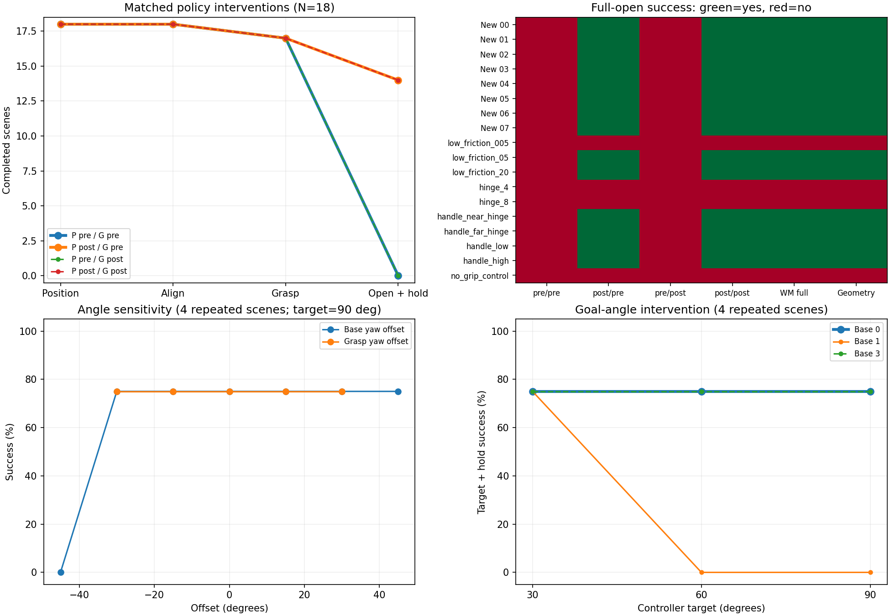
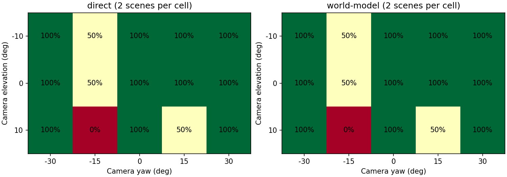

# H-JEPA stage and angle experiments (2026-10-17)

The complete official model is frozen. **504 evaluation records** include 360 scene candidates, 84 execution/target-angle records, and 60 camera-view records. There are 482 executor calls and 389 dynamic integrations; vision/initial-IK rejections still count as failures rather than completed dynamics.

Eight fresh random scenes use seed=20261017, alongside 9 physical stress scenes and 1 no-grip control. Camera experiments reuse two fresh scenes and angle scans four; shared records are not independent scenes.

P/G each have pre/post versions: supervised-warmup `best.pt` and `selected.pt` after 100 alternating offline updates. World-model, value-head, and normalization tensors match exactly. Candidate outcomes support post hoc evaluation only, not test-time ranking, training, or tuning.



## Separate policy effects

| Combination | Position | Align | Grasp | Open + hold | Success rate | Safe opening fraction |
|---|---:|---:|---:|---:|---:|---:|
| P_pre/G_pre | 18 | 18 | 17 | 0 | 0.0% | 0.421 |
| P_post/G_pre | 18 | 18 | 17 | 14 | 77.8% | 0.831 |
| P_pre/G_post | 18 | 18 | 17 | 0 | 0.0% | 0.421 |
| P_post/G_post | 18 | 18 | 17 | 14 | 77.8% | 0.831 |
| fixed/G_post | 18 | 18 | 17 | 14 | 77.8% | 0.830 |
| P_post/world/h0.25 | 18 | 18 | 17 | 14 | 77.8% | 0.831 |
| P_post/world/h0.5 | 18 | 18 | 17 | 14 | 77.8% | 0.831 |
| P_post/world/h1.0 | 18 | 18 | 17 | 14 | 77.8% | 0.831 |
| P_post/geometry | 18 | 18 | 17 | 14 | 77.8% | 0.831 |

Every denominator is 18 scenes. Position means reachable grasp/pregrasp IK; Align means completing the 2.5 s approach without prior collision; Grasp means stable bilateral contact; Open + hold means reaching the target and holding for one second. Grasp acquisition is not full-task success.

| Scene group | P_pre/G_pre | P_post/G_pre | P_pre/G_post | P_post/G_post |
|---|---:|---:|---:|---:|
| negative_control | 0/1 | 0/1 | 0/1 | 0/1 |
| new_in_range | 0/8 | 8/8 | 0/8 | 8/8 |
| stress | 0/9 | 6/9 | 0/9 | 6/9 |

Fix reached states, images, and bases to compare grasp policies over 18x5=90 reached states, including upstream failures:

| Grasp version | Position | Align | Grasp | Open + hold |
|---|---:|---:|---:|---:|
| pre | 69 | 69 | 65 | 28 |
| post | 69 | 69 | 65 | 28 |

Paired effects replacing one policy at a time:

| Replacement | Success-rate change, percentage points | Improved/degraded scenes | Changed decisions |
|---|---:|---:|---:|
| position_update_with_G_pre | +77.8 | 14/0 | 18 |
| grasp_update_with_P_pre | +0.0 | 0/0 | 18 |
| position_update_with_G_post | +77.8 | 14/0 | 18 |
| grasp_update_with_P_post | +0.0 | 0/0 | 18 |

Updated P selects base [3] in all 18 scenes. Fixed nominal base 0 also succeeds 14/18, so the update corrects a poor station preference without establishing improvement over a good fixed station or broad adaptive positioning.

Post hoc physical candidate coverage is 14/18 scenes with at least one successful candidate. This oracle summary is not deployed or used for action selection.

## Remaining failures after updates

| Scene | Stop reason | Final angle | Failure stage |
|---|---|---:|---|
| low_friction_005 | slip_or_contact_loss | 0.001° | opening |
| hinge_4 | slip_or_contact_loss | 63.114° | opening |
| hinge_8 | slip_or_contact_loss | 27.638° | opening |
| no_grip_control | grasp_not_acquired | 0.000° | grasp |

## Angles and vision

Base yaw offsets span -45 to 45 degrees, grasp yaw -30 to 30, and targets 30/60/90 degrees. Partial-opening tests change the physical trajectory and require final-second error <=2 degrees, sustained bilateral contact, and low angular velocity. They assess the controller; H-JEPA is not trained as a target-angle-conditioned model.

| Scan | Angle | Success / records | Mean final angle |
|---|---:|---:|---:|
| base_yaw | -45° | 0/4 | 44.51° |
| base_yaw | -30° | 3/4 | 67.24° |
| base_yaw | -15° | 3/4 | 67.24° |
| base_yaw | 0° | 3/4 | 67.24° |
| base_yaw | 15° | 3/4 | 67.24° |
| base_yaw | 30° | 3/4 | 67.24° |
| base_yaw | 45° | 3/4 | 67.24° |
| grasp_yaw | -30° | 3/4 | 67.34° |
| grasp_yaw | -15° | 3/4 | 67.27° |
| grasp_yaw | 0° | 3/4 | 67.24° |
| grasp_yaw | 15° | 3/4 | 67.25° |
| grasp_yaw | 30° | 3/4 | 67.33° |
| target_base0 | 30° | 3/4 | 22.30° |
| target_base0 | 60° | 3/4 | 44.75° |
| target_base0 | 90° | 3/4 | 67.25° |
| target_base1 | 30° | 3/4 | 22.31° |
| target_base1 | 60° | 0/4 | 32.15° |
| target_base1 | 90° | 0/4 | 31.87° |
| target_base3 | 30° | 3/4 | 22.30° |
| target_base3 | 60° | 3/4 | 44.77° |
| target_base3 | 90° | 3/4 | 67.24° |



| Camera test method | Success / records | Failure stage |
|---|---:|---|
| direct | 25/30 | {'arrival_perception': 5} |
| world-model | 25/30 | {'arrival_perception': 5} |

## Scope and reproduction

Positioning updates improve downstream feasibility; grasp-only updates do not improve complete openings on these fresh scenes. Fixed-base, direct, and geometry controls remain necessary; a world-model advantage is unestablished. Initial RGB does not reveal friction/hinge resistance or provide post-contact material identification. Camera failures count as vision failures rather than grasp/opening capability.

These results do not tune or retrain weights. One seed, eight random scenes, and deliberately constructed stress cases do not establish broad generalization or significance. Use a new test seed after the next model change.

```powershell
.\.venv\Scripts\python.exe evaluate_hjepa_stages.py --device cuda
.\.venv\Scripts\python.exe evaluate_hjepa_views.py --device cuda
.\.venv\Scripts\python.exe report_hjepa_stages.py
.\.venv\Scripts\python.exe check_git_size.py
```

Detailed JSON, candidate outcomes, and checkpoint/source SHA256 records are in ignored `runs/hjepa/{stage_evaluation,view_evaluation}/`. Fourteen code tests and 8 baseline regressions pass. Git checks reject visible files/staged blobs over 10 MiB; model/data/video outputs stay outside version control.
