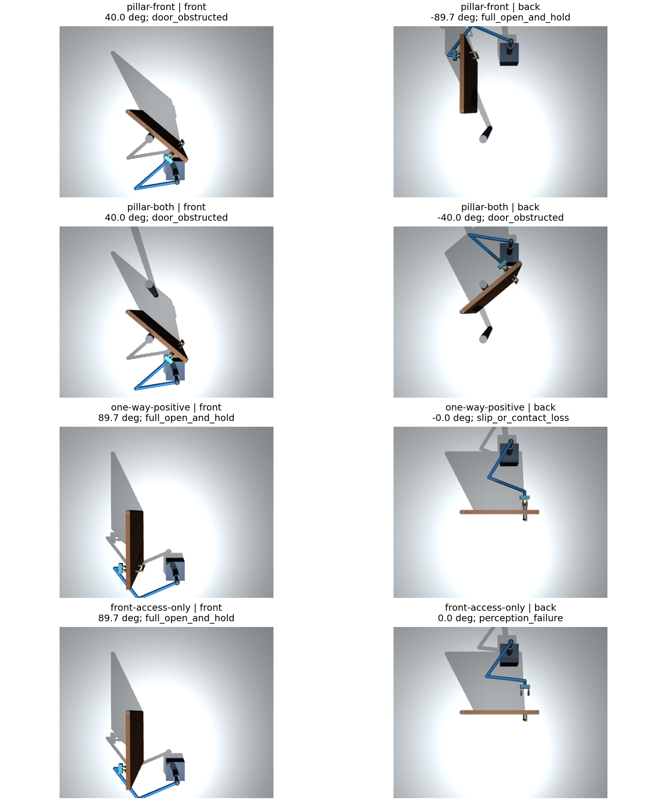

# Structural door-constraint experiments (2026-10-17)

Scenes add physical pillars, one-/two-way hinges, and independent front/back handles. MuJoCo contact blocks door motion without scene-name failure rules. Front pulling produces positive hinge angles, back pulling negative; the base stays fixed during opening.

**Changing stations cannot bypass the same obstructed door trajectory.** A two-way door can turn oppositely; if a pillar blocks a one-way door's only allowed direction, the current candidate library has no complete-opening solution.



All panels show top views: blue arm, brown door, gray pillars. Each uses the neutral-grasp terminal state on its respective side, or reached state if no handle is visible.

## Frozen-checkpoint measurements

Use complete official-model pre-update `best.pt` and post-update `selected.pt`. Shared world-model, value, and normalization tensors match; no training/test tuning occurs. Each side has two bases with four grasps each, totaling four bases. **Back-side bases, reversed actions, and new structures are outside old training data**; these are capability checks rather than adapted-model results.

| Method | Success /9 | Position -> Align -> Grasp -> Open/Hold |
|---|---:|---|
| P_pre/G_pre | 4/9 | 7 → 7 → 7 → 4 |
| P_pre/G_post | 4/9 | 7 → 7 → 7 → 4 |
| P_post/G_pre | 4/9 | 8 → 8 → 8 → 4 |
| P_post/G_post | 4/9 | 8 → 8 → 8 → 4 |
| fixed-front/G_post | 4/9 | 8 → 8 → 8 → 4 |
| fixed-back/G_post | 4/9 | 7 → 7 → 7 → 4 |
| P_post/world/h0.25 | 4/9 | 8 → 8 → 8 → 4 |
| P_post/world/h0.5 | 4/9 | 8 → 8 → 8 → 4 |
| P_post/world/h1.0 | 4/9 | 8 → 8 → 8 → 4 |
| geometry-side | 7/9 | 9 → 9 → 9 → 7 |

## Physically feasible sides

| Scene | Candidate-verified feasible side | Old P/G | Updated P/G | Known-geometry side selection |
|---|---|---|---|---|
| free-two-way | back, front | back: success | front: success | back: success |
| pillar-front | back | back: success | front: door_obstructed | back: success |
| pillar-back | front | back: door_obstructed | front: success | front: success |
| pillar-both | No complete-opening candidate | back: door_obstructed | front: door_obstructed | back: door_obstructed |
| one-way-positive | front | back: slip_or_contact_loss | front: success | front: success |
| one-way-negative | back | back: success | front: slip_or_contact_loss | back: success |
| front-access-only | front | back: perception_failure | front: success | front: success |
| back-access-only | back | back: success | front: perception_failure | back: success |
| front-only-blocked | No complete-opening candidate | back: perception_failure | front: door_obstructed | front: door_obstructed |

Full-path known-geometry screening executes 7 scenes successfully and correctly refuses 2, with 0 false refusals. Refusal is not opening success. This privileged reference reads geometry/hinge ranges unavailable to learned policy/latent rollout.

## Physical interpretation and limitations

- `pillar-front/back`: the door hits a pillar near 40 degrees; only the opposite turn reaches 90.
- `pillar-both`: both turns are blocked; changing only base or grasp does not complete opening.
- `one-way-positive/negative`: both sides have handles, but hinge limits permit one turn. A wrong-side fixed pulling skill can grasp but slips while failing to move the door. The action library lacks pushing, so this does not establish impossibility of every skill on that side.
- `front/back-access-only`: only the designated face has a handle. A separate geometry diagnostic confirms collision when reaching through the door from behind; it is not a perception-failure fallback.
- `front-only-blocked`: one-sided handle, one-way hinge, and pillar in the permitted direction leave no complete-opening candidate.
- The learned selector always chooses an action; it has no trained refusal/side-switch behavior or calibrated feasibility threshold. Physical collision stops are executor protection rather than advance model predictions.
- Arrival switches cameras to the operating face and refreshes calibrated RGB-D. Switching sides still resets the simulator; navigation around the door and automatic regrasping are not implemented.

## Records and reproduction

There are 144 candidate evaluations, 120 executor calls, and 120 dynamic integrations. Classify failures by reached observation, IK, approach, stable grasp, and final opening/hold. Save neutral-grasp joints at 0/2.5/3.5 s and termination.

```powershell
.\.venv\Scripts\python.exe evaluate_hjepa_structure.py --device cuda
.\.venv\Scripts\python.exe run_hjepa.py --scenario pillar-front --base-mode fixed --fixed-base-id 2 --method geometry --output runs/hjepa/structural_demo
.\.venv\Scripts\python.exe -m unittest test_structural_scene test_hjepa test_hjepa_stages test_git_size -v
```

JSON, candidate CSV, and source/checkpoint SHA256 records are in ignored `runs/hjepa/structural_evaluation/`. Older parameter/angle reports bind their original source. If source verification changes on rerun, specify a new `--output` rather than mixing caches.
