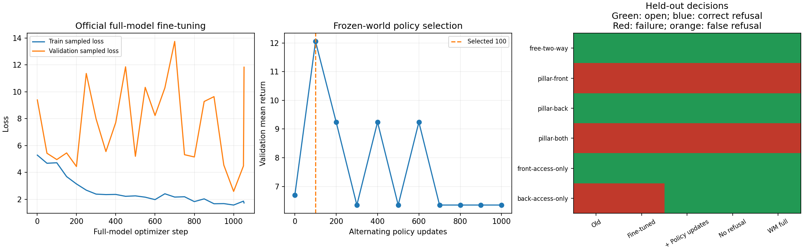

# Full H-JEPA training on structural scenes (2026-10-17)

Continue all world-model weights from the official full checkpoint for **9 epochs / 1053 steps**. Retain 23,324,422 parameters, batch 128, bf16-mixed, 224x224 inputs, two official levels, and ViT recomputation.

**On held-out testing, old/new models open 3/5 and 4/5 feasible scenes. One single-pillar scene still selects the wrong side, and the double-pillar case is not correctly refused. Lookahead has not surpassed direct execution.**

Training takes 43.2 minutes, with PyTorch peak allocation 2848.3 MiB and reservation 3514.0 MiB, excluding collection and subsequent policy optimization with frozen world model.

Data comprise 24 fresh scenes (12 train / 6 val / 6 test), 408 records, 40,518 frames, and about 5.68 GiB native images. Scenes include two-way doors, single/double pillars, and one-sided handles. All bases/grasps from one scene share its split. Test scenes do not enter training, normalization, checkpoint selection, or policy updates.



## Six held-out scenes

| Method | Full opening | Correct refusal | False refusal | Correct decisions | Collisions |
|---|---:|---:|---:|---:|---:|
| old_checkpoint | 3/5 | 0 | 0 | 3/6 | 2 |
| P_pre/G_pre | 3/5 | 0 | 0 | 3/6 | 2 |
| P_pre/G_post | 3/5 | 0 | 0 | 3/6 | 2 |
| P_post/G_pre | 4/5 | 0 | 0 | 4/6 | 2 |
| P_post/G_post | 4/5 | 0 | 0 | 4/6 | 2 |
| trained_four_actions | 4/5 | 0 | 0 | 4/6 | 2 |
| world_h0.25 | 4/5 | 0 | 0 | 4/6 | 2 |
| world_h0.5 | 4/5 | 0 | 0 | 4/6 | 2 |
| world_h1.0 | 4/5 | 0 | 0 | 4/6 | 2 |

Full-opening denominators count scenes with successful candidates. Correct decisions include complete openings and infeasible refusals, with refusals excluded from opening success. Old has four execution candidates; new policies add a zero-feature refusal candidate without more parameters. `trained_four_actions` removes refusal to compare side selection with the same four actions.

| Scene | Old model | New policy | Full world-model prediction horizon |
|---|---|---|---|
| free-two-way | front: success | front: success | front: success |
| pillar-front | front: door_obstructed | front: door_obstructed | front: door_obstructed |
| pillar-back | front: success | front: success | front: success |
| pillar-both | front: door_obstructed | back: door_obstructed | back: door_obstructed |
| front-access-only | front: success | front: success | front: success |
| back-access-only | front: perception_failure | back: success | back: success |

## Training and selection

Validation loss selects world-model step 1000. Then perform 1000 alternating offline policy updates, selecting both policies at update 100 by validation return. Evaluate every 100 updates including the initial candidate, without test-based step selection. Tensor audits confirm the world model stays frozen in this stage.

World-model training uses official prediction loss on physical trajectories plus task value/policy supervision. P uses each training base's best measured downstream return; G uses physical grasp/opening return. Refusal always returns 0, without feasibility truth, invented trajectories, or reached-grasp images. Additional policy optimization uses frozen encodings/cached training returns: finite-candidate offline policy gradient rather than online PPO/GRPO.

Replay all 6 fresh test scenes with live RGB-D/contact dynamics and assert selected actions/outcomes match held-out candidates. Future candidate returns are used for scoring only after action selection.

## Reproduction and limitations

Six held-out scenes and one seed do not establish broad generalization or significant superiority over geometry. Compute pre/post policies on the same world model separately from the old-model baseline to avoid mixing representation spaces. Hidden one-way hinges without visual cues are excluded from main training; identical closed-door images cannot reveal hidden turn limits. Retain fixed pulling, simulator base placement, and calibrated gold-handle vision.

```powershell
.\.venv\Scripts\python.exe run_hjepa.py --checkpoint runs/hjepa/structural_model/selected.pt --scenario pillar-front --output runs/hjepa/structural_trained_demo
.\.venv\Scripts\python.exe evaluate_structural_training.py --device cuda
.\.venv\Scripts\python.exe report_structural_training.py
```

Models, data, and logs remain in ignored `runs/hjepa/structural_{data,model,trained_evaluation}/`. Model directories preserve initialization SHA256, launch source snapshots, and manifest hashes. Git stores small source/docs/figures rather than weights/arrays.

## Validation-based positioning representation refit

Validation mean return before refit is 12.056 and after fitting P on the same ViT's pre-projection CLS is 9.165. Accepted: False.

Only the original positioning MLP updates; H-JEPA core, predictors, value heads, and G remain identical. Training returns provide temperature-0.03 soft-label ranking; training-feature normalization is folded into the first affine layer. Add no parameters or geometry truth. Fit 300 steps and select step 60 on validation without test involvement.

The candidate does not improve validation, so retain projected features and matching pre/post policy interfaces. Development also tried frozen-head return regression, ranking, and overhead observation rehearsal. Select by validation return without adding unsuccessful extra-camera variants to the final policy. More independent scenes are needed after small-set model selection.

```powershell
.\.venv\Scripts\python.exe refit_structural_position.py
```

## Supplementary checks on earlier structures

These debugging cases are supplemental and excluded from the six fresh held-out metrics. Two hidden one-way cases have identical initial RGB-D without visible turn cues.

| Scene | New-policy decision | Outcome |
|---|---|---|
| free-two-way | front | full_open_and_hold |
| pillar-front | back | full_open_and_hold |
| pillar-back | front | full_open_and_hold |
| pillar-both | back | door_obstructed |
| one-way-positive | front | full_open_and_hold |
| one-way-negative | front | slip_or_contact_loss |
| front-access-only | front | full_open_and_hold |
| back-access-only | back | full_open_and_hold |
| front-only-blocked | back | perception_failure |
