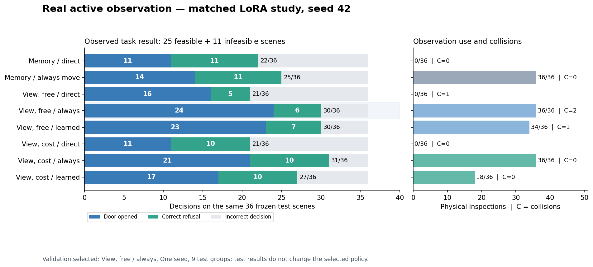

# 移动开门与真实主动观察实验（2026-11-09）

本轮完成三组各 480 步的 H-JEPA LoRA 续训，以及 288 次实际物理策略回放。验证集选定 `view_free_always`：新测试集上完整开门 **24/25 个可开场景**，正确决策 **30/36**；初始图像对照为 11/25、22/36。该策略仍有 2 次碰撞，安全拒绝尚未解决。

## 场景、移动与训练范围

- 144 个新场景，训练/验证/测试为 **72/36/36**，即 18/9/9 组。每组共享门、把手、摩擦与初始位置，分别布置前侧阻挡、后侧阻挡、两侧阻挡、无阻挡；整组划分，避免同一外观跨训练和测试。
- 支持 lever、t-bar、d-pull、offset-bar 四种既有把手，以及六种门外观。几何、把手位置和摩擦有连续扰动。这是已知类别的新参数组合。
- 底盘采用 x/y/yaw 伺服的理想全向模型，A* 使用已知 MuJoCo 几何；机械臂以 RRT 准备抓持。检查器使用独立 `MjData`，执行由 `mj_step` 推进。
- 真实执行“初始观察 → 可选绕到背面观察 → 选择站位 → 行走 → 准备抓持 → 接触开门”。每个回合只初始化一次；本轮开门阶段保持所选底盘站位。门铰链保持被动。
- 相机随底盘移动。策略初次决策只收到当前 RGB/proprio；第二次决策读取真正到达观察点后的新图像；抓持策略只在站位到达后读取到达图像。
- 原 H-JEPA 核心、归一化统计和历史实验保留。仅更新原有 rank-8 编码器 LoRA 与 P/G 策略。固定 seed=42，Python/NumPy/Torch/CUDA 与启动时的 Python hash seed 均有回执。
- 本轮固定夹爪力 6 N、角度 −15°/22°。主分支的独立 29 角度抓持实验继续保留。


图中是冻结策略的实际回放轨迹和采集图像：同一回合累计移动 4.62 m，仿真持续 63.73 s；起始图像受到前方遮挡，移动后重新获得门的另一侧图像。地面示意使用已知场景几何。

## 定位、抓持、开门与观察的 reward

本轮采用任务流监督，P 和 G 分别学习其后续执行回报：

```text
U(branch, base, grasp) = 2 × 完整成功 − 1 − 后续碰撞
拒绝执行的价值 = 0

G 的目标：实际观察到抓持输入后，对应动作的 U
P0 的目标：不观察分支中，当前 G0 所选动作的实际 U
P1 的目标：观察分支中，当前 G1 所选动作的实际 U

观察成本 = 0.2 × 实际观察路径(m)/6
         + 0.1 × 实际观察耗时(s)/60
I 的目标 = 当前 P1/G1 所选后续执行的实际回报 − 观察成本
```

监督标签从训练场景的完整物理反事实表中查询。后续 P/G 选择停止梯度，每 40 次更新只在训练集刷新；观察标签对应当前后续策略的选择，而非预知哪个动作最终成功后挑选最优动作。P0、P1、I 共用现有 P 网络和不同的真实相对目标指令；没有为某个对照额外增加网络容量。

训练损失为 `LP0 + LP1 + 0.5×(LG0+LG1) + LI`。未获得抓持观察的动作屏蔽 G 监督；不安全的观察立即结束回合，并屏蔽后续 P/G 标签。观察后拒绝仍支付已发生的观察成本，每回合最多观察一次。

这样，走到站位和部分开门不会单独抵消错误站位或最终失败；定位的目标与当前抓持、开门的实际后果保持关联。旧版阶段分解与二值对照代码仍保留在 `staged_mobile_reward.py`、`mobile_crossed_v2.py`。

## 对照与冻结规则

三组模型使用同一批两分支数据，每场景 2×4×2=16 次从头执行的候选，共 **2,304 次候选执行**。每次更新均处理 2 个场景、同等数量的图像与策略输入。

| 模型 | 观察后的图像输入 | 训练时观察成本 |
| --- | --- | --- |
| `repeat` | 重用初始图像；仍输入实际到达状态与相对目标 | 有 |
| `view_free` | 实际新视角图像 | 0 |
| `view_cost` | 实际新视角图像 | 有 |

`repeat` 测试直接执行和始终移动；另外两模型各测试直接执行、始终观察、自主决定观察，共 8 组策略。**所有测试策略均按相同正成本计算净回报**；`free` 只描述训练目标。

初始化来自前轮验证集选定的 `fixed_binary_grouped/selected.pt`。各模型按验证集选择检查点，依次比较正确决策数、碰撞、完整开门、净回报、路径、观察数；跨模型采用相同规则，完全相同则按预先声明的策略顺序。选中步数为 repeat=400、view_free=440、view_cost=280。

验证集的正确决策数为 20、24、19、31、31、20、30、26（顺序与下表一致）；`view_free_always` 在声明的平局规则下被选中。选定模型、策略及哈希写入 `frozen_for_test.json` 后才采集测试结果，文件时间顺序也已核验。

## 新测试结果

可开场景定义为两条实际分支中任一候选成功的共同并集：25 个可开、11 个当前候选集合均未成功。正确决策是完整开门，或在当前集合不可开时拒绝。

| 策略 | 完整开门 /25 | 正确拒绝 /11 | 误拒绝 | 正确决策 /36 | 碰撞 | 观察次数 | 平均净回报 |
| --- | ---: | ---: | ---: | ---: | ---: | ---: | ---: |
| 初始图像，直接执行 | 11 | 11 | 14 | 22 | 0 | 0 | 0.3056 |
| 移动后仍用旧图像 | 14 | 11 | 11 | 25 | 0 | 36 | 0.2068 |
| 新视角模型，直接执行 | 16 | 5 | 5 | 21 | 1 | 0 | 0.1389 |
| **新视角模型，始终观察〔验证选定〕** | **24** | **6** | **1** | **30** | **2** | **36** | **0.2902** |
| 新视角模型，自主观察 | 23 | 7 | 2 | 30 | 1 | 34 | 0.3280 |
| 代价模型，直接执行 | 11 | 10 | 10 | 21 | 0 | 0 | 0.1667 |
| 代价模型，始终观察 | 21 | 10 | 4 | 31 | 0 | 36 | 0.3735 |
| 代价模型，自主观察 | 17 | 10 | 8 | 27 | 0 | 18 | 0.3538 |



可以作出的判断：

1. 实际新视角在本批测试上有帮助。同一 `view_free` 权重从直接执行变为始终观察，开门从 16 增至 24；同等移动、同等训练计算但仍读旧图像的独立模型为 14。移动自身也有收益，不能把全部提升都归因于图像。
2. 代价确实改变了观察行为：自主观察从 34 次降至 18 次，平均观察成本从 0.1720 降至 0.0906。但开门从 23 降至 17；代价模型自主观察的净回报也低于其始终观察对照，观察选择还没有取得最佳折中。
3. 所选策略在不可开场景上正确拒绝 6/11，仍有 5 次不必要尝试、2 次流程碰撞。碰撞发生在开门续段，观察路径均安全完成。测试中 `view_cost_always` 的正确决策更高，但仍保留验证集选定的主结果。

测试仅有 9 个相关场景组、一个训练种子。按组做探索性配对分析，主策略比初始图像对照多 8 次正确决策，比移动旧图像对照多 5 次；两项组级精确符号翻转检验均为 p=0.0625，且未作多重比较校正。结果支持继续研究，尚不足以宣称跨种子稳定的统计优势。

训练/验证观察审计另找到 1 组“初始 RGB、proprio 完全相同但可开性相反”的输入；实际观察后两图像不同，平均像素差 52.84/255。该检查不读取测试数据，也不意味着其余错误都由遮挡造成。

## 物理与权重核验

- **288/288** 次策略回放与离线所选动作、成功、拒绝、碰撞结果一致，每个回合初始化次数均为 1。
- **141** 次实际进入开门技能，入口 qpos/qvel 与前一阶段逐位一致；时间轴连续。
- **160** 次实际观察均到达；检查观察期间门未被提前推开，路径无碰撞。
- 最大记录底盘平移速度 **0.28124 m/s**，相邻记录最大位移 **0.01641 m**；底盘目标限速 0.3 m/s。
- 三组模型的 selected/last 均审计：**422 个原非策略、非 LoRA 张量**以及归一化统计逐位不变。每个 selected 检查点实际变化为 148 个 LoRA 张量、6 个 P 张量和 6 个 G 张量。
- 当前与保存的 **101 份源码/配置**哈希一致；原始初始化、历史冻结文件、manifest、选中权重哈希均保持。
- 回迁到当前主分支后 **32 项契约测试通过**，包括真实移动后开门、被动门铰链、无中途重置、图像使用时机、训练标签屏蔽和碰撞检查。

## 运行记录与工作区恢复

本地提交，无排队。启动预计 6 小时；05:57:09 启动，PID **25444**，权威工具会话 **65833**，启动约 8 秒。代理首次连续休眠约 21,571 秒，到期确认仍存活，再依仓库规则各休眠 30 分钟。12:48:44 完成，原会话最终退出码 **0**。实际 **24,694.37 秒，约 6 小时 52 分钟**。

| 阶段 | 实际秒 | 实际分钟 |
| --- | ---: | ---: |
| 训练/验证采集，2 workers | 9,309.05 | 155.15 |
| repeat 训练、刷新目标与验证 | 4,094.25 | 68.24 |
| view_free 训练、刷新目标与验证 | 3,526.11 | 58.77 |
| view_cost 训练、刷新目标与验证 | 2,394.24 | 39.90 |
| 冻结后的测试采集，2 workers | 2,618.56 | 43.64 |
| 8 组物理回放 | 2,658.59 | 44.31 |
| 启动、I/O 与其余核验 | 93.57 | 1.56 |

采集与 GPU 训练没有并发。三组模型实际平均更新速度为 5.58、4.80、3.27 秒/步，前两组慢于小规模实测；未采集利用率时间序列，不能确定变慢原因。下一次估时应采用本批完整阶段耗时和实际场景组成，保守计入目标刷新与验证。

此前小规模流程完成了采集、三模型各 2 步更新和 32 次回放，但工作区在 05:23 执行外部 reset/pull、清理未跟踪源码，最后源码核验失败。失败回执原样保留。随后在 ignored `runs/` 内建立 detached worktree，按启动源码快照恢复环境，重新通过 26 项测试、32 次回放及权重核验；正式实验在该隔离目录完成。当前主分支的 `simulate.py` 和新合入的抓持角度修改均保留。

本地结果入口为 `runs/mobile_active_seed42_20261109/`，它指向 ignored 隔离目录里的正式结果。数组、模型、日志全部保持忽略：

- [主结果](../runs/mobile_active_seed42_20261109/report.json)
- [冻结前选择与哈希](../runs/mobile_active_seed42_20261109/frozen_for_test.json)
- [完整权重、运动与配对核验](../runs/mobile_active_seed42_20261109/final_verification.json)
- [协议](../runs/mobile_active_seed42_20261109/protocol.json)
- [启动源码](../runs/mobile_active_seed42_20261109/source/)

## 继续实验

下一轮在训练/验证集上先冻结后观察 P/G，再校准观察及拒绝决策，比较减少观察与降低误拒绝的关系；同时考虑把门扇扫掠碰撞检查纳入开门规划。超参数、阈值、检查点均由训练/验证决定，使用新 stream、新输出目录和新的冻结测试场景。当前测试集转为历史比较。

当前代码可用新的目录和 stream 启动完整复现实验，例如 PowerShell：

```powershell
$env:PYTHONHASHSEED = '42'
.venv\Scripts\python.exe run_mobile_active_experiment.py `
  --output runs/mobile_active_seed42_new `
  --stream mobile_active_v3_new `
  --steps 480 --workers 2 --estimate-seconds 25200
```

`25200` 为按本次完整运行向上取整的 7 小时保守预算，队列单独记录；新实验仍须按实际启动和负载修订。输出目录非空会拒绝覆盖。正式结果始终绑定其启动时源码，回迁版本另加入了本批 manifest 的历史去重检查。

方法参考：本轮借鉴 [Observe Then Act](https://arxiv.org/abs/2409.14891) 中先获得新观察、再执行操作并关联后续任务价值的组织方式；参考 [TAMPAgent](https://arxiv.org/abs/2611.03584) 将观测与运动约束放入执行、重规划链路的思路。这里采用离线反事实监督和已知几何规划，未复现论文的完整系统。
