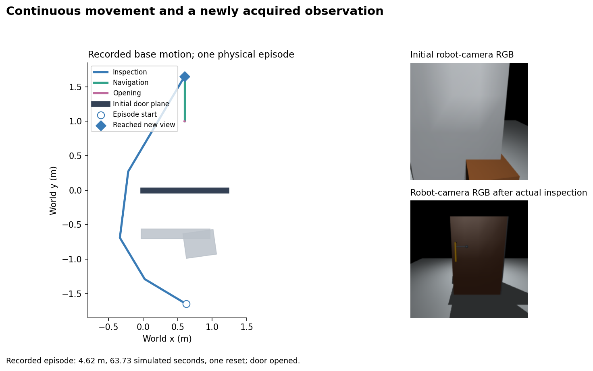

# Mobile door opening and physical active inspection (2026-11-09)

Three H-JEPA LoRA arms each complete 480 updates, followed by 288 physical policy replays. Validation selects `view_free_always`: **24/25 feasible openings**, **30/36** correct decisions on the fresh test, versus 11/25 and 22/36 for the initial-image control. Primary still has 2 collisions and unresolved safe-refusal failures.

## Scenes, motion, and training scope

- 144 fresh scenes split **72/36/36** across training/validation/test, or 18/9/9 groups. Each group shares door, handle, friction, and initial pose, with front/rear/both/no-obstacle layouts. Split complete groups to prevent shared appearance across training/testing.
- Four familiar handles (lever, t-bar, d-pull, offset-bar) and six door appearances, with continuous perturbations to geometry, handle position, and friction. These are fresh parameter combinations within known categories.
- An ideal x/y/yaw holonomic servo base uses A* on known MuJoCo geometry; the arm uses RRT preparation. Geometry checks use separate `MjData`; execution advances with `mj_step`.
- Execute initial observation -> optional rear-side inspection -> station selection -> navigation -> grasp preparation -> contact opening, with one initialization per episode. Hold the selected base station during opening; retain a passive door hinge.
- Cameras move with the base. Initial decisions receive current RGB/proprio only; inspection decisions use newly captured reached-view images, and grasp decisions use images captured after station arrival.
- Preserve original H-JEPA core, normalization, and historical experiments. Update only existing rank-8 encoder LoRA and P/G policies. Fix seed=42 and record Python/NumPy/Torch/CUDA/startup hash seeds.
- Fixed gripper force cap 6 N and angles -15/+22 degrees. Preserve the independent 29-angle grasp experiment on the main branch.



The figure uses an actual frozen-policy replay and recorded images: 4.62 m traveled in 63.73 simulated seconds. The initial view is obstructed; moving around the door reveals the opposite side. The floor diagram uses known scene geometry.

## Positioning, grasping, opening, and inspection rewards

Task-flow supervision trains P and G on their downstream execution returns:

```text
U(branch, base, grasp) = 2 * complete_success - 1 - downstream_collision
Refusal value = 0

G target: actual U of the action after obtaining its grasp observation
P0 target: actual U of the action selected by current G0 on the direct branch
P1 target: actual U of the action selected by current G1 on the inspected branch

Inspection cost = 0.2 * actual_inspection_path(m)/6
                + 0.1 * actual_inspection_time(s)/60
I target = actual return of continuation selected by current P1/G1 - inspection cost
```

Query labels from complete physical counterfactual tables for training scenes. Detach downstream P/G choices and refresh every 40 updates on training only. Inspection labels follow the current continuation rather than selecting a successful action afterward. P0, P1, and I share the existing P network with different physical relative-target commands; controls add no capacity.

Loss is `LP0 + LP1 + 0.5*(LG0+LG1) + LI`. Mask G labels where no grasp observation exists. Unsafe inspection terminates the episode and masks downstream P/G. Refusal after inspection still pays its incurred cost. At most one inspection per episode.

Reaching a station or partially opening does not offset a wrong station or terminal failure. Positioning targets remain tied to current grasp/opening consequences. Preserve earlier stage-factorized/binary controls in `staged_mobile_reward.py` and `mobile_crossed_v2.py`.

## Controls and freezing rules

All three models use the same two-branch data: 2x4x2=16 independently initialized candidates per scene, totaling **2,304 executions**. Each update processes 2 scenes with matching image and policy-input counts.

| Model | Image after inspection | Inspection cost during training |
| --- | --- | --- |
| `repeat` | Initial image reused; actual reached state and relative target retained | Yes |
| `view_free` | Actual reached-view image | 0 |
| `view_cost` | Actual reached-view image | Yes |

Test repeat under direct/always-move modes, and each other model under direct/always/learned inspection: 8 policies. **All test net utilities use the same positive cost**; free refers only to training.

Initialize from earlier validation-selected `fixed_binary_grouped/selected.pt`. Select each model by validation correctness, collisions, full openings, net utility, path length, and inspection count. Use the same rule across models, with preregistered policy order on exact ties. Selected updates: repeat=400, view_free=440, view_cost=280.

Validation correctness is 20, 24, 19, 31, 31, 20, 30, 26 in table order. The declared tie rule selects `view_free_always`. Collect test outcomes only after recording selected model/policy/hashes in `frozen_for_test.json`; file chronology is verified.

## Fresh test results

Feasibility is the union of successful candidates across both physical branches: 25 feasible scenes and 11 with no successful library candidate. Correct decisions are complete openings or refusals on library-infeasible scenes.

| Policy | Full open /25 | Correct refusal /11 | False refusal | Correct /36 | Collisions | Inspections | Mean net utility |
| --- | ---: | ---: | ---: | ---: | ---: | ---: | ---: |
| Initial image, direct | 11 | 11 | 14 | 22 | 0 | 0 | 0.3056 |
| Move but reuse initial image | 14 | 11 | 11 | 25 | 0 | 36 | 0.2068 |
| Reached-view model, direct | 16 | 5 | 5 | 21 | 1 | 0 | 0.1389 |
| **Reached-view model, always inspect (validation selected)** | **24** | **6** | **1** | **30** | **2** | **36** | **0.2902** |
| Reached-view model, learned inspection | 23 | 7 | 2 | 30 | 1 | 34 | 0.3280 |
| Cost model, direct | 11 | 10 | 10 | 21 | 0 | 0 | 0.1667 |
| Cost model, always inspect | 21 | 10 | 4 | 31 | 0 | 36 | 0.3735 |
| Cost model, learned inspection | 17 | 10 | 8 | 27 | 0 | 18 | 0.3538 |


Findings:

1. Reached views help on this test. With the same view_free weights, openings increase from 16 direct to 24 always-inspect. An independently trained, matched-motion/compute model reusing the initial image opens 14. Motion also helps, so gains are not entirely due to images.
2. Cost changes inspection behavior from 34 to 18 inspections and mean cost from 0.1720 to 0.0906, but openings drop from 23 to 17. The cost model's learned-inspection utility is below its always-inspect control, so selection has not found the best tradeoff.
3. Selected primary correctly refuses 6/11 infeasible scenes, with 5 unnecessary attempts and 2 pipeline collisions. Collisions occur during opening; inspection paths are safe. Retain validation-selected primary despite higher test correctness from view_cost_always.

Testing covers 9 correlated groups and one training seed. Exploratory grouped pairing gives 8 more correct decisions than initial-image control and 5 more than moving/old-image control. Both exact group sign-flip tests give p=0.0625, without multiplicity correction; stable cross-seed significance is not established.

A training/validation audit finds one group with identical initial RGB/proprio but opposite feasibility. Reached images differ, with mean pixel difference 52.84/255. This audit does not read test data or attribute every remaining error to occlusion.

## Physics and weight verification

- **288/288** replays match offline selected actions, success, refusal, and collision outcomes; every episode initializes once.
- **141** opening entries preserve preceding qpos/qvel bitwise with continuous time.
- **160** physical inspections reach their targets without early door motion or path collisions.
- Maximum recorded translation speed **0.28124 m/s**, adjacent displacement **0.01641 m**; target speed cap 0.3 m/s.
- Selected/last checkpoints for all three models preserve **422 non-policy, non-LoRA tensors** and normalization bitwise. Each selected checkpoint changes 148 LoRA, 6 P, and 6 G tensors.
- Current and archived **101 source/configuration** hashes match. Preserve initialization, historical frozen files, manifest, and selected-weight hashes.
- After integration, **32 contracts pass**, covering opening after real motion, passive hinge, no intermediate reset, image timing, label masking, and collision checking.

## Runtime and workspace recovery

Local run, no queue. Initial estimate 6 hours; launch 05:57:09, PID **25444**, session **65833**, startup about 8 seconds. Sleep continuously for about 21,571 seconds, then inspect the still-live session and extend in 30-minute intervals under repository rules. Completion 12:48:44; final exit **0**. Actual **24,694.37 seconds, about 6 hours 52 minutes**.

| Phase | Actual seconds | Actual minutes |
| --- | ---: | ---: |
| Training/validation collection, 2 workers | 9,309.05 | 155.15 |
| repeat training, label refresh, validation | 4,094.25 | 68.24 |
| view_free training, label refresh, validation | 3,526.11 | 58.77 |
| view_cost training, label refresh, validation | 2,394.24 | 39.90 |
| Post-freeze test collection, 2 workers | 2,618.56 | 43.64 |
| Eight physical-policy replay sets | 2,658.59 | 44.31 |
| Startup, I/O, remaining verification | 93.57 | 1.56 |

Collection and GPU training do not overlap. Mean updates are 5.58, 4.80, and 3.27 seconds; the first two exceed smoke throughput. No utilization time series was collected, so the slowdown cause is unknown. Future estimates should use full-stage durations and action composition, allowing label refresh and validation.

An earlier smoke run completes collection, 2 updates per model, and 32 replays, but an external reset/pull at 05:23 removes untracked source, failing the final source audit. Preserve its receipt. Create a detached worktree inside ignored `runs/`, restore launch snapshots, and pass 26 tests, 32 replays, and weight audits before the formal run there. Preserve the main branch's `simulate.py` and independently merged grasp-angle work.

Convenience entry `runs/mobile_active_seed42_20261109/` points to formal results in the ignored isolation workspace. Arrays, models, and logs remain ignored:

- [Main results](../runs/mobile_active_seed42_20261109/report.json)
- [Pre-test selection and hashes](../runs/mobile_active_seed42_20261109/frozen_for_test.json)
- [Full weight, motion, and paired verification](../runs/mobile_active_seed42_20261109/final_verification.json)
- [Protocol](../runs/mobile_active_seed42_20261109/protocol.json)
- [Launch source](../runs/mobile_active_seed42_20261109/source/)

## Next experiments

Select/freeze post-inspection P/G on training/validation, then calibrate inspection/refusal and compare inspection savings against false refusals. Consider door-sweep constraints in opening planning. Select hyperparameters, thresholds, and checkpoints on development data; use a fresh stream, output directory, and frozen test. This test becomes historical evidence.

Launch reproduction with a new directory and stream, for example in PowerShell:

```powershell
$env:PYTHONHASHSEED = '42'
.venv\Scripts\python.exe run_mobile_active_experiment.py `
  --output runs/mobile_active_seed42_new `
  --stream mobile_active_v3_new `
  --steps 480 --workers 2 --estimate-seconds 25200
```

`25200` is a conservative 7-hour budget rounded up from this full run. Record queue time separately and refine for actual startup/load. Refuse nonempty output directories. Formal results bind launch source; integrated code additionally excludes historical geometries from this manifest.

References: this run adopts the organization of acquiring a new view before acting and linking decisions to downstream value from [Observe Then Act](https://arxiv.org/abs/2409.14891), and the integration of observations/motion constraints into execution/replanning from [TAMPAgent](https://arxiv.org/abs/2611.03584). It uses offline counterfactual supervision and known-geometry planning rather than reproducing either full system.
