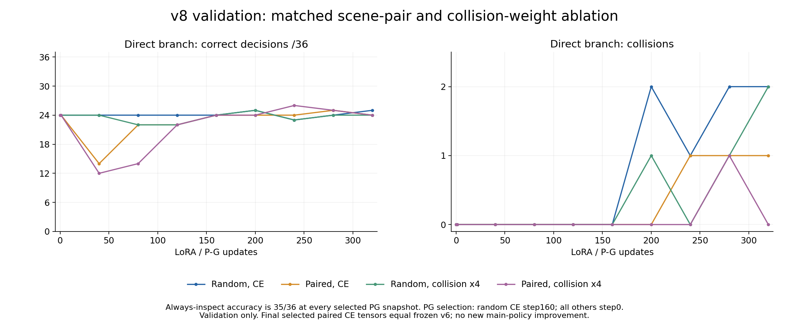

# 双分支选模与场景组织训练（v8，2026-11-10）

四组各完成 **320 次 LoRA／P-G 更新、1600 次 I 更新**，原核心与归一化保持冻结。验证选中 **paired_ce**，但其全部模型状态张量与冻结 v6 主策略完全一致，因此**没有新的主策略改进**。同组布局配对与碰撞类别加权均未让选定模型超过初始化。随机普通 CE 组得到不同权重，但最终验证补看为 22 次，较主选择多 1 次。

新 18 组／72 场景已在训练启动时冻结。本文保留当时的开发结果；随后[独立测试已完成](mobile_branch_balance_results.md)，下表不改写为泛化指标。

## 四组匹配训练与选择

相同初始化、网络容量、每次两场景、320 步 LoRA／P-G 与 1600 步联合后悔 I 预算。随机配对在全训练集抽两场景；同组配对在一个随机组内抽不同布局。碰撞加权 CE 只改变训练类别权重，正式效用仍为成功 +1、普通失败 −1、碰撞 −2、拒绝 0 及实际观察成本。[预先声明的设计](mobile_branch_balance_plan.md)。

PG 选择先比较直接／始终观察两分支的碰撞总数，再依次比较始终观察正确数、直接正确数、开门总数、净回报和路程；完全并列取最早。选定 PG 后，I 阶段冻结编码器、LoRA、P/G。最终四策略按既有验证正确、碰撞、开门、净回报、路程、补看顺序选择。

| arm | 选中 PG 步 | 选中 I 步 | 开门 /26 | 正确 /36 | 碰撞 | 补看 | 平均净回报 | 与 v6 全张量一致 |
| --- | ---: | ---: | ---: | ---: | ---: | ---: | ---: | --- |
| random_ce | 160 | 280 | 25 | 35 | 0 | 22 | 0.5825 | 否 |
| **paired_ce〔验证选定〕** | **0** | **40** | **25** | **35** | **0** | **21** | **0.5876** | **是** |
| random_collision4 | 0 | 40 | 25 | 35 | 0 | 21 | 0.5876 | 是 |
| paired_collision4 | 0 | 40 | 25 | 35 | 0 | 21 | 0.5876 | 是 |

后面三组指标完全并列，按预先声明的顺序选 paired_ce。它们选择的是同一旧模型，不应将组名解释为配对或加权训练已有收益。随机 CE 的选中 PG 确有新的 LoRA 更新，其直接验证从 15 开门＋9 正确拒绝变为 16＋8，正确总数仍 24/36、零碰撞，路程反而增加；不能称为准确率提升。

四组末步直接分支分别为 25/36、24/36、24/36、24/36，碰撞分别 2／1／2／0；始终观察分支均为 35/36、零碰撞。安全优先选择没有直接采用所有末步检查点，避免把更多开门与更少拒绝误解为整体改善。

一个明确的分支权衡出现在 paired_collision4 第 240 步：直接执行从初始化的 24/36 提高到 **26/36**，始终观察却从 35/36 降到 **30/36**，两者碰撞均为 0。预定选择规则因此保留旧检查点。这说明只报某一分支的最好数字会遗漏另一分支退化；它尚不能单独证明梯度方向冲突或其具体机制。

## 数据、权重与限制

只读取既有 72 训练、36 验证场景与实际候选；训练每 40 步刷新当前 G 所选动作标签，不取事后最优动作。原地图、感知与连续执行保持，不把 v7 地图校准的负结果包装成规划改进。新测试排除 **602** 个历史几何身份；清单 SHA256 为 `3e506223e2fc6bf8e59da03b132398e5f91de4dddaa4af624017986e4fe62c7e`。

16 份阶段检查点均核验：原 **422** 核心张量及归一化逐位一致；四组末步均确有 LoRA 张量更新，I 阶段所有非 I 张量与对应选定 PG 保持。三组最终模型逐张量等同 v6 主策略；不是仅碰巧指标相同。8 项契约与小流程通过，覆盖训练拆分、同组不同布局、碰撞梯度权重、双分支安全选择及实际固定后续动作监督。

固定 seed42，记录 Python、NumPy、Torch、CUDA、hash seed。仍有 attention warn-only 非确定性限制，不宣称跨运行完全确定。一个种子、重复使用的小验证集、既有类别和固定物理环境限制了结论。P/G 仍共享 LoRA，未证明梯度冲突已消除。

四组中仍有 random_ce 的选定权重不同，随后按训练前协议执行了新冻结测试，未把历史 v6 数字视为新结果，也未按测试更换主策略。测试前核验模型张量、归一化、推理配置与观察模式，将七个名称归并为四种实际执行策略，完成 288 次实时回放；共用记录的别名单列，不计作独立实验。正式结果见本文首段链接。

## 运行与耗时

小流程 8 契约＋四组各 8／8 步，预计 5 分钟、排队 0。实际训练流程 **189.09 秒**、控制器 197.18 秒；权威会话 **13937**，退出码 0，代理连续休眠 261.28 秒后核验。

正式预计 **2 小时、排队 0**，依据完整历史 PG 阶段约 1238–1288 秒／组，四组加 I、缓存、双分支验证与审计预留余量。11:33:12 启动，实际进程 **10532**、控制器 **14432**、权威会话 **8346**。启动 9.28 秒，代理一次休眠 **7161.88 秒**至 13:33:12 预计截止，再核实同一会话已于 **13:04:26** 正常完成，退出码 **0**。实际流程 **5471.93 秒（91 分 12 秒）**、控制器 5474.25 秒。

| 阶段 | 秒 |
| --- | ---: |
| random_ce PG／I | 1267.32／99.76 |
| paired_ce PG／I | 1282.53／97.65 |
| random_collision4 PG／I | 1265.00／96.31 |
| paired_collision4 PG／I | 1244.59／97.29 |
| 启动、I/O、选择、审计 | 21.46 |

本阶段无物理采集并发，估计与实测分别保留。根目录只保存实现、报告和图，权重、数组、日志与遥测都在 ignored `runs/`。

[训练报告与完整曲线](../runs/mobile_branch_balance_training_seed42_20261110/report.json) · [测试前选择及哈希](../runs/mobile_branch_balance_training_seed42_20261110/frozen_for_test.json) · [16 检查点核验](../runs/mobile_branch_balance_training_seed42_20261110/tensor_audit.json) · [启动与休眠核验](../runs/mobile_branch_balance_training_seed42_20261110/verification.json)。

实际运行仍在冻结 v3 物理工作区 `runs/mobile_partial_workspace_seed42_20261109/`，输出为其下 `runs/p8_train_seed42_20261110/`；不要混用根目录另一物理版本。
