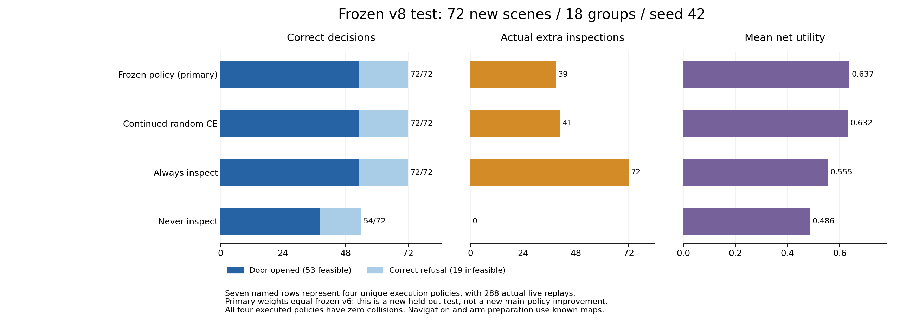

# Independent scene-group test retains the frozen policy (v8, 2026-11-10)

Validation-selected **paired_ce** achieves **72/72** correct decisions on 18 fresh groups and 72 scenes: **53/53 feasible openings**, **19/19 correct refusals**, **0** collisions. Inspections fall from **72 to 39 (-45.8%)** against always inspection with identical frozen policy weights and per-scene task outcomes.

Every paired_ce tensor matches v6 primary. This is independent evaluation of an existing policy, **not a gain from paired training or new LoRA**. Different random_ce weights also achieve full correctness but use two more inspections; primary selection remains unchanged.

## Seven names, four deployed policies

Pre-test bytewise model/normalization/inference/mode checks establish equivalence of paired_ce, random_collision4, paired_collision4, and frozen_v6_learned. Two training-only metadata blocks do not affect inference. Primary represents the group; three aliases share its records explicitly. Always/never remain distinct execution modes despite shared weights.

| Policy name | Open /53 | Correct refusal /19 | Correct /72 | Collisions | Inspections | Mean net utility | Physical replays for row |
| --- | ---: | ---: | ---: | ---: | ---: | ---: | ---: |
| random_ce | 53 | 19 | 72 | 0 | 41 | 0.6315 | 72 |
| **paired_ce (primary)** | **53** | **19** | **72** | **0** | **39** | **0.6365** | **72** |
| random_collision4 | 53 | 19 | 72 | 0 | 39 | 0.6365 | 0; shared primary records |
| paired_collision4 | 53 | 19 | 72 | 0 | 39 | 0.6365 | 0; shared primary records |
| frozen_v6_learned | 53 | 19 | 72 | 0 | 39 | 0.6365 | 0; shared primary records |
| frozen_v6_always | 53 | 19 | 72 | 0 | 72 | 0.5548 | 72 |
| frozen_v6_never | 38 | 16 | 54 | 0 | 0 | 0.4861 | 72 |

Total **1152 new candidates and 288 physical policy replays**, rather than 504 independent replays. Freeze equivalence groups/hashes before the first test observation. Different LoRA/P-G models independently encode prediction caches; random_ce does not reuse primary features.

Candidate feasibility is the success union over two physical branches x four stations x two grasps, not global solvability. Correctness includes refusals; 72/72 does not mean 72 opened doors. Primary opens 53 of all 72 scenes.

## Inspection cost and training findings

| Same frozen policy | Learned inspection | Always inspect |
| --- | ---: | ---: |
| Correct decisions | 72/72 | 72/72 |
| Physical inspections | 39 | 72 |
| Mean episode, simulated seconds | 37.60 | 57.55 |
| Mean base path, m | 2.677 | 5.010 |
| Mean net utility | 0.6365 | 0.5548 |

Learned inspection saves 45.8% of inspections, 34.7% of simulated duration, and 46.6% of path length, raising utility by 0.0817. Means include opening/refusal episodes and measure execution rather than evaluation wall-clock time. Inspection changes both motion and information, not image content alone.

Four arms complete 320 LoRA/P-G and 1600 I updates each. Three select the same initial PG and reproduce v6 I. Random CE selects PG update 160 but gains no correct test decisions and adds two inspections. [Training records](mobile_branch_balance_development.md). No extra task benefit from new LoRA, pairing, or collision weighting is established.

## Two tests of the same frozen policy

v6/v8 test geometries are disjoint. Primary tensors, normalization, inference settings, and 120 common source hashes match. Direct comparison also preserves non-I tensors/normalization for always/never references. The following is a **descriptive summary**:

| Metric | New v6 test | New v8 test | Total / weighted mean |
| --- | ---: | ---: | ---: |
| Correct decisions | 68/72 | 72/72 | **140/144 (97.2%)** |
| Open / feasible | 47/48 | 53/53 | **100/101** |
| Correct refusal / infeasible | 21/24 | 19/19 | **40/43** |
| Collisions | 0 | 0 | **0** |
| Learned inspections | 43 | 39 | **82** |
| Always inspections | 72 | 72 | **144** |
| Learned mean simulated seconds | 37.15 | 37.60 | **37.38** |
| Always mean simulated seconds | 54.46 | 57.55 | **56.01** |

Matched always/learned success/refusal/collision vectors agree in both tests. Total inspections drop by 62 (**43.1%**) and mean duration by **33.3%**. Never inspection totals 101/144 correct and 69/101 openings with shorter episodes; interpret cost alongside task outcomes.

The 144 scenes belong to **36 groups, 9 familiar templates, and one training seed**. They are not independent categories or cross-seed evidence. Earlier v5 72/72 uses different I weights and is excluded. Differences between these same-policy cohorts reflect scenes rather than training gains from 68 to 72.

The three inappropriate attempts after perception failure and one depth-mask false refusal in v6 remain in the summary. [Failure analysis and scope](mobile_inspection_regret_results.md).

## Verification and runtime records

- Four equivalence/cache/test-isolation contracts pass; smoke matches 64 candidates and 16 physical replays. Models/thresholds remain unchanged afterward.
- Formal **288/288** live replays match actions, refusals, openings, collisions, and current-depth masks. Aliases share the same evidence.
- One initialization per episode; **197** continuous opening-entry checks and **152** physical inspections pass, with monotonic time and no early door motion during successful inspection. Counts cover four deployed policies only.
- Maximum recorded translation speed **0.28124 m/s**; adjacent displacement **0.01639 m**.
- Sixteen stage checkpoints and old references preserve **422** core tensors/normalization bitwise and non-I tensors during I training; all frozen weight/data/source hashes match.
- Four deployed policies have zero collisions; exploratory candidates include collisions. Full geometry excludes all **108** colliding candidates and retains all **212** successful ones, which are correlated records rather than independent scenes or safety certificates.
- New runs fix Python/NumPy/Torch/CUDA/hash seed 42 and record warn-only attention/OpenGL limitations on cross-run determinism.

Smoke estimate: 15 minutes, queue 0. Actual evaluation **489.35 seconds**, controller 497.40; session **52275**, exit 0. Inspect the same session after a continuous 862.07-second sleep to the deadline.

Formal estimate **3.5 hours, queue 0**, from phase-wise smoke extrapolation and slower historical full collection. Launch 14:06:35: evaluator **35264**, controller **32532**, session **53402**. Startup 14.02 seconds, first opening candidate 6.67. Sleep once **12547.23 seconds** until 17:36:35, then confirm completion at **16:21:54**, exit **0**. Actual evaluation **8117.69 seconds (2 hours 15 minutes 18 seconds)**; controller 8119.90.

| Phase | Actual seconds |
| --- | ---: |
| Pre-test checkpoint audit | 5.76 |
| 1152-candidate collection, 2 workers | 5160.50 |
| Independent checkpoint prediction caches | 122.19 |
| 288 live replays | 2788.33 |
| Final tensor/physics audit | 17.80 |
| Startup, I/O, other | 23.10 |

No concurrent LoRA training. Keep estimates separate from measurements; collection variation does not establish algorithmic speedup.

## Files and scope

Opening maps use current depth and door/robot CAD; navigation/preparation retain known maps. Scope remains an ideal holonomic base, familiar handles, simulation, one seed, and small development data. Full-map geometry is a strong historical reference but uses a different cohort. Imagined-rollout advantages remain unverified.

[Formal report](../runs/mobile_branch_balance_evaluation_seed42_20261110/report.json) · [Pre-test groups/hashes](../runs/mobile_branch_balance_evaluation_seed42_20261110/evaluation_frozen.json) · [Tensor/physics audit](../runs/mobile_branch_balance_evaluation_seed42_20261110/tensor_and_physics_audit.json) · [Same-policy two-cohort verification](../runs/mobile_branch_balance_evaluation_seed42_20261110/post_analysis.json) · [Runtime/sleep verification](../runs/mobile_branch_balance_evaluation_seed42_20261110/verification.json) · [Evaluation design](mobile_branch_balance_evaluation_plan.md).

Raw arrays, weights, trajectories, and logs remain in new ignored `runs/`, with actual output `runs/p8_test_seed42_20261110/` in the frozen v3 workspace. Reproduce with archived source and new outputs, preserving frozen runs without mixing root physics.
