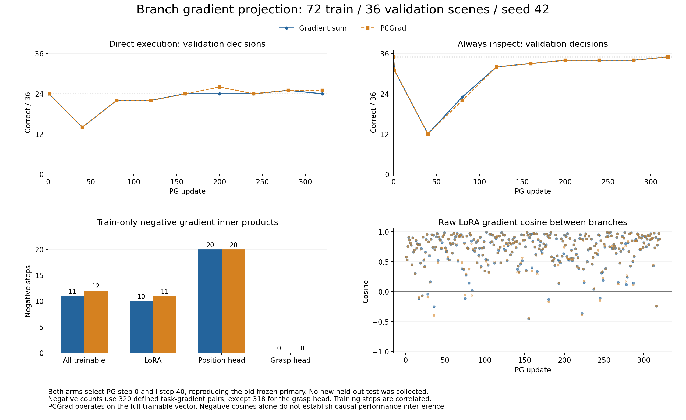

# 两分支梯度投影训练结果

2026 年 11 月 11 日，两组各完成 **320 步 LoRA／P-G、1600 步观察策略 I**。PCGrad 在 320 步中对 **12 次**负内积梯度进行投影，但两组最终都选中第 0 步 P/G、第 40 步 I，全部模型张量与旧主策略一致。**本轮没有产生新的部署策略，也没有验证性能提升。** 原核心与归一化保持，新冻结的 72 场景测试未采集、未读取。

## 匹配训练与选模

两个任务分别为直接执行和实际补看后执行，每个任务使用 P 交叉熵加 0.5 倍可见 G 交叉熵。相同初始化、rank8 LoRA、两场景批次、完整采样序列、优化器和预算；只比较普通梯度相加与两任务 PCGrad。两组都计算两次反传。标签取当前 G 实际所选候选的终局结果，每 40 步仅用训练数据刷新；不能将标签理解为事后最优抓持。

投影按 [Yu 等的 PCGrad 原论文 Algorithm 1](https://proceedings.neurips.cc/paper/2020/hash/3fe78a8acf5fda99de95303940a2420c-Abstract.html) 实现，分别使用另一任务的原始梯度，最后相加。作用范围为所有可训练 LoRA 和 P/G 头；分块梯度记录用于分析，没有分别投影各块。

| 策略 | 选中 PG 步 | 选中 I 步 | 开门／候选可行 | 正确拒绝 | 正确决策 | 碰撞 | 补看 | 平均净回报 |
| --- | ---: | ---: | ---: | ---: | ---: | ---: | ---: | ---: |
| 普通相加 | 0 | 40 | 25/26 | 10/10 | 35/36 | 0 | 21 | 0.5876 |
| PCGrad | 0 | 40 | 25/26 | 10/10 | 35/36 | 0 | 21 | 0.5876 |

以上均为原 **36 个验证场景**，不是新测试。两组完全并列，按训练前顺序保留普通相加。检查点字节哈希因元数据不同而不同，但模型张量、归一化及有效推理配置相同。两组末步 LoRA 各有 148 个张量实际更新，不能把选回初始化误解为没有执行训练。

## 梯度冲突与分支权衡

| 原始梯度的负内积次数 | 普通相加 | PCGrad |
| --- | ---: | ---: |
| 全部可训练参数 | 11/320 | 12/320 |
| LoRA 参数块 | 10/320 | 11/320 |
| 站位 P 头 | 20/320 | 20/320 |
| 抓持 G 头 | 0/318 | 0/318 |

G 有两步缺少非零的分支梯度，夹角未定义，不将它们计入 318 次有效夹角。其余三组每步夹角均有定义。PCGrad 的 12 次投影均来自全参数负内积；普通相加不执行投影。全参数平均余弦分别为 0.6166、0.6168，LoRA 分别为 0.7084、0.7091。两条优化轨迹在首次投影后不同，不能把两组不同步的负内积次数视为同一点上的配对效果。

PCGrad 第 200 步直接验证正确 **26/36、零碰撞**，高于初始化的 24/36；但始终补看为 **34/36**，低于初始化 35/36，因此没有通过预定的双分支选择顺序。两组末步始终补看均恢复 35/36、零碰撞，直接分支分别为 24/36、25/36，均有一次碰撞。仅报告直接分支最好数字会遗漏另一分支退化或安全问题。

本轮确认训练中确有少量负梯度内积，同时显示这项投影干预不足以改善当前验证选择。它不证明负内积导致性能下降，也未测量曲率；AdamW、学习率分组及权重衰减还可能改变实际参数更新方向。任务划分仍是直接／补看两分支，尚未分别测量或隔离 P 与 G 目标之间的梯度冲突。既有小开发集、单训练种子和当前地图约束限制了结论。

## 测试与权重保护

训练前另冻 **18 组、72 场景**，排除 **682** 个历史几何身份。manifest SHA256 为 `98d4cfbb519d7fb125ae0222ebb9042ea00ad01ecfb42880b2e4f0818bbaaad3`。两组选定策略与旧主策略完全相同，按预先声明的规则保留这批测试未读取，不重复采集同一策略，不给这轮训练添加历史测试数字。

8 项梯度／掩码／采样／选模契约和两组各 8／8 步小流程通过。正式 8 份阶段检查点均核验原 **422** 核心张量与归一化逐位保持，I 阶段非 I 张量保持。全部训练批次只含训练场景，训练与 I 特征记录没有测试身份；旧模型、数组和源码哈希保持。Python、NumPy、Torch、CUDA 与 hash seed 固定 42；warn-only 算子及 OpenGL 舍入仍限制跨运行完全确定性。

## 实际耗时

首次小流程因配置字典重复字段在更新前失败：权威会话 46290、退出码 1、控制器 66.37 秒。修正后使用新目录，保留原源码快照和日志。第二次小流程预计 8 分钟、排队 0，实际流程 **114.26 秒**、控制器 121.51 秒，权威会话 **44693** 退出码 0；按截止连续代理休眠 437.20 秒后核验同一会话。

正式预计 **90 分钟、排队 0**。小流程双反传约 2.6–3.2 秒／步，结合历史完整标签刷新、验证、I 训练及审计外推约 55 分钟，保守预留至 5400 秒。02:49:09 启动，实际进程 **26788**、控制器 **6180**、权威会话 **63222**，启动准备 17.26 秒。代理一次连续休眠 **5359.49 秒**至预计 04:19:09，再核验同一会话已于 **03:43:15** 正常完成，退出码 **0**。实际流程 **3241.97 秒（54 分 2 秒）**、控制器 3245.98 秒。

| 阶段 | 实际秒 |
| --- | ---: |
| 普通相加 PG／I | 1528.16／111.56 |
| PCGrad PG／I | 1464.68／98.53 |
| 启动、I/O、选择与审计 | 39.04 |

两组平均 PG 更新耗时为 3.138／3.033 秒，无物理采集并发。记录估计与实测，不将两组墙钟差异当作算法提速证据。

[训练前设计](mobile_branch_pcgrad_plan.md) · [完整报告](../runs/mobile_branch_pcgrad_training_seed42_20261111/report.json) · [选模冻结记录](../runs/mobile_branch_pcgrad_training_seed42_20261111/frozen_for_test.json) · [检查点核验](../runs/mobile_branch_pcgrad_training_seed42_20261111/tensor_audit.json) · [梯度及推理身份复核](../runs/mobile_branch_pcgrad_training_seed42_20261111/post_analysis.json) · [运行与休眠核验](../runs/mobile_branch_pcgrad_training_seed42_20261111/verification.json)。

原始权重、数组、梯度记录和日志保存在新 ignored `runs/`；实际输出为冻结 v3 工作区下 `runs/p9_train_seed42_20261111/`。开门使用实际当前深度与门／机器人 CAD，导航和机械臂准备仍使用已知地图。既有正式结果仍见[两批冻结策略测试](mobile_branch_balance_results.md)。
