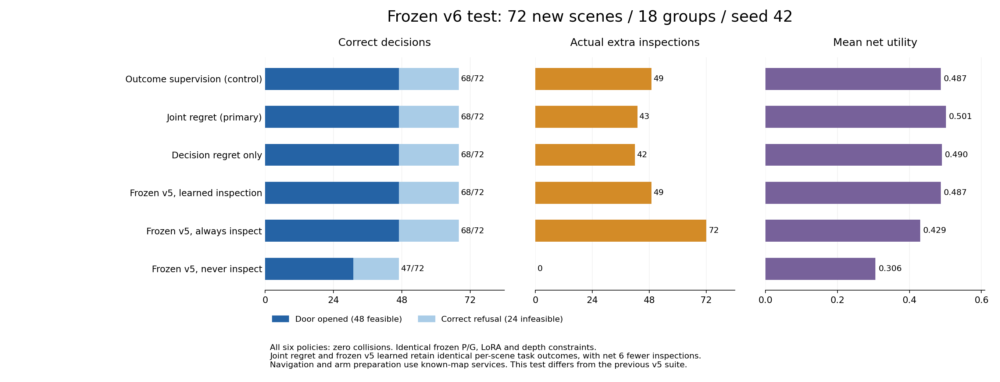

# Formal inspection-regret test (v6, 2026-11-10)

Training/validation-selected **`joint_regret`** makes **68/72** correct decisions on 18 fresh groups and 72 scenes: **47/48 feasible openings**, **21/24 correct refusals**, **0** collisions. Frozen v5 learned inspection also scores 68/72 with identical per-scene success/refusal/collision vectors. The new objective reduces inspections from **49 to 43: 6 fewer (12.2%)**.

This differs from v5's earlier 72/72 test, so scores do not establish model regression or improvement. The benefit is lower inspection cost with matched task outcomes. Correctness includes refusals; feasibility refers to 16 frozen physical candidates, not global continuous-action solvability. Candidate failure can also reflect perception failure.

## Frozen design and implementation

Initialize three arms from v5 depth-feature `selected_pg.pt`, completing 1600 I updates each. Freeze core, rank-8 LoRA, P/G, normalization, and maps. Original supervision uses post-inspection outcome CE and cost MSE; joint adds return-difference-weighted decision BCE; regret-only removes outcome CE. Labels compare returns of **actions selected on each physical branch** by fixed P/G rather than oracle actions.

Use 72 training and 36 validation scenes. Selected updates are 280/40/120; joint/regret-only validation metrics tie, selecting `joint_regret` by preregistered order. Freeze primary at **2026-11-10 06:19:51 +08:00** and exclude 526 historical geometries. New-test results change no checkpoint, primary choice, threshold, or map setting.

I receives initial-image features, relative inspection target, declared risk, and observed initial depth. Physical base motion precedes P's station choice, and station arrival precedes G's grasp choice. Retain unmodified v5 collection/replay with frozen checkpoint routing. Rebuild maps from current RGB-D without cached maps or future images in live decisions.

Opening constraints use current depth and door/robot CAD; navigation and preparation use known maps. An ideal x/y/yaw base stays at its selected station during gripper-contact opening of a passive door. Scope is simulation rather than full unknown-environment navigation or wheeled hardware.

[Training/validation records](mobile_inspection_regret_development.md) · [Training design](mobile_inspection_regret_plan.md) · [Formal test protocol](mobile_inspection_regret_evaluation_plan.md).

## Matched independent test

| Policy | Open /48 | Correct refusal /24 | False refusal | Correct /72 | Collisions | Inspections | Mean net utility |
| --- | ---: | ---: | ---: | ---: | ---: | ---: | ---: |
| Current outcome supervision | 47 | 21 | 1 | 68 | 0 | 49 | 0.4868 |
| **Outcome + decision regret (primary)** | **47** | **21** | **1** | **68** | **0** | **43** | **0.5015** |
| Decision regret only | 47 | 21 | 0 | 68 | 0 | 42 | 0.4901 |
| Frozen v5, learned inspection | 47 | 21 | 1 | 68 | 0 | 49 | 0.4868 |
| Frozen v5, always inspect | 47 | 21 | 1 | 68 | 0 | 72 | 0.4295 |
| Frozen v5, never inspect | 31 | 16 | 16 | 47 | 0 | 0 | 0.3056 |

The three v5 modes were declared before training rather than added or reselected from testing. All policies share terminal utility and actual inspection cost; training-loss values are not task returns.

| Metric | Frozen v5 learned inspection | Joint regret | Change |
| --- | ---: | ---: | ---: |
| Correct decisions | 68/72 | 68/72 | Identical per scene |
| Physical inspections | 49 | 43 | -12.2% |
| Mean episode, simulated seconds | 40.86 | 37.15 | -9.1% |
| Mean base path, m | 3.257 | 2.832 | -13.0% |
| Mean net utility | 0.4868 | 0.5015 | +0.0147 |

Against always inspection, primary reduces inspections **72 to 43 (-40.3%)** with identical per-scene task outcomes. Relative to old learned inspection, it removes 7 inspections and adds 1: a net reduction of 6 rather than a strict subset of inspected scenes.

Regret-only uses one fewer inspection but adds one navigation/wrong-side attempt, giving lower terminal/net utility. Retain the validation-selected primary rather than selecting by test inspection counts.

## Four remaining errors

1. **Three layouts in one geometry group** (`g002_front_blocked`, `g002_rear_blocked`, `g002_free`) are library-infeasible but still attempted. Selected continuations terminate at perception with `handle_not_detected`. The new I objective does not resolve this downstream failure or the missing correct refusals.
2. **One false refusal in `g008_rear_blocked`.** Station 0/grasp 0 succeeds on both physical branches and passes full geometry. Initial depth already excludes that station; fusion excludes all stations, and primary refuses after inspection. This establishes exclusion of a successful station, without locating or correcting its specific point-cloud cause.

This analysis explains frozen outcomes without changing maps, models, or thresholds. Primary and frozen-v5 learned/always share all four errors, so they cannot be attributed to the new regret objective. Zero observed collisions does not establish complete map constraints or dynamic safety.

## Weight, information, and physics verification

- **1152** new candidates and **432/432** live replays match inspection/refusal/station/grasp/opening/collision outcomes and map masks.
- **266** continuous opening-entry q/v checks and **255** physical inspections pass. Episodes initialize once, timestamps increase monotonically, and successful inspection does not push the door early.
- Maximum recorded translation speed **0.28124 m/s**; maximum adjacent displacement **0.01659 m**.
- Six stage checkpoints and frozen-v5 references preserve every non-I tensor, **422** core tensors, and normalization bitwise. Historical input/model/source/manifest hashes remain unchanged.
- All six deployed policies have zero collisions; exploratory collection includes collisions. Full geometry excludes all **148** collision candidates and retains all **176** successful candidates, which are correlated records rather than independent scenes.
- New collection/replay/analysis fixes seed=42 and records Python/NumPy/Torch/CUDA/hash settings. Warn-only nondeterministic operators and OpenGL rounding limit cross-run bitwise reproducibility.

Exploratory paired analysis clustered by 9 templates gives mean utility difference +0.01472, bootstrap 95% interval **-0.00023 to +0.02979**, and exact sign-flip p=0.1875. It is unregistered, unadjusted for multiple comparisons, and includes zero, without stable statistical-advantage evidence or policy reselection. Scope remains 9 familiar templates, 18 new groups, one seed, and reused development data.

## Runtime and measured durations

Four-scene smoke estimate: 15 minutes, queue 0. Actual **655.66 seconds**, matching 64 candidates and 24 replays; session **8385**, exit 0. The agent sleeps continuously for 874.52 seconds and inspects the same session at deadline.

Formal estimate **4 hours, queue 0**, from a roughly 3-hour-17-minute phase extrapolation and previous collection/replay without concurrent training, plus margin. Launch **06:44:32**: evaluator **29412**, controller **14988**, session **64988**. Startup 8.29 seconds; first opening candidate 6.46. Sleep once for **14372.29 seconds** until 10:44:32, then confirm completion at **09:23:46**, exit **0**. Actual evaluation **9552.94 seconds (2 hours 39 minutes 13 seconds)**; controller 9555.15.

| Phase | Actual seconds | Minutes |
| --- | ---: | ---: |
| 1152-candidate collection, 2 workers | 5200.48 | 86.67 |
| Cached policy computation | 54.19 | 0.90 |
| 432 live replays | 4245.76 | 70.76 |
| Full tensor/physics audit | 26.92 | 0.45 |
| Startup, I/O, other | 25.58 | 0.43 |

No concurrent LoRA training. Keep estimates and measurements separate; faster collection alone is not algorithmic speedup evidence. Future estimates must account for host load and action composition.

## Files and presentation scope

Keep arrays, weights, logs, trajectories, telemetry, and archived source in new ignored `runs/`; the repository stores implementation, reports, and figures.

- [Formal report and phase durations](../runs/mobile_inspection_regret_evaluation_seed42_20261110/report.json)
- [Pre-test selection and hashes](../runs/mobile_inspection_regret_evaluation_seed42_20261110/evaluation_frozen.json)
- [Tensor/physics audit](../runs/mobile_inspection_regret_evaluation_seed42_20261110/tensor_and_physics_audit.json)
- [Per-scene controls, failures, and exploratory statistics](../runs/mobile_inspection_regret_evaluation_seed42_20261110/post_analysis.json)
- [Runtime, waiting, and completion verification](../runs/mobile_inspection_regret_evaluation_seed42_20261110/verification.json)
- [Plotting and analysis script](../runs/mobile_inspection_regret_evaluation_seed42_20261110/post_analysis.py)

Actual workspace `runs/mobile_partial_workspace_seed42_20261109/`, output `runs/p6_test_seed42_20261110/`. Reproduce with archived source and new outputs, preserving frozen runs without mixing root physics.

Present this 68/72 cohort alongside the [historical v5 72/72 cohort](mobile_partial_results.md), identifying separate tests. Evidence supports full-task execution and inspection-cost reduction, with remaining perception/exclusion failures and limited cross-seed/category scope. Imagined-rollout advantages remain unverified.
