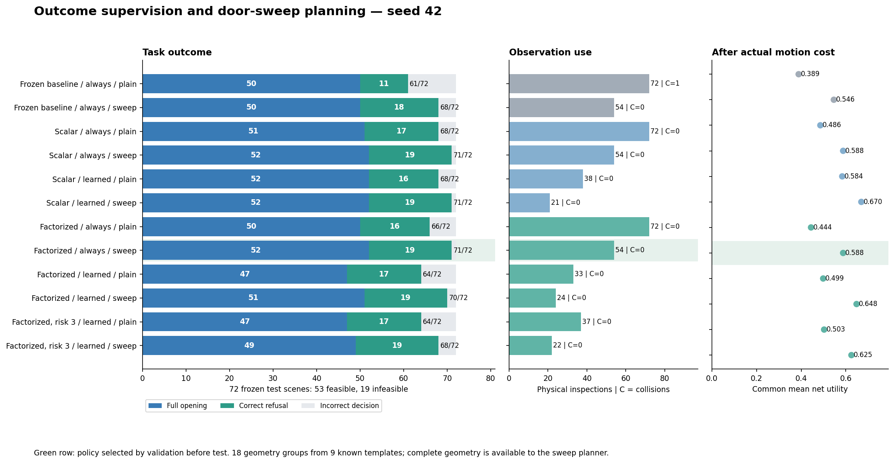

# 结果分解与门扇规划实测（v4，2026-11-09）

验证集选定的 **`factorized_always_sweep`** 在全新 72 个场景上做对 **71/72 个决策**，完整打开 **52/53 个可开场景**，**碰撞 0 次**。同批测试上的冻结 v3 基线为 61/72、50/53、碰撞 1 次。864 次物理回放全部匹配，原模型核心保持冻结。

本轮更明确的收益来自已知几何规划约束和继续训练；同容量的结果分解监督没有表现出优于标量回报监督的证据。



## 训练与数据

两模型从 v3 验证集选定的 `view_free/selected.pt` 初始化。它们使用相同网络容量、初始化、数据和更新预算：

| 阶段 | 实际训练 | 验证选定检查点 |
| --- | --- | --- |
| scalar 定位／抓持 | 320 次更新，原有 rank-8 编码器 LoRA 与 P/G | 第 320 步 |
| scalar 观察网络 | 800 次更新；P/G、编码器及 LoRA 全冻结 | 第 1 步 |
| factorized 定位／抓持 | 320 次更新，原有 rank-8 编码器 LoRA 与 P/G | 第 200 步 |
| factorized 观察网络 | 800 次更新；P/G、编码器及 LoRA 全冻结 | 第 280 步 |

完成预算和最终选用检查点分别记录，最后一步没有自动替代验证选择。第二阶段将是否观察的梯度隔离；定位与抓持仍共享 LoRA，本轮未检验它们之间的梯度方向或使用梯度投影。

复用 v3 的 **72 个训练、36 个验证场景**，验证物理源码和每份读取文件的哈希，原数组保持不变。最终测试重新生成 **18 组、72 个场景**，9 种既有模板各有两个独立参数组；每组包含前挡、后挡、双挡和无挡四种布局，整组划分。测试几何排除所有历史场景。

每个新测试场景从头执行“不观察／实际观察”两分支、4 个站位、2 个夹爪角度，共 **1,152 次新候选执行**；随后 12 组策略各回放 72 个场景，共 **864 次回放**。测试结果采集前已冻结所有检查点、策略选择和哈希。

所有新训练、采集和分析固定 **seed=42**，Python、NumPy、Torch、CUDA 及启动 hash seed 均记录。仿真、已知把手类别、相机和理想全向底盘沿用 v3；主分支独立抓持角度实验与历史测试保留。

## reward 的具体区别

P/G 均输出成功、普通失败、碰撞三类概率。风险系数 1 的结果价值分别为 `1、−1、−2`。

- `scalar`：将概率合成为期望回报，与真实动作回报做 MSE。
- `factorized`：对同一实际结果的类别做交叉熵，保留失败组成的监督。

定位目标来自当前 G 所选动作的实际结果。G 只在实际获得抓持观察时接受监督；观察后输入不安全时屏蔽后续监督。训练标签仅在训练场景上刷新，未取反事实中事后最优动作。

单独的观察网络学习冻结后续 P/G 所选结果，额外包含“后续拒绝”类别（价值 0），并用正值输出拟合实际观察成本：

```text
cost = 0.2 × 实际观察距离(m)/6 + 0.1 × 实际观察耗时(s)/60
观察价值 = 当前冻结后续策略的期望回报 − 预测观察成本
```

两个模型的观察训练都包含风险系数 1/3、普通／扫掠规划共四种条件。风险和规划模式是执行时已知的输入；网络不接收场景编号、布局标签、未来图像或实际结果。附加 `risk3` 策略使用同一分解模型，碰撞价值改为 −4；所有测试主指标仍按共同的风险系数 1 和实际运动成本计分。

## 规划的具体区别

`plain` 沿用已知几何 A* 底盘导航、RRT 机械臂准备和实际接触开门。`sweep` 额外检查门扇与把手从关闭到 90° 的扫掠：

- 在独立 `MjData` 上每 1° 查询门组件与静态障碍、目标底盘外形的交叠，穿透容差 1 mm。
- 选择前排除预计碰撞的站位；全部排除时在初始位置拒绝，实际不发生观察或行走。
- 实际门仍由夹爪接触推动，几何查询不修改实时门角、机器人状态或时钟。

该规划器使用完整已知地图，结果包含额外几何信息的贡献。它未覆盖移动机械臂的全部轨迹和接触动力学，离散查询也不是连续碰撞证明。

可开场景分母始终是未经该排除的两条实际分支候选并集：**53 个可开，19 个当前候选集合不可开**。保守排除造成的误拒绝仍计为错误。

## 完整新测试结果

正确决策定义为完整开门，或在当前候选集合不可开时拒绝。观察次数是实际发生的移动观察。

| 策略 | 开门 /53 | 正确拒绝 /19 | 误拒绝 | 正确 /72 | 碰撞 | 观察 | 平均净回报 |
| --- | ---: | ---: | ---: | ---: | ---: | ---: | ---: |
| 冻结 v3，始终观察，plain | 50 | 11 | 3 | 61 | 1 | 72 | 0.3886 |
| 冻结 v3，始终观察，sweep | 50 | 18 | 3 | 68 | 0 | 54 | 0.5463 |
| scalar，始终观察，plain | 51 | 17 | 1 | 68 | 0 | 72 | 0.4858 |
| scalar，始终观察，sweep | 52 | 19 | 1 | 71 | 0 | 54 | 0.5880 |
| scalar，自主观察，plain | 52 | 16 | 1 | 68 | 0 | 38 | 0.5839 |
| scalar，自主观察，sweep | 52 | 19 | 1 | 71 | 0 | 21 | 0.6695 |
| factorized，始终观察，plain | 50 | 16 | 1 | 66 | 0 | 72 | 0.4442 |
| **factorized，始终观察，sweep〔验证选定〕** | **52** | **19** | **1** | **71** | **0** | **54** | **0.5880** |
| factorized，自主观察，plain | 47 | 17 | 3 | 64 | 0 | 33 | 0.4985 |
| factorized，自主观察，sweep | 51 | 19 | 2 | 70 | 0 | 24 | 0.6481 |
| factorized risk3，自主观察，plain | 47 | 17 | 4 | 64 | 0 | 37 | 0.5028 |
| factorized risk3，自主观察，sweep | 49 | 19 | 4 | 68 | 0 | 22 | 0.6252 |

验证集上的正确决策依次为 31、34、32、34、32、34、30、35、30、34、30、33；主策略在查看测试结果之前被选定。测试中的 scalar 自主观察有更高净回报，仍作为预先声明的次要对照保留。

可以作出的判断：

1. **规划贡献明确。** 冻结同一旧模型仅增加扫掠检查，正确决策由 61 增至 68，开门仍为 50；它主要减少不可开场景上的无效尝试。新测试的 168 条碰撞候选均被排除，192 条成功候选全部保留。这些是相关候选执行记录，不是 360 个独立场景。
2. **继续训练有收益，分解监督没有额外优势。** 不加扫掠时 scalar 为 68/72、factorized 为 66/72；加扫掠并始终观察时两者均为 71/72。应继续保留标量监督作为强基线。
3. **自主观察能减少本批动作成本。** 同一 scalar 权重和扫掠规划下，始终／自主观察的逐场景正确性向量完全一致；观察由 54 降至 21，平均实际回合耗时由 49.12 降至 29.66 仿真秒，净回报提高 0.0815。
4. **更强碰撞惩罚未改善当前指标。** 分解模型的扫掠自主观察从 risk1 到 risk3，碰撞均为 0，开门从 51 降至 49、误拒绝从 2 增至 4。

本轮没有预注册“不观察＋扫掠”正式测试策略。随后补充的[只读开发集诊断](mobile_no_observation_control.md)显示，当前 scalar 模型在验证集不观察为 27/36、自主观察为 34/36；该诊断不读取测试结果，也不改变本轮主选择。完整已知地图下的纯几何选站位及 P0 校准仍需比较。

## 配对分析与范围

主策略比冻结旧模型多 10 个正确决策（+13.89 个百分点）。探索性精确符号翻转检验按 18 个几何组聚类为 p=0.00195，按 9 个模板聚类为 p=0.03125；模板聚类的 bootstrap 95% 区间为 +6.94 至 +20.83 个百分点。

这些分析未作多重比较校正，只有一个训练种子、四种既有把手和已知地图。分解对标量、不加扫掠的正确决策差为 −2，探索性 p=0.5。本批结果支持规划与阶段组织的后续研究，不能推断陌生类别、部分地图或真实轮式机器人上的效果。

## 权重、物理与冻结核验

- **864/864 回放匹配**动作、拒绝、成功和碰撞；每次实际回合均只初始化一次。
- **604 次**进入开门技能的 qpos/qvel 连续；所有记录时间轴单调。
- **553 次**实际移动观察；成功观察期间门没有提前被推动。
- **108 次**“所有站位被排除”的回放在初始位置拒绝，无观察动作。
- 最大记录平移速度 **0.28124 m/s**；相邻记录最大位移 **0.01653 m**。
- 两模型共 **8 份阶段检查点**逐张量审计：原 **422 个非策略、非 LoRA 张量**及归一化统计逐位不变。
- 两模型选中 PG 均有 **148 个 LoRA 张量**相对 v3 初始化发生变化；观察训练期间选定 PG 和全部 LoRA 逐位保持，选中观察网络各有 6 个张量发生变化。
- **106 份启动源码／配置**与当前隔离环境、归档哈希一致；初始化、旧冻结文件、复用开发数据、manifest 和选中模型哈希保持。
- 冻结文件早于所有新测试观察文件，训练读取测试数组计数为 0。

前置小流程通过 **41 项测试**及 48 次回放；正式流程自身执行上述全量核验。原始 CPU/GPU 统计迁移错误、失败回执及源码均保留，修复后使用新目录重跑。

## 运行与耗时

本地排队 0。14:31:17 启动，PID **3352**，权威会话 **22687**；预计 5.5 小时、20:01 检查。代理连续休眠约 **19,743 秒**，到期检查同一会话，确认退出码 **0**。进程于 **19:21:03** 完成，实际 **17,385.41 秒，4 小时 49 分 45 秒**。

| 阶段 | 秒 | 分钟 |
| --- | ---: | ---: |
| 开发数据复用与扫掠查询 | 7.04 | 0.12 |
| scalar PG 训练、目标刷新与验证 | 1,262.57 | 21.04 |
| scalar 观察阶段 | 71.96 | 1.20 |
| factorized PG 训练、目标刷新与验证 | 1,250.16 | 20.84 |
| factorized 观察阶段 | 71.99 | 1.20 |
| 72 场景采集，2 workers | 5,127.66 | 85.46 |
| 864 次物理回放 | 9,337.88 | 155.63 |
| 其余选择、I/O 与核验 | 256.15 | 4.27 |

采集与 GPU 训练未并发。PG 实际平均更新速度为 2.45／2.44 秒；每分钟记录一次设备遥测，两个训练阶段记录温度范围分别为 49–53°C、52–53°C，不能据此单独判定性能瓶颈。

回放均值为 **10.81 秒/案例**，高于小规模的 7.57 秒；正式案例中实际观察和进入开门的比例也更高。下次应按完整阶段与策略动作组成估时，继续预留 I/O 和负载余量，避免直接用小规模均值当作实测总时长。

## 文件与复现

本地结果入口 `runs/mobile_outcome_seed42_20261109/` 指向 ignored 隔离目录；数组、模型、日志与遥测全部在 `runs/`，不进入 Git。

- [主结果与阶段耗时](../runs/mobile_outcome_seed42_20261109/report.json)
- [测试前选择及冻结哈希](../runs/mobile_outcome_seed42_20261109/frozen_for_test.json)
- [完整张量与物理核验](../runs/mobile_outcome_seed42_20261109/tensor_and_physics_audit.json)
- [配对分析与遥测汇总](../runs/mobile_outcome_seed42_20261109/post_analysis.json)
- [实验协议](../runs/mobile_outcome_seed42_20261109/protocol.json)
- [完整启动源码](../runs/mobile_outcome_seed42_20261109/source/)

当前主分支保留原 `simulate.py` 与独立抓持更新。旧开发数据复用要求关键物理源码完全匹配，正式回执绑定隔离环境及启动快照。可在原隔离环境中用**新目录、新 stream**复现：

```powershell
$python = 'E:\Code\mujoco-door-opening\.venv\Scripts\python.exe'
Push-Location runs/mobile_outcome_workspace_seed42_20261109
& $python run_mobile_outcome_experiment.py `
  --output runs/mobile_outcome_new `
  --stream mobile_outcome_v4_new `
  --pg-steps 320 --gate-steps 800 --test-groups 18 `
  --estimate-seconds 21600
Pop-Location
```

`21600` 是按本次完整阶段和动作组成向上取整的 6 小时复现预算，仍需记录排队并按实际负载修订。现主分支的回迁代码额外加入本轮 manifest 的历史排除保护；启动源码快照保持原身份。读取已归档结果可运行 `audit_mobile_outcome.py --output runs/mobile_outcome_seed42_20261109 --archived-sources`。

下一轮先用训练／验证数据比较“不观察＋扫掠”与自主观察，再考虑仅使用实际可见地图的约束，区分已知几何与主动视觉的收益；同时检查定位／抓持共享 LoRA 的任务梯度。任何新阈值、损失和检查点都先在开发集确定，新的最终评估继续使用新冻结测试场景。
