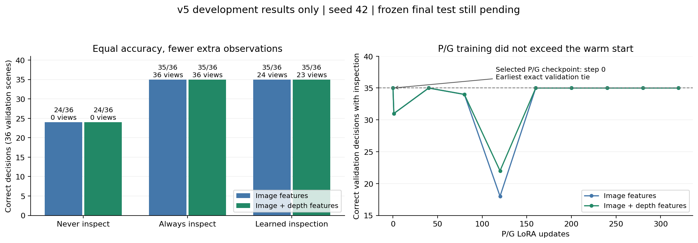

# 部分地图训练与开发集结果（v5，2026-11-09）

已完成两组各 320 次 LoRA／P-G 更新、800 次独立观察网络更新。部分地图下，验证选定 `depth_features_learned`：正确决策 **35/36**、完整开门 **25/26**、碰撞 **0**，额外观察 **23 次**。本文保留训练／验证阶段的记录；当时尚未采集新冻结测试，也未回放这些新控制器。2026-11-10 的[独立正式测试已完成](mobile_partial_results.md)，以下开发数据不改写为测试结果。

最重要的限制是：两组 P/G 均按验证选中 **第 0 步**，新 LoRA 更新没有超过初始化检查点。本轮最终选定模型的变化来自 I；不能把训练执行成功解释为 P/G 改进，也不能声称当前 P 已学会使用深度特征。

## 数据与信息范围

既有 v3 的 72 训练／36 验证物理候选保持冻结。新增 108 条独立、真实移动的 RGB-D 观察前缀；每条只初始化一次，在实际补看到达后采集后视角。19 维状态及观察路程／仿真耗时与原候选前缀一致；RGB 最大舍入差异 1 灰度级。原始数组、源码、模型和历史回执未覆盖。

开门扫掠只使用门／机器人 CAD 与当前已见深度；外部障碍几何和布局标签不进入建图。初始与补看地图分别使用各自当时可用的深度。未知空间保持未知，按站位提供已见阻挡、抽样可见比例和观测净空。导航与机械臂准备仍使用原已知地图服务，因此此实验不代表未知环境下的全流程导航。

| 地图诊断 | 训练 72 场景 | 验证 36 场景 |
| --- | ---: | ---: |
| 初始地图仍允许的完整地图阻挡站位 | 36 | 18 |
| 融合后仍允许的完整地图阻挡站位 | 0 | 0 |
| 融合后额外排除的完整地图可行站位 | 0 | 2 |

这些是站位记录数，不是独立成功／失败场景数。验证中的两次额外排除来自同一组的两个布局：轮廓端点与膨胀点云触发保守阻挡。保持本轮设置与记录，不将此地图视为精确安全证明。

此前完整地图的开发集对照中，几何后侧优先＋固定 −15° 抓持已经达到 35/36、零补看。完整地图参考具有额外信息；它证明原观察收益存在信息混杂，不能用于声称所有场景都无需观察。[设计与完整地图对照](mobile_partial_map_plan.md)。

## 匹配训练与验证

两组从同一 v4 `factorized/selected.pt` 初始化，均扩展相同数量的 P/I 输入槽位、使用相同部分地图动作约束和随机顺序。`images_only` 将地图特征槽置零；`depth_features` 使用当前真实深度特征。原 H-JEPA 核心保持冻结，第一阶段仅继续既有 rank-8 LoRA 和 P/G；第二阶段冻结编码器、LoRA、P/G，仅训练 I。

损失为成功／普通失败／碰撞三类交叉熵。终局效用为成功 +1、普通失败 −1、碰撞 −1−c、拒绝 0；默认 c=1。观察扣实际路程与仿真耗时成本。I 用当前冻结后续策略实际选择的结果训练，输入只有初始图像、初始地图、相对观察目标与已声明风险，不能使用未来图像／地图或事后最优候选。

| 模型 | 观察方式 | 开门 /26 | 正确决策 /36 | 碰撞 | 额外观察 | 平均净回报 |
| --- | --- | ---: | ---: | ---: | ---: | ---: |
| 图像特征 | 从不 | 15 | 24 | 0 | 0 | 0.3889 |
| 图像特征 | 始终 | 25 | 35 | 0 | 36 | 0.5133 |
| 图像特征 | 自主 | 25 | 35 | 0 | 24 | 0.5725 |
| 图像＋深度特征 | 从不 | 15 | 24 | 0 | 0 | 0.3889 |
| 图像＋深度特征 | 始终 | 25 | 35 | 0 | 36 | 0.5133 |
| 图像＋深度特征 | 自主 | 25 | 35 | 0 | 23 | 0.5774 |

两组 I 分别选择第 40／280 步。P/G 在后续多个检查点回到初始化的同一验证指标，按预先规定的最早完全并列规则保留第 0 步。选定 P 的新增地图列仍为零；深度组 I 的新增地图列已更新。深度特征比图像组少 1 次观察，仅是本批验证集差异，不构成独立泛化结论。

8 份阶段检查点均核验：原 **422** 个冻结张量与归一化统计逐位一致；两组末步 P/G 的 **148** 个 LoRA 张量更新；两组选定 I 各 **6** 个张量更新，I 阶段所有非 I 张量逐位保持。20 项地图、信息边界、模型容量、检查点和既有结果监督测试通过。

## 运行证据与下一阶段

| 阶段 | 运行估计／排队 | 实际耗时 | 权威会话 |
| --- | --- | --- | --- |
| 完整地图几何对照 | 5 分钟／0 | 159.42 秒 | 47352，退出码 0 |
| 4 场景 RGB-D 试采 | 2 分钟／0 | 42.19 秒 | 36086，退出码 0 |
| 108 场景前缀采集 | 20 分钟／0 | 855.06 秒 | 22812，退出码 0 |
| 20 测试＋两模型短流程 | 6 分钟／0 | 117.36 秒 | 76762，退出码 0 |
| 两模型正式训练与选模 | 1 小时／0 | 2724.39 秒，控制器 2726.65 秒 | 62644，退出码 0 |

正式阶段：图像组 P/G 1288.06 秒、I 72.44 秒；深度组 P/G 1237.81 秒、I 72.07 秒；加载、选择与核验 54.00 秒。P/G 平均更新耗时分别 2.54／2.41 秒。前缀采集是无并行 LoRA 训练的采集阶段。每项启动前分别记录运行与排队估计，启动后验证实际进程；代理按预计截止时间连续休眠，再检查同一权威会话，未通过高频轮询等待。

全部新运行固定 Python／NumPy／Torch／CUDA seed=42，并记录 CUDA 与哈希确定性设置。Torch 的 memory-efficient attention 仍发出非确定性算子警告，使用 `warn_only=True`；OpenGL 也可能有稀疏像素舍入，不能声称跨次执行完全确定。

已冻结 **18 个新组、72 个测试场景**，排除 450 个历史几何身份，组间不跨拆分。冻结时间为 2026-11-09 22:30:19 +08:00；主策略为 `depth_features_learned`。训练完成时新测试目录尚无结果。随后保持模型、策略及地图参数执行独立测试采集和实时决策回放，并单列预先声明的完整地图几何、部分地图不观察、部分地图按未知比例观察、冻结 v4 始终观察参考，未按测试重新选主策略。正式结果另见上方链接。

[训练／验证报告](../runs/mobile_partial_training_seed42_20261109/report.json) · [冻结测试协议](../runs/mobile_partial_training_seed42_20261109/frozen_for_test.json) · [张量核验](../runs/mobile_partial_training_seed42_20261109/tensor_audit.json) · [进程与休眠核验](../runs/mobile_partial_training_seed42_20261109/verification.json) · [RGB-D 采集报告](../runs/mobile_partial_development_seed42_20261109/report.json)。

所有数组、检查点、日志与轨迹在忽略的 `runs/` 中。实际运行工作区为 `runs/mobile_partial_workspace_seed42_20261109/`，绑定冻结 v3 物理源码；根目录包含另一路更新后的 `simulate.py`，复用器会拒绝将其与旧冻结物理结果混用。复现本轮应从该隔离工作区／归档源码运行，不能仅以根目录同名文件推断源码身份。
