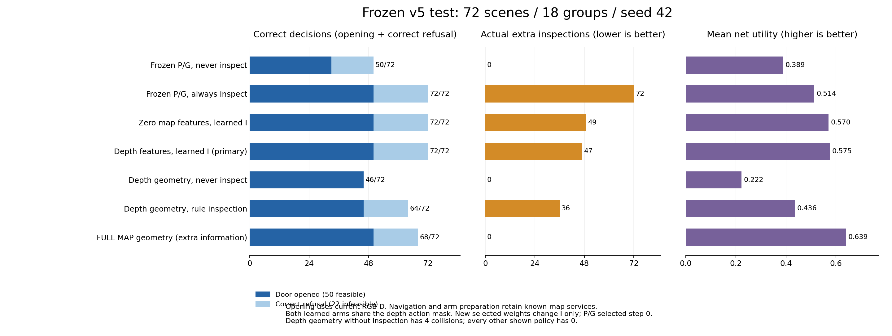

# Formal partial-map test (v5, 2026-11-10)

Validation-selected **`depth_features_learned`** achieves **72/72** correct decisions on 18 fresh groups and 72 scenes: **50/50 feasible openings**, **22/22 correct refusals**, and **0** collisions. Against always inspection with identical weights, additional physical inspections decrease from **72 to 47 (-34.7%)**, preserving per-scene correctness.

This is a single-seed parameter-generalization test within familiar categories. Correctness 72/72 includes refusals; openings across all scenes are 50/72. Infeasibility refers to the frozen candidate library rather than every continuous action.

## Method and frozen components

P selects stations, G selects grasps after arrival, and I chooses whether to physically inspect once. A* base motion, RRT arm preparation, and contact opening execute continuously with one initialization per episode. The camera moves with the base, and the gripper pushes the passive door while the base stays at its station during opening.

Opening constraints use door/robot CAD and current RGB-D, retaining unknown space as unknown. Navigation/preparation use known maps. Image-only arms share depth-based action constraints but zero added map-feature slots, so they are not depth-free controllers.

Retain H-JEPA and rank-8 LoRA. P/G labels follow terminal outcomes of current G's chosen actions: success +1, ordinary failure -1, collision -2, refusal 0. Freeze P/G and LoRA before separately training I, subtracting physical inspection cost `0.2*distance(m)/6 + 0.1*time(s)/60`. P/G still share LoRA; elimination of gradient conflict is unverified.

Both arms complete 320 LoRA/P-G and 800 I updates but select PG update 0 under validation's earliest-tie rule. Selected-weight changes come only from I; selected P's added depth columns remain zero. See [training/validation records](mobile_partial_development.md) and the [frozen evaluation protocol](mobile_partial_evaluation_plan.md).

Freeze primary and manifest at 2026-11-09 22:30:19 +08:00; record evaluation-source, model, and manifest hashes again before execution. Testing changes no weights, maps, or thresholds. Nine templates each supply 2 fresh groups, each with front/rear/both/no-obstacle layouts, split by whole group and excluding 450 historical geometries. Seed=42.

## Complete matched test results

Correct decisions are complete openings or refusals on library-infeasible scenes. Execute all policies independently on the same 72 scenes with a common inspection-cost definition.

| Policy | Open /50 | Correct refusal /22 | False refusal | Correct /72 | Collisions | Inspections | Mean net utility |
| --- | ---: | ---: | ---: | ---: | ---: | ---: | ---: |
| Image-only, never inspect | 33 | 17 | 17 | 50 | 0 | 0 | 0.3889 |
| Image-only, always inspect | 50 | 22 | 0 | 72 | 0 | 72 | 0.5136 |
| Image-only, learned inspection | 50 | 22 | 0 | 72 | 0 | 49 | 0.5703 |
| Depth features, never inspect | 33 | 17 | 17 | 50 | 0 | 0 | 0.3889 |
| Depth features, always inspect | 50 | 22 | 0 | 72 | 0 | 72 | 0.5136 |
| **Depth features, learned inspection (validation selected)** | **50** | **22** | **0** | **72** | **0** | **47** | **0.5754** |
| Full-map geometry, rear first, fixed grasp | 50 | 18 | 0 | 68 | 0 | 0 | 0.6389 |
| Current-depth geometry, never inspect | 46 | 0 | 0 | 46 | 4 | 0 | 0.2222 |
| Current-depth geometry, visibility-rule inspection | 46 | 18 | 0 | 64 | 0 | 36 | 0.4358 |
| Frozen v4 P/G, current depth, always inspect | 50 | 22 | 0 | 72 | 0 | 72 | 0.5136 |

The full-map reference has extra obstacle information. Partial-map geometry selects the nearest allowed station; its rule inspects once when initial sampled visibility there is <0.4. Both use fixed -15-degree grasps. Full-map geometry is rear-first, fixed -15 degrees, and never inspects. All references were declared before formal training.

| Same depth-feature model | Physical inspections | Mean episode, simulated seconds | Mean base path, m | Mean net utility |
| --- | ---: | ---: | ---: | ---: |
| Always inspect | 72 | 55.38 | 4.869 | 0.5136 |
| Learned inspection | 47 | 40.74 | 3.142 | 0.5754 |
| Relative change | -34.7% | -26.4% | -35.5% | +0.0618 |

Means cover all 72 scenes, including refusals. These are simulated execution durations and paths, not training/evaluation wall-clock times.

## Findings and limitations

1. **Inspection benefits this controller under partial observation.** Never/always inspection scores 50/72 and 72/72 with the same model; learned inspection retains correctness with 25 fewer inspections. The intervention jointly changes physical motion and information, rather than isolating image content.
2. **The new learning benefit is lower inspection cost.** Frozen v4 with always inspection also scores 72/72. New I reduces inspections without evidence of improved P/G accuracy. Image-only uses 49 inspections versus 47 with depth features; two events do not establish a significant feature benefit.
3. **Geometry is a strong baseline.** Full-map geometry opens all 50 feasible scenes with zero collisions/inspections but four fewer correct refusals. Net utility **0.6389 exceeds primary 0.5754**, with shorter mean episodes (32.59 versus 40.74 simulated seconds). Interpret results under their different map information.
4. **Rule-based inspection helps but still errs.** Current-depth geometry without inspection has 4 collisions and 46/72 correct; the visibility rule has zero collisions and 64/72, with 4 wrong-side choices. Learned policies also change station/grasp decisions, so differences are not solely due to I.
5. **Factorization has not surpassed scalar supervision.** In the historical [matched v4 ablation](mobile_outcome_results.md), scalar/factorized supervision with sweeps both score 71/72. Different v4/v5 scenes and information conditions prevent interpreting 71 to 72 as model improvement.

The project implements continuous physics, downstream supervision, and active inspection with controls. It has not established an imagined-rollout advantage or generalization to new door categories, multiple training seeds, real wheeled robots, or hardware. The base is an ideal x/y/yaw servo, and discrete door sweeps are not continuous dynamic safety certificates.

## Physics, information, and weight verification

- 72 scenes x 16 candidates = **1152** new physical records; 10 policies x 72 = **720** independent live replays, matching precomputed actions, refusals, openings, collisions, and map masks.
- Live maps reconstruct only currently captured images/depth, without cached maps. Each initial map has one current frame. Every episode initializes once with monotonic time.
- **462** continuous opening-entry checks and **348** physical inspections pass. Maximum recorded translation speed **0.28124 m/s**; maximum adjacent displacement **0.01659 m**.
- All 8 checkpoints preserve **422** core tensors and normalization bitwise; I training preserves non-I tensors. Protected model, manifest, and source hashes remain unchanged.
- Full-geometry queries exclude all **120** colliding candidates and retain all **208** successful candidates. These are correlated candidates, not independent scenes or partial-map safety guarantees.
- Python/NumPy/Torch/CUDA/startup hash seed is 42. Warn-only deterministic algorithms permit nondeterministic attention and sparse OpenGL rounding, limiting cross-run bitwise reproducibility.

## Runtime record

Queue estimate **0**, runtime **6 hours**. The completed 4-scene/40-replay smoke run extrapolates by phase to about 4 hours 45 minutes, plus rendering/scene/load margin, without concurrent LoRA. Launch at 00:23:46: controller PID **8952**, evaluator **17608**, session **86502**. Expected 06:23:46; completed **04:11:43**. Actual evaluation **13675.94 seconds (3 hours 47 minutes 56 seconds)**; controller 13679.53; exit **0**.

The agent sleeps continuously against the original deadline. User questions about the final presentation and its 10-minute duration interrupt two sleeps after 8229.95 and 11177.86 seconds. Resume the original deadline after the first, then confirm the same session completed after the second; no duplicate job is launched.

| Phase | Actual seconds | Minutes |
| --- | ---: | ---: |
| Collect 1152 candidates, 2 workers | 6560.84 | 109.35 |
| Cached policy computation | 125.74 | 2.10 |
| 720 live controller replays | 6914.88 | 115.25 |
| Full weight/physics audit | 44.59 | 0.74 |
| Startup, I/O, other | 29.87 | 0.50 |

The first smoke test failed when writing long Windows log paths; preserve its receipt. After shortening log/output names and adding path-length checks, a fresh-directory smoke test exits 0 with 64 matching candidates and 40 replays. Models, maps, and thresholds are unchanged.

## Local records and reproduction

Raw arrays, weights, logs, trajectories, and source archives remain ignored in `runs/`. Convenience entries point to actual results in the frozen physics workspace:

- [Formal results and phase durations](../runs/mobile_partial_evaluation_seed42_20261110/report.json)
- [Pre-test frozen hashes](../runs/mobile_partial_evaluation_seed42_20261110/evaluation_frozen.json)
- [Full weight/physics audit](../runs/mobile_partial_evaluation_seed42_20261110/tensor_and_physics_audit.json)
- [Launch, waiting, and completion verification](../runs/mobile_partial_evaluation_seed42_20261110/verification.json)
- [Matched analysis and plotting script](../runs/mobile_partial_evaluation_seed42_20261110/post_analysis.py)
- [Evaluation launch source](../runs/mobile_partial_evaluation_seed42_20261110/source/)

Actual workspace: `runs/mobile_partial_workspace_seed42_20261109/`; actual output: its `runs/p5_test_seed42_20261110/`. The root's alternative `simulate.py` differs. Reproduce with archived source identities and new ignored outputs, preserving frozen results rather than mixing physics versions.
